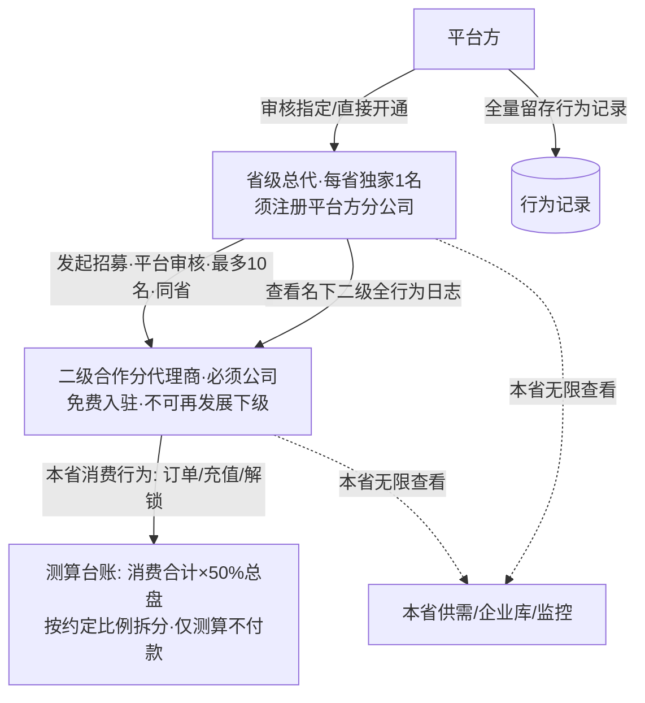
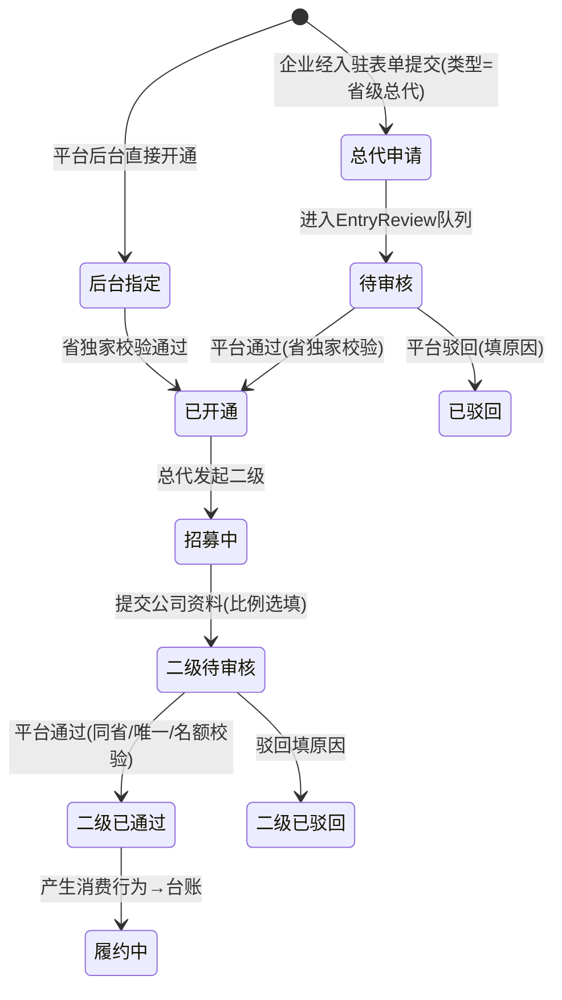

# 省级总代体系迭代执行文档（v0.2 · 待审批）

> 状态：**草案，未经用户书面同意，不得改动任何代码/配置/文案**。
> v0.2 变更：O2 比例上限、O6 总代缴费、O7 总代经营能力、O5 演示账号四项已拍板（D21–D24）；O1/O3/O4 仍为暂定建议。
> 本文档基于 5 轮沟通确认的结论（决策记录 D1–D20）与现有 demo 全量盘点写成；文中「现状」均来自对项目源码的实际读取，「建议/暂定」项已单独标注。
> 审批方式：用户在本文档上批注或回复「同意/按此执行」后，才进入 M1 实施；任何一条决策被修改，需回到对应轮次重新确认后再动工。

---

## 0. 一页结论

- **替换什么**：现有「企业合伙人」（入驻类型 `partner` / 专属徽章 / full 完整二级分销 / 团队管理 / ¥0 审核入驻）整体下线，替换为**省级总代 → 二级合作分代理商**两层代理体系。
- **不替换什么**：个人合伙人（8%/2%、无团队、可提现）原样保留；建筑企业、中介企业现有邀请返佣与提现保留；平台 Phase 0「不碰交易资金、不抽佣」原则不变。
- **商业模式要点**：每省独家 1 名总代（企业申请+平台指定双轨、总代须注册平台方分公司）；总代最多发展 10 名同省二级（必须公司、免费入驻、平台审核生效）；平台按二级**全部平台消费行为的 50%** 做**测算台账**（不进钱包、不付款、不可提现），总代录入线下约定比例做拆分；总代与二级对**本省**信息免积分解锁、监控无限、可直连；全行为留痕。
- **交付方式**：分 M1–M4 四阶段推进，每阶段设独立验收节点与回归项，前一阶段验收通过才进入下一阶段。

---

## 1. 迭代背景与目标

### 1.1 背景
当前 demo 中「合伙人」实际是两条独立并行的线：

| 线 | 现有实现（源码已核实） | 本次处理 |
|---|---|---|
| **企业合伙人**（入驻类型 `partner`） | `entry.html` 三选一（建筑/中介/合伙人，可并行）；`entryTypes.partner` 入驻费 ¥0、平台人工审核；`distTier=full` 完整二级分销（一级12%/二级3%）；有团队管理（`hasTeam`）；监控 200 家；积分 5 折；专属徽章 | **整体下线，替换为省级总代体系** |
| **个人合伙人**（`isIndividualPartner`） | 独立申请页 `auth-partner.html`；8%/2% 返佣；无团队管理；¥50 起提现 | **原样保留，不受影响** |

现有企业合伙人走的是「海报邀请绑定 → Rebate 返佣 → 冻结结算进钱包 → 可提现」的线上资金闭环，与新体系「平台不付款、总代线下分配、仅测算台账」存在根本冲突，因此不能在旧返佣引擎上打补丁，需独立建模。

### 1.2 迭代目标
1. 用「省级总代 / 二级合作分代理商」两层代理体系替代企业合伙人身份，规则与本文件第 3 章一致。
2. 保证个人合伙人、建筑/中介企业现有返佣提现零误伤。
3. 所有分佣只做测算留痕，平台不产生任何代付、垫付、提现动作，符合 Phase 0 不碰资金原则。
4. 每省独家、同省招募、10 人名额、平台审核四道约束在系统内可校验、可拦截，不靠人工自觉。

### 1.3 非目标（本期明确不做）
- 不做平台代付、线下分账对账、税务发票处理（纯线下，平台不留资金流）。
- 不做二级再发展下级（体系严格两层）。
- 不改造个人合伙人 8%/2% 体系，不改造建筑/中介现有邀请返佣。
- 不改造资质招商加盟（franchise 分公司挂靠）模块，它与本次代理体系是两条业务线。
- 不做真实后端接口，仍为 localStorage Mock 演示；生产级权限/结算不在本期。

---

## 2. 已确认决策记录（5 轮沟通结论）

| 编号 | 决策点 | 结论 |
|---|---|---|
| D1 | 替换范围 | 只替换企业合伙人；个人合伙人保留 |
| D2 | 总代产生方式 | 双轨：企业经入驻表单新增「省级总代」类型申请 → 平台审核指定；后台也可直接指定开通 |
| D3 | 分公司注册主体 | 落在**总代**本人：总代必须注册平台方分公司并提交资料核验 |
| D4 | 省级独家 | 每省仅 1 名总代；该省已有总代时禁止重复开通并提示 |
| D5 | 二级主体要求 | 仅需合法工商公司（营业执照等），**不要求**注册平台方分公司 |
| D6 | 二级地区 | 必须与发起总代**同省**（省内可跨市），跨省禁止发起 |
| D7 | 名额上限 | 每名总代最多 10 个二级；**计数含全部状态**（待审核/已通过/已驳回），满 10 禁止再发起 |
| D8 | 二级唯一绑定 | 一个公司只能绑定一名总代，不可被多名总代重复发起 |
| D9 | 50% 测算基数 | 二级**全部平台消费行为**（订单成交、钱包充值、积分解锁等）合计 ×50% = 总代可分配总盘 |
| D10 | 比例录入 | 总代录入「线下约定分给该二级的比例」；发起时选填，通过后可补录/修改并留痕；台账据此拆「二级约定所得 / 总代自留」，仅测算 |
| D11 | 平台不付款 | 测算金额不进钱包余额、不可提现；佣金提现通道对总代/二级关闭 |
| D12 | 台账与退款 | 逐笔记录消费行为、按月汇总；退款/售后从后续测算中等额冲减 |
| D13 | 无限查看（限本省） | 总代与名下二级对**本省**供需联系方式免 98 积分解锁、可直连；本省企业库全量可见；监控本省企业无上限；跨省仍走普通规则 |
| D14 | 行为记录 | 总代可查看名下二级全部行为日志；平台后台全量留存 |
| D15 | 审核流 | 复用现有入驻审核队列（EntryReview），不新建审核菜单；总代申请、二级发起均进该队列 |
| D16 | 二级自身能力 | 具备普通入驻企业全部能力（发布/接单/订单/自身钱包消费），不可再发展下级 |
| D17 | 二级标识 | 前端打「二级合作分代理商」标签，资料页可见归属总代与授权省份 |
| D18 | 旧入口处置 | 旧企业合伙人入口全部下线，按新体系重建，不留旧页给新身份 |
| D19 | 保留项 | 个人合伙人全链路；建筑 base/中介 limited 返佣、钱包、提现；franchise 加盟；Phase 0 资金原则 |
| D20 | 总代申请资料 | 复用现有入驻表单加类型：分公司营业执照、意向省份、公司资料 |
| D21 | 比例上限约束 | 约定分给二级的比例约束在 **0–50%**，且单名二级约定所得 ≤ 该二级总盘；倒挂/超界提交即拦截（O2 已拍板） |
| D22 | 总代缴费 | 费用**线下执行，线上不体现付费**：平台内无总代付费入口、不展示收费金额，线上口径按 ¥0 处理（O6 已拍板） |
| D23 | 总代经营能力 | 总代自身**保留**普通企业全部能力（发布供需/接单/订单/自身钱包充值消费）（O7 已拍板） |
| D24 | 演示账号 | 由本次新增，不改动现有 u1–u8；方案见 §5.4（O5 已拍板） |

### 2.1 待确认遗留项（不阻塞框架，实施前可批注调整）

| 编号 | 遗留项 | 暂定建议（未拍板前按此执行，可改） |
|---|---|---|
| O1 | 对外命名与徽章配色 | 建议「省级总代（省代）」「二级合作分代理商」，配色另定，不沿用个人合伙人紫色 |
| O3 | 行为记录字段明细与保留时长 | 建议字段：时间/动作/对象/省份/关联公司；演示期全量保留 |
| O4 | 二级是否签电子协议 | 建议通过 esign 签《二级合作协议》，本期先占位、不做签署闭环 |

> 已关闭：O2→D21、O5→D24、O6→D22、O7→D23。

---

## 3. 新商业模式定义

### 3.1 角色关系

### 3.2 角色定义与权益矩阵

| 能力 | 省级总代 | 二级合作分代理商 |
|---|---|---|
| 主体要求 | 企业 + 平台方分公司注册 | 合法工商公司即可 |
| 入驻费用 | 线上 ¥0、无付费入口；费用线下另行执行，平台不展示收费（D22） | ¥0，由总代发起 |
| 产生方式 | 企业申请审核 / 平台直接指定 | 总代发起 → 平台审核通过 |
| 区域 | 绑定唯一省份（独家） | 必须与总代同省 |
| 下级名额 | 最多 10 名二级（含全部状态） | 不可发展下级 |
| 本省无限查看 | ✅ 免解锁直连 / 企业库全量 / 监控无限 | ✅ 同左 |
| 跨省查看 | 普通规则 | 普通规则 |
| 普通企业能力（发布/接单/订单/自身钱包） | ✅ 保留（D23） | ✅ 具备 |
| 测算台账 | 查看全部二级月汇总、逐笔、拆分、退款冲减 | 查看本人约定所得测算 |
| 比例录入 | 可为名下二级录入/修改约定比例（留痕） | 不可改比例 |
| 行为记录 | 查看名下二级全量日志 | 不可查看他人 |
| 钱包/提现 | ❌ 关闭（不付款） | ❌ 关闭（不付款） |
| 身份标签 | 省级总代（省代） | 二级合作分代理商（可见归属总代/省） |

### 3.3 分佣测算规则（D9/D10/D12，仅测算）

1. **总盘**：某二级在统计周期内全部平台消费行为金额合计（订单成交额、钱包充值、积分解锁消费等）× 50%。
2. **拆分**：二级约定所得 = 该二级总盘 × 总代录入的约定比例；总代自留 = 该二级总盘 − 二级约定所得。
3. **台账**：逐笔记录消费行为（类型/金额/时间/关联订单），按月汇总成月账单；退款/售后发生时，从后续未结算测算中等额冲减并留痕。
4. **资金隔离**：以上数字只存在于代理台账存储，**不写入 BalanceStore、不产生可提现余额、不出现佣金提现入口**。
5. **比例约束（D21）**：约定分给二级的比例限定 **0–50%**；且单名二级约定所得不得超过该二级总盘（防拆分倒挂）。超界或倒挂时发起/保存即拦截并提示，不留存非法比例。

### 3.4 审核流（D15 复用现有队列）

**四道系统校验（拦截点）**：
- 省独家：开通总代时目标省已有总代 → 阻止并提示「该省已独家授权」。
- 同省：发起二级时公司省份 ≠ 总代授权省 → 阻止。
- 唯一绑定：该公司已绑定其他总代 → 阻止。
- 名额：该总代名下全部状态记录达 10 → 阻止再发起。

### 3.5 本省无限查看落地（D13）
- 供需详情联系方式：身份为总代/二级且资料省份 = 授权省时，跳过 98 积分解锁锁，可直连；跨省不放开。
- 监控：对该身份移除 200 家上限，仅本省企业可无限监控。
- 企业库/项目库：本省结果全量可见；跨省维持现有可见规则。

---

## 4. 现状触点盘点（源码已核实，改造依据）

### 4.1 App 端

| 触点 | 现状 | 处置 |
|---|---|---|
| `pages/profile/entry.html` | 建筑/中介/合伙人三选一卡片、对比表、监控额度列 | 下线 partner 卡片与对比列，改为总代申请入口 |
| `pages/profile/entry-form.html` | `type=partner` 的 ¥0/审核/文案分支 | 改造为总代申请表单或下线（M2 定） |
| `pages/profile/index.html` | 宫格 partner 企业入驻图标、分销中心门控文案 | 移除企业合伙人入口，加总代入口；个人合伙人步骤保留 |
| `pages/profile/auth.html`、`auth-prep.html?type=partner` | 跳转 `auth-partner.html`（**个人合伙人**） | **保留，勿误删** |
| `pages/profile/auth-partner.html` | 个人合伙人申请全流程 | 保留不动 |
| `pages/distribution/index.html` | partner 演示数据 seed、full 档文案 | 移除 partner seed；旧返佣中心对 base/limited/个人合伙人保留 |
| `pages/distribution/team.html` | full 档团队树 | 旧页保留给旧体系；新二级管理在新模块独立实现 |
| `pages/distribution/earnings.html` / `withdraw.html` | 返佣明细、佣金提现 | 对总代/二级关闭入口与按钮；旧体系不变 |
| `pages/distribution/rules.html` | full「合伙人企业」费率行 | 移除/改写该行 |
| `pages/distribution/poster.html` | 邀请海报 | 旧返佣体系保留，总代体系不使用海报 |
| `pages/agreement/user.html` | frz-5 分销计划、partner 入驻条款、监控 partner 200 家 | 改写为代理体系条款，删除旧合伙人企业表述 |
| `pages/monitor/index.html` | partner 监控 200 家额度 | 改为总代/二级本省无限 |
| `preview.html` | 原型总览导航含合伙人/合伙人申请入口 | 同步更新导航 |

### 4.2 数据/逻辑层

| 文件 | 现状 | 处置 |
|---|---|---|
| `js/data.js` | `entryTypes.partner`、`business.distribution`、`membership.partner`、`monitor.limits.partner` | partner 企业配置迁移为总代配置；个人合伙人配置保留 |
| `js/domain.js` | `tiers.full`（合伙人企业12%/3%）、`safeDistTier`、Rebate 引擎 | full 档从旧返佣引擎摘除；Rebate 对 base/limited/个人合伙人保留 |
| `js/stores.js` | `entryAccess()`、`hasTeam`、`distTier` | 扩展总代/二级身份判定与门控，不破坏旧分支 |
| `js/detail.js` | 98 积分解锁付费墙 | 增加「本省总代/二级免解锁」钩子，默认不放开 |

### 4.3 后台（admin-vue）

| 触点 | 现状 | 处置 |
|---|---|---|
| `views/users/EntryReview.vue` | 企业/中介/合伙人入驻审核队列 | 增加总代申请、二级申请两类标签与通过动作（写新存储） |
| `api/mock/users.js` | partner 企业 mock、个人合伙人 mock | partner 企业改为总代示例；个人合伙人 mock 保留 |
| `views/distribution/Overview/Team/Payout.vue` | 旧返佣总览/团队/批次发放 | 过滤 full/partner 数据，仅服务旧体系 |
| `views/users/List.vue`、`views/auth/Review.vue` | 个人合伙人筛选项/审核 | 保留不动 |
| `views/todo/index.vue` | 待办「合伙人入驻」 | 文案同步 |

---

## 5. 执行方案（模块设计）

### 5.1 新增存储（localStorage，纯 Mock）

| Key | 内容 |
|---|---|
| `engchain-province-agents` | 总代表：`{uid, province, branchCompany{name, licenseNo, ...}, status, appointedAt, appointedBy, source: apply/direct}` |
| `engchain-sub-agents` | 二级表：`{id, parentUid, company{name, uscc, license, legal, contact}, province, ratioToSub, status: pending/approved/rejected, createdAt, reviewedAt, rejectReason, ratioLog[]}` |
| `engchain-agent-ledger` | 测算台账：逐笔 `{subUid, type, amount, orderId, at, refunded}` + 月汇总缓存 |
| `engchain-agent-behavior` | 行为记录：`{subUid, action, target, province, at}` |

### 5.2 新增 App 页面（建议目录 `pages/province-agent/`，命名待 O1）
1. **总代工作台**：身份卡（授权省独家、名额 n/10、本省权益说明）、二级管理列表、发起二级入口、测算台账（月账单+逐笔+冲减）、行为记录查看。
2. **发起二级表单**：公司名称/信用代码/执照/法人/联系人/省份（默认带总代省，跨省拦截）/约定比例（选填）。
3. **二级视角页**：身份卡（归属总代、授权省、无限查看提示）、本人测算、普通企业能力入口。
4. **申请进度态**：总代申请审核中/通过/驳回（复用现有审核态视觉）。

### 5.3 后台改造
- EntryReview 队列新增两类条目：`省级总代申请`、`二级合作分代理商申请`，通过时执行四道校验并写对应存储；驳回填原因。
- 新增「省级总代管理」视图（P0 最小实现可先落在用户详情/审核弹窗内）：省独家列表、直接指定开通、查看名下二级与台账。
- 旧分销三页过滤 partner/full。

### 5.4 演示账号配置（D24，本次新增，不动现有 u1–u8）

| 新账号 | 角色 | 建议资料（实施时可微调） | 演示数据 |
|---|---|---|---|
| `u9` / 13800009101 | 四川省独家省级总代 | 王××，四川××工程集团有限公司，已注册平台方四川分公司，授权省=四川省 | 名下挂 2 名二级（1 通过 1 待审核，展示名额计数 n/10）；无钱包/提现入口 |
| `u10` / 13800009202 | 二级合作分代理商（归属 u9，四川省内） | 李××，成都××建材有限公司，普通工商公司，约定比例示例 20% | 一笔充值 + 一笔订单消费台账、一笔退款冲减示例、若干行为日志；无提现入口 |

- 现有旧企业合伙人 mock（u7，`entryTypes=['partner']`）在 M4 下线阶段清除/改写，不保留旧身份。
- 演示账号密码沿用现有 demo 约定（与 u1 同规则），实施时在 README 演示账号表补登。

---

## 6. 执行路径与阶段验收

> 原则：每阶段独立可验收，前一阶段不通过不进入下一阶段；每阶段结束做旧体系回归。

### M1 · 身份与数据层（不可见改动）
- **任务目标**：建好新存储与身份判定，四道校验规则落成纯函数，不改动现有页面流程。
- **任务清单**：
  1. 新建代理存储读写模块（总代/二级/台账/行为）。
  2. `entryAccess()` 扩展 `isProvinceAgent / isSubAgent / agentProvince / agentQuotaUsed` 字段，旧分支原样保留。
  3. 实现四个纯函数校验：省独家、同省、唯一绑定、名额 10（含全部状态）。
- **验收节点 M1-A**：
  - 成功场景：构造一名总代+两名二级（一通过一驳回），名额计数=2，判定函数返回正确身份与省份。
  - 边界场景：同省重复开通被拦截；名额满 10 发起被拦截；已绑定公司被重复发起被拦截。
  - 回归：旧 base/limited/个人合伙人 `entryAccess()` 输出与改动前一致。
- **验收方法**：控制台/冒烟脚本调用纯函数逐断言；`node --check` 通过；不触发任何页面改动。

### M2 · 申请与审核开通
- **任务目标**：双轨开通总代、复用 EntryReview 审核二级，四道校验在真实提交链路生效。
- **任务清单**：
  1. 入驻表单新增「省级总代」类型（分公司执照/意向省/公司资料）；**线上不出现任何总代付费入口与收费金额（D22）**。
  2. EntryReview 适配两类新申请，通过/驳回写存储；后台直接指定开通入口。
  3. 省独家冲突提示与通知消息。
- **验收节点 M2-A**：
  - 成功：企业提交总代申请 → 后台通过 → 身份生效、省份绑定；后台直接指定同路径可用。
  - 边界：目标省已有总代时两种开通方式均被拦截并提示；驳回带原因、可重提。
  - 回归：建筑/中介入驻审核流程与个人合伙人审核不受影响。

### M3 · 总代工作台与测算台账
- **任务目标**：二级管理、发起、比例录入、月台账、退款冲减、行为记录全闭环。
- **任务清单**：
  1. 总代工作台/发起表单/二级视角页。
  2. 台账逐笔记录 + 月汇总 + 50% 总盘 + 约定比例拆分 + 退款等额冲减。
  3. 比例录入选填/通过后补改/留痕；**比例限定 0–50% 且二级约定所得 ≤ 总盘，超界/倒挂拦截（D21）**；总代查看名下二级全行为日志。
  4. 钱包/提现入口对总代二级隐藏，台账数字不进 BalanceStore。
  5. 按 §5.4 播种 u9/u10 演示账号与示例台账、退款冲减、行为日志。
- **验收节点 M3-A**：
  - 成功：发起二级 → 通过 → 模拟一笔充值/订单 → 月账单出现总盘与拆分；录入比例后二级约定所得/总代自留正确。
  - 边界：录入 >50% 或倒挂比例被拦截；模拟退款 → 后续测算等额冲减；总代端无任何可提现金额与提现按钮。
  - 回归：个人合伙人/旧企业返佣钱包提现链路不变。

### M4 · 本省无限查看 + 旧入口下线 + 文案 + 全量回归
- **任务目标**：本省免解锁/监控无限落地；旧企业合伙人入口清零；协议文案一致；全量交叉验证。
- **任务清单**：
  1. detail.js 付费墙加本省总代/二级免解锁钩子；monitor 额度放开；企业库本省可见。
  2. 下线 entry/entry-form/profile 宫格/rules/preview 中旧企业合伙人入口（注意保留个人合伙人）；清除 u7 旧 partner mock，README 演示账号表补登 u9/u10。
  3. 协议 frz-5 与入驻条款改写；后台旧分销页过滤 full。
- **验收节点 M4-A（终验）**：见第 7 章交叉验证矩阵全绿。

---

## 7. 全量交叉验证清单（防混乱/漏项）

### 7.1 身份门控矩阵（五种身份 × 关键能力）

| 能力 | 建筑企业 | 中介企业 | 个人合伙人 | 省级总代 | 二级代理 |
|---|---|---|---|---|---|
| 旧邀请返佣中心 | ✅ base | ✅ limited | ✅ 8%/2% | ❌ | ❌ |
| 佣金提现 | ✅ | ✅ | ✅ | ❌ 关闭 | ❌ 关闭 |
| 团队管理 | ❌ | ❌ | ❌ | ✅ 二级管理 | ❌ |
| 本省免解锁/监控无限 | ❌ | ❌ | ❌ | ✅ | ✅ |
| 发展下级 | ❌ | ❌ | ❌ | ✅ ≤10 同省 | ❌ |
| 普通企业发布/接单 | ✅ | ✅ | — | ✅（D23） | ✅ |

### 7.2 必查风险项
1. **个人合伙人零误伤**：`auth-partner.html`、8%/2%、¥50 提现、审核队列个人合伙人条目全部不变。
2. **旧返佣引擎隔离**：`tiers.full` 摘除后，base/limited/个人合伙人费率与结算不漂移。
3. **资金隔离**：台账金额不出现在钱包余额、可提现、提现记录任何一处。
4. **省边界**：无限查看只在授权省生效，跨省仍需积分/受额度限。
5. **名额口径**：待审核/驳回都占 10 名额。
6. **比例约束（D21）**：约定比例 0–50%、二级约定所得 ≤ 总盘，超界/倒挂不得保存。
7. **线上零付费（D22）**：总代全流程不出现收费金额、付费按钮、订单付费。
8. **命名不混淆**：个人合伙人 ≠ 省级总代 ≠ 二级代理，文案、徽章、入口三处一致。
9. **协议与页面同口径**：分销规则页、用户协议、后台文案数字一致（50%、10 名、同省、独家、线上零付费）。
10. **后台联动**：后台通过后 App 刷新状态一致（已知历史问题：需整页刷新，本期沿用并注明）。

### 7.3 验收方法总则
- 每种身份用演示账号走一遍主路径；
- `node --check` 全部改动 JS；页面内联脚本语法解析通过；
- localStorage 状态手测 + 硬刷新（Ctrl+Shift+R）复验；
- 旧体系回归用例逐条过；
- 终验输出验收记录（通过/边界/回归三张表）。

---

## 8. 风险与对策

| 风险 | 对策 |
|---|---|
| 误删个人合伙人入口（两者都含「合伙人」字样） | M1 先做身份判定隔离；M4 下线前逐条对照第 4 章触点表，个人合伙人标「保留」 |
| 台账金额误入钱包 | M3 起断言台账存储与 BalanceStore 完全隔离，提现页对新身份直接门控 |
| 省独家/名额校验只在前端一处、可绕过 | 校验集中在纯函数，提交与后台通过两处都调用 |
| 本省无限查看被扩大为全国 | 免解锁钩子必须带省份相等判断，默认拒绝放开 |
| 双轨申请与旧入驻表单混淆 | 新类型在表单与审核队列明确标注，旧三类入驻流程不动 |

---

## 9. 审批栏

| 项 | 状态 |
|---|---|
| 决策 D1–D24 是否全部认可 | ☐ 同意 ☐ 需修改（批注） |
| 剩余暂定项 O1 命名徽章 / O3 行为字段 / O4 二级电子协议 | ☐ 按暂定建议执行 ☐ 需修改（批注） |
| 是否同意按 M1→M4 路径执行 | ☐ 同意执行 ☐ 需调整阶段划分 |

> 用户书面同意后，从 M1 开始实施；每阶段验收通过再进入下一阶段。
