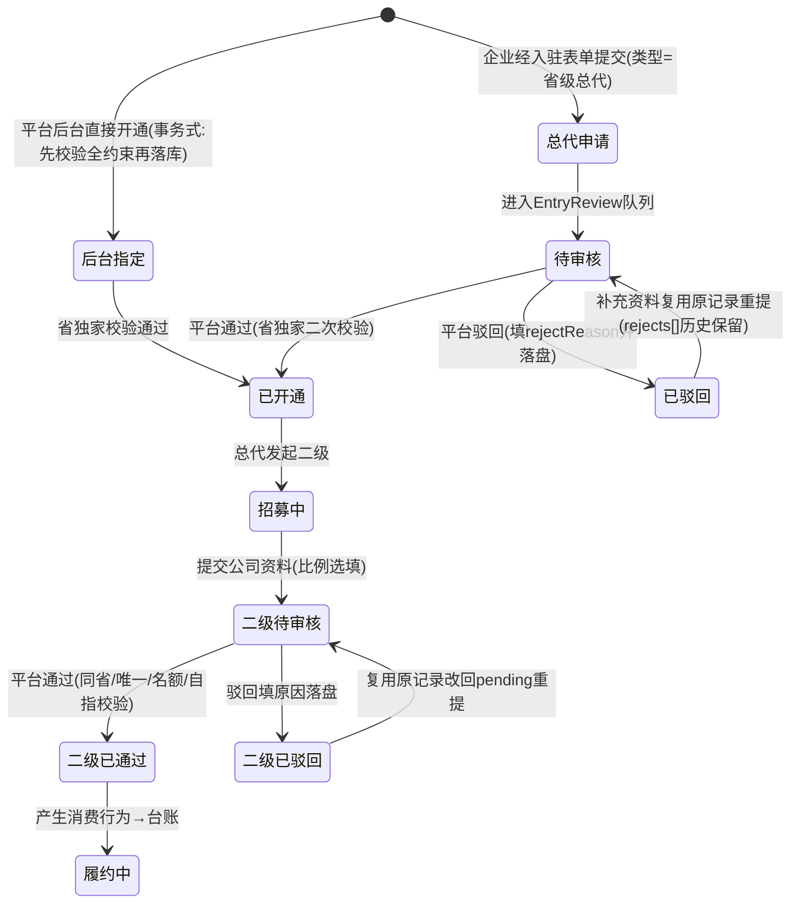

# 省级总代体系迭代执行文档（v0.3 · 评审加固版 · 待审批）

> 状态：**草案，未经用户书面同意，不得改动任何代码/配置/文案**。
> 版本关系：本文在《省级总代体系迭代执行文档-v0.2-待审批.md》基础上经五方评审（系统迭代工程师 / 商业模式规划师 / 产品经理 / 专家前端工程师 + 两份新拍板补充）加固而成；**v0.2 原文正确内容予以保留**，被修订的决策条目在决策记录中标注「v0.3 修订」并附修订说明，未被要求改动的代码/配置/文案/其他 md 一律不动。
> v0.3 主要新增：D25（金税四期代扣税，新旧都加、税率全占位）、D26（总代自身收益线单列分区）；修订 D7（名额=max(10,本省地级市数量)，平台按省核定）、D9/D12（充值不计入基数、T+N 冻结期、后台特殊退款冲减、台账下载、财务税项字段）、D1/D19（个人合伙人零误伤=规则费率不变仅叠加税项展示）、D24（演示账号改 u11/u12，修正 u7/u8 误标与撞号）。
> 审批方式：用户在本文档上批注或回复「同意/按此执行」后，才进入 M1 实施；任何一条决策被修改，需回到对应轮次重新确认后再动工。
> 占位原则：税率/征收方式/起征点/速算扣除、T+N 冻结天数、自身收益比例、各省地级市数量、下载格式等**全部为待核定可配置占位**，本文不写真实承诺数值，生产前由税务专业/平台规则核定。

---

## 0. 一页结论

- **替换什么**：现有「企业合伙人」（入驻类型 `partner` / 专属徽章 / full 完整二级分销 / 团队管理 / ¥0 审核入驻）整体下线，替换为**省级总代 → 二级合作分代理商**两层代理体系。【v0.3 事实修正：旧企业合伙人种子是 **u8（周航）**，不是 v0.2 误写的 u7（u7=游客）；u9=个人合伙人、u10=平台运营已占用，新演示账号改用空闲的 u11/u12。】
- **不替换什么**：个人合伙人（8%/2%、无团队、可提现）原样保留；建筑企业、中介企业现有邀请返佣与提现保留；平台 Phase 0「不碰交易资金、不抽佣」原则不变。【v0.3 修订：个人合伙人 8%/2% 是**返佣比例非税率**；D25 仅在其提现流程与台账**叠加**代扣税计算/税项展示/税后实发列，业务规则、费率、¥50 门槛、审核队列全部不变。】
- **商业模式要点**：每省独家 1 名总代（企业申请+平台指定双轨、总代须注册平台方分公司）；总代在本省招募二级，**名额上限 = max(10, 本省地级市数量)，由平台按省核定、总代不可自定**（四川=21 仅演示示例）；平台按二级**真实消费实付行为的 50%** 做**测算台账**（**充值等形成可提现余额的方式不计入基数**；仅测算、不进钱包、不付款、不可提现），总代录入线下约定比例做拆分；台账分「二级分账测算」「总代自身收益」两独立分区；消费行为设 T+N 退款冻结期（占位），后台特殊原因退款等额冲减；新体系台账与个人合伙人提现均接代扣税**计算与展示**（税率占位）；总代与二级对**本省**信息免积分解锁、监控无限、可直连；全行为留痕。
- **交付方式**：分 M1–M4 四阶段推进，每阶段设独立验收节点与回归项，前一阶段验收通过才进入下一阶段；每条任务均标注【责任 Agent】【所需 Skills】【部署与执行要求】【验收方式】。

---

## 1. 迭代背景与目标

### 1.1 背景

当前 demo 中「合伙人」实际是两条独立并行的线：

| 线 | 现有实现（源码已核实） | 本次处理 |
|---|---|---|
| **企业合伙人**（入驻类型 `partner`） | `entry.html` 三选一（建筑/中介/合伙人，可并行）；`entryTypes.partner` 入驻费 ¥0、平台人工审核；`distTier=full` 完整二级分销（一级12%/3%）；有团队管理（`hasTeam`）；监控 200 家；积分 5 折；专属徽章；**种子账号 u8（周航，databus.js:150/1914）** | **整体下线，替换为省级总代体系** |
| **个人合伙人**（`isIndividualPartner`） | 独立申请页 `auth-partner.html`；8%/2% 返佣（**返佣比例，非税率**）；无团队管理；¥50 起提现；**种子账号 u9（孙小美）** | **原样保留；D25 仅叠加代扣税展示，规则不动** |

现有企业合伙人走的是「海报邀请绑定 → Rebate 返佣 → 冻结结算进钱包 → 可提现」的线上资金闭环，与新体系「平台不付款、总代线下分配、仅测算台账」存在根本冲突，因此不能在旧返佣引擎上打补丁，需独立建模。

### 1.2 迭代目标

1. 用「省级总代 / 二级合作分代理商」两层代理体系替代企业合伙人身份，规则与本文件第 3 章一致。
2. 保证个人合伙人、建筑/中介企业现有返佣提现零误伤（v0.3：零误伤=规则/费率/¥50 门槛/审核队列不变，仅叠加税项展示，见 D25 与 §7.3 R-01~R-10）。
3. 所有分佣只做测算留痕，平台不产生任何代付、垫付、提现动作，符合 Phase 0 不碰资金原则；代扣税仅做计算与展示，不开票、不实名、不申报。
4. 每省独家、同省招募、名额按省核定上限、平台审核四道约束在系统内可校验、可拦截，不靠人工自觉。

### 1.3 非目标（本期明确不做，v0.3 增补）

- 不做平台代付、线下分账对账、税务发票处理（纯线下，平台不留资金流）；**v0.3 明确：代扣税仅在台账/提现预览做比例计算、税项列与税后实发列展示；不做税号实名认证、不开具发票、不出完税凭证、不接税务申报/扣缴系统，真实税率由财务核定后填入配置。**
- 不做二级再发展下级（体系严格两层、一省）。
- 不改造个人合伙人 8%/2% 体系（仅叠加税项展示），不改造建筑/中介现有邀请返佣。
- 不改造资质招商加盟（franchise 分公司挂靠、线上加盟费 ¥29,800）模块，它与本次代理体系是两条业务线；**franchise 线上付费 ≠ 代理线上零付费，文案须区隔。**
- 不做真实后端接口，仍为 localStorage Mock 演示；生产级权限（RBAC/后台鉴权/操作审计）/结算不在本期。
- **v0.3 增补（防实施中被加需求）：**
  - 不做移动端独立适配、不做打印/导出 PDF 版式；台账下载仅做数据层导出（打印视图占位 + CSV 列结构定义），不含打印排版。
  - 不做短信、App 推送、邮件、微信触达；审核结果仅在页面状态与审核队列可见。
  - 不做列表搜索、状态筛选、分页；演示数据全量直出。
  - 不做总代转让、继承、主体过户；不做多省授权、跨省招募、跨级发展。
  - 下载为本地数据导出，不做导出审批、下载权限分级、导出留痕。
  - 解约/独家收回/二级解绑/权益收回/名额与省释放/台账封存：**本期不实现闭环**，仅按 §3.9 占位原则写明演示口径，生产再定。
  - 总代自身收益比例、余额提现是否对新身份开放、计入总盘的消费行为枚举、台账下载格式，均列入第 10 章待核定清单，本期不写死。

---

## 2. 已确认决策记录（5 轮沟通结论 + v0.3 新拍板）

| 编号 | 决策点 | 结论 | v0.3 备注 |
|---|---|---|---|
| D1 | 替换范围 | 只替换企业合伙人；个人合伙人保留 | **v0.3 修订**：零误伤口径=个人合伙人规则/费率(8%/2%)/¥50门槛/审核队列全部不变，仅按 D25 叠加代扣税展示 |
| D2 | 总代产生方式 | 双轨：企业经入驻表单新增「省级总代」类型申请 → 平台审核指定；后台也可直接指定开通 | 不变 |
| D3 | 分公司注册主体 | 落在**总代**本人：总代必须注册平台方分公司并提交资料核验；注册成本由总代自行承担，demo 不展示金额 | v0.3 补演示口径 |
| D4 | 省级独家 | 每省仅 1 名总代；该省已有总代时禁止重复开通并提示「该省已独家授权」；仅 approved 占位，pending/rejected 不占省；双轨在通过时统一二次校验，冲突回滚 | v0.3 补占位/并发口径 |
| D5 | 二级主体要求 | 仅需合法工商公司（营业执照等），**不要求**注册平台方分公司 | 不变 |
| D6 | 二级地区 | 必须与发起总代**同省**（省内可跨市），跨省禁止发起 | 不变 |
| D7 | 名额上限 | **v0.3 修订**：固定上限 = `max(10, 本省地级市数量)`，**平台按省核定、总代不可自定**；计数仍含全部状态（待审核/已通过/已驳回），满核定上限禁止再发起；demo 设「省→地级市数量」Mock 表（四川=21 仅演示示例），落位 `js/data.js` 独立配置块；直辖市/自治州/地区/盟/港澳台计数口径待核定 | 原 v0.2「固定 10 名」作废 |
| D8 | 二级唯一绑定 | 一个公司只能绑定一名总代，不可被多名总代重复发起；uscc 去重前归一化（去空格/大写/校验位）；rejected 不占绑定，terminated/removed 释放绑定 | v0.3 补归一化与释放口径 |
| D9 | 50% 测算基数 | **v0.3 修订**：二级**真实消费实付行为**（订单成交实付净额、解锁实付、增值实付等，枚举待核定）合计 ×50% = 总盘；**充值等形成可提现余额的方式不属于消费行为，不计入基数**；免费积分不计、打折积分包按实付成本折算（待核定） | 删除 v0.2「钱包充值计入」 |
| D10 | 比例录入 | 总代录入「线下约定分给该二级的比例」；发起时选填，通过后可补录/修改并留痕（demo 单方留痕，生产可双方确认）；台账据此拆「二级约定所得 / 总代自留」，仅测算 | v0.3 补修改机制说明 |
| D11 | 平台不付款 | 测算金额不进钱包余额、不可提现；**佣金提现通道（distribution/withdraw）对总代/二级关闭**；自身余额提现（wallet/withdraw）是否开放列入待核定，本期不新增、不主动开放 | **v0.3 修订**：拆分佣金提现/余额提现两条链路 |
| D12 | 台账与退款 | **v0.3 修订**：逐笔记录消费行为、按月汇总；消费行为设退款冻结期（T+N 天占位，冻结期内不计入/可冲回）；用户正常退款/售后与**后台特殊原因退款**均从后续测算中等额冲减并留痕；台账支持本地下载（demo 打印视图占位 + CSV 列结构）；财务字段见 §5.1 | 补冻结期/特殊退款/下载/税项字段 |
| D13 | 无限查看（限本省） | 总代与名下二级对**本省**供需联系方式免 98 积分解锁、可直连；本省企业库全量可见；监控本省企业无上限；跨省仍走普通规则；省份须归一化比对，默认拒绝放开 | v0.3 补归一化与默认拒绝 |
| D14 | 行为记录 | 总代可查看名下二级全部行为日志；平台后台全量留存；**总代本人查看/联系/下载行为同样留痕**；身份失效即收回全部本省权益 | v0.3 补总代自身留痕与收回 |
| D15 | 审核流 | 复用现有入驻审核队列（EntryReview），不新建审核菜单；总代申请、二级发起均进该队列；**v0.3：admin 不落盘、与 App localStorage 物理隔离，M2 必须先设计双端桥接（§5.3 给方案选项与验收，不编造实现）** | v0.3 补桥接前置 |
| D16 | 二级自身能力 | 具备普通入驻企业全部能力（发布/接单/订单/自身钱包消费），不可再发展下级 | 不变 |
| D17 | 二级标识 | 前端打「二级合作分代理商」标签，资料页（含他方查看）可见归属总代与授权省份 | v0.3 补他方资料页落点 |
| D18 | 旧入口处置 | 旧企业合伙人入口全部下线，按新体系重建，不留旧页给新身份；**定点清除 u8，不按 partner 标签批量删（避免误伤 u10 平台运营）** | v0.3 补定点清除 |
| D19 | 保留项 | 个人合伙人全链路；建筑 base/中介 limited 返佣、钱包、提现；franchise 加盟；Phase 0 资金原则 | **v0.3 修订**：同 D1，个人合伙人仅叠加税项展示，链路不动 |
| D20 | 总代申请资料 | 复用现有入驻表单加类型：分公司营业执照、意向省份、公司资料；M2 前补「现有字段→新表单字段」差距表 | v0.3 补差距表要求 |
| D21 | 比例上限约束 | 约定分给二级的比例约束在 **0–50%**，倒挂断言保留作防御（ratio≤50% 下恒成立）；0%=全自留语义写明；超界提交即拦截（O2 已拍板） | v0.3 补 0% 与防御说明 |
| D22 | 总代缴费 | 费用**线下执行，线上不体现付费**：平台内无总代付费入口、不展示收费金额，线上口径按 ¥0 处理（O6 已拍板） | 不变 |
| D23 | 总代经营能力 | 总代自身**保留**普通企业经营能力（发布供需/接单/订单/自身钱包充值消费）；**「经营能力」不含旧邀请返佣推广收益**（B-12） | v0.3 补与返佣的边界 |
| D24 | 演示账号 | **v0.3 修订**：由本次新增，不改动现有 u1–u10；新账号改用全仓空闲的 **u11（四川总代）/u12（成都二级）**；u9=个人合伙人、u10=平台运营不得复用；旧企业合伙人清除对象=**u8**（非 u7）；方案见 §5.4 | 修正撞号与误标 |
| **D25** | **金税四期代扣税（新旧都加）** | **v0.3 新增**：新体系测算台账 + 个人合伙人 8%/2% 提现都接入代扣税计算与展示；个人合伙人业务规则/费率/¥50门槛/审核队列不变，仅在提现流程与台账增代扣税计算、税项展示、税后实发列；税率/征收方式（劳务报酬或经营所得）/起征点/速算扣除全部为可配置占位，待税务专业核定，不写承诺税率；个人合伙人税项改动单独立回归用例（§7.3） | 新增 |
| **D26** | **总代自身收益线** | **v0.3 新增**：单列，与下级二级总盘分开列示、不混用；自身经营/消费（不含充值）单独比例测算（比例占位待核定）；台账分「二级分账测算」「总代自身收益」两独立分区；退款冲减两线各自适用；仍仅测算、不付款、不进钱包、不可提现 | 新增 |

### 2.1 待确认遗留项（不阻塞框架，实施前可批注调整）

| 编号 | 遗留项 | 暂定建议（未拍板前按此执行，可改） |
|---|---|---|
| O1 | 对外命名与徽章配色 | 建议「省级总代（省代）」「二级合作分代理商」，配色另定，不沿用个人合伙人紫色 |
| O3 | 行为记录字段明细与保留时长 | 建议字段：时间/动作/对象/省份/关联公司/actor/来源页/对象ID/幂等键；演示期全量保留 |
| O4 | 二级是否签电子协议 | 建议通过 esign 签《二级合作协议》，本期先占位、不做签署闭环；可复用现有 esign `coop 合作框架` 分类与次数包链路；最低必备条款见 §3.7 附注 |

> 已关闭：O2→D21、O5→D24、O6→D22、O7→D23；名额口径（原 O5-new 口径A/B 之争）已由拍板1关闭为口径A：固定值 max(10, 地级市数)，总代不可自定。

### 2.2 v0.3 评审阻断/高优问题 → 落位索引（便于追溯，正文已吸收）

| 评审编号 | 问题 | v0.3 落位 |
|---|---|---|
| S-01 / B-01 / P-01 / F-02 | 账号撞号、旧 partner 误标 u7（实 u8） | D24、§5.4、M3-8、M4-4 |
| S-02 / P-02 / F-03 | admin 不落盘、双端隔离、桥接缺失 | D15、§5.3、M2-2 |
| P-03 / F-23 / S-17 | 佣金提现 vs 余额提现口径冲突 | D11/D23、§3.2、M3-7、第10章待核定 |
| P-06 / F-08 | MonitorStore 限额不在改造清单、监控无本省过滤 | §4.2、M4-2 |
| F-24 / F-01 | entryAccess 只读叠加、legacyDistributor 资格位 | M1-2、M3-7、§7.1 |
| F-04 / F-05 | tiers.full 摘除防漂移、档位键统一 | M4-3 |
| F-07 / P-19 | 免解锁省份归一、company 独立锁、不得 mark | M4-1 |
| P-04 / B-11 | 终止态缺失 | §3.9、§1.3 |
| P-05 / S-07 / F-22 | 驳回重提路径、rejectReason 落盘 | M2-4、§3.4 |
| P-11 / S-01~S-09 | 非目标增补 | §1.3 |
| P-12 | 审批栏不完备 | 第9章 |
| S-04 / B-02 / P-09 | M2 并存期软下线、残留清单 | M2-5、M4-4 |
| B-03 / S-13 | 充值计入总盘双计 | D9、M3-2 |
| B-05 / S-14 / S-15 | 冻结期、时点、特殊退款 | D12、M3-2 |
| B-07 | 合规抗辩、线下事项/发票链空白 | §3.8、第10章 |
| B-12 | 身份叠加规则、经营≠返佣 | §3.10、M3-7 |

---

## 3. 新商业模式定义

### 3.1 角色关系

```mermaid
graph TD
    PF[平台方] -->|审核指定/直接开通| AG[省级总代·每省独家1名<br/>须注册平台方分公司·名额按省核定]
    AG -->|发起招募·平台审核·同省| SUB[二级合作分代理商·必须公司<br/>免费入驻·不可再发展下级]
    SUB -->|真实消费实付: 订单/解锁/增值<br/>充值不计入| LED[二级分账测算: 消费合计×50%总盘<br/>按约定比例拆分·仅测算不付款]
    AG -->|自身经营/消费单独比例测算<br/>比例占位| SELF[总代自身收益线·独立分区·仅测算]
    AG -->|查看名下二级全行为日志| SUB
    PF -->|全量留存行为记录(含总代本人)| LOG[(行为记录)]
    AG -.本省无限查看.-> PROV[本省供需/企业库/监控]
    SUB -.本省无限查看.-> PROV
```

### 3.2 角色定义与权益矩阵（v0.3：资金相关拆四行）

| 能力 | 省级总代 | 二级合作分代理商 |
|---|---|---|
| 主体要求 | 企业 + 平台方分公司注册 | 合法工商公司即可 |
| 入驻费用 | 线上 ¥0、无付费入口；费用线下另行执行，平台不展示收费（D22） | ¥0，由总代发起 |
| 产生方式 | 企业申请审核 / 平台直接指定 | 总代发起 → 平台审核通过 |
| 区域 | 绑定唯一省份（独家） | 必须与总代同省 |
| 下级名额 | 上限=max(10,本省地级市数)，平台按省核定（含全部状态计数） | 不可发展下级 |
| 本省无限查看 | ✅ 免解锁直连 / 企业库全量 / 监控无限 | ✅ 同左 |
| 跨省查看 | 普通规则 | 普通规则 |
| 普通企业经营能力（发布/接单/订单） | ✅ 保留（D23，**不含推广返佣**） | ✅ 具备 |
| 钱包充值（自身经营用） | ✅ 保留（D23） | ✅ 保留（D16） |
| 余额消费（自身经营用） | ✅ 保留 | ✅ 保留 |
| 佣金提现（distribution/withdraw） | ❌ 关闭（D11） | ❌ 关闭（D11） |
| 自身余额提现（wallet/withdraw） | 待核定（第10章），本期不新增不主动开放 | 待核定，本期不新增 |
| 测算台账 | 查看二级分账测算 + 总代自身收益两分区、逐笔、拆分、退款冲减、税项占位 | 仅查看本人约定所得测算（不见总代自留/自身收益区） |
| 比例录入 | 可为名下二级录入/修改约定比例（留痕） | 不可改比例 |
| 行为记录 | 查看名下二级全量日志；本人行为亦被留痕 | 不可查看他人 |
| 旧邀请返佣中心/团队/海报 | ❌ 关闭（legacyDistributor 资格位=false） | ❌ 关闭 |
| 积分折扣 | 默认无折扣（回落 1.0），待核定，不沿用旧 partner 0.5 折 | 同左 |
| 身份标签 | 省级总代（省代） | 二级合作分代理商（可见归属总代/省） |

### 3.3 分佣测算规则（D9/D10/D12/D21/D26，仅测算）

1. **总盘（二级分账测算线）**：某二级在统计周期内**真实消费实付**金额合计（订单成交实付净额、积分解锁实付、增值道具/会员实付等；枚举白名单待核定）× 50%。
   - **不计入**：钱包充值（形成可提现余额，非消费）；免费渠道发放积分的面值；充值本金；平台费用类是否计入待核定。
   - **去重**：同一笔资金在充值环节与消费环节只计一次，消费时按实付只计一次，余额退回/转出等额冲减。
2. **退款冻结期（T+N 占位）**：每笔消费先入「冻结/待结算」态，满 T+N（天数待核定）无退款后转入计入基数；冻结期内发生退款直接剔除、不进总盘。
3. **拆分**：二级约定所得 = 该二级总盘 × 总代录入的约定比例；总代自留 = 该二级总盘 − 二级约定所得（自留区间 50%–100%，demo 不再向第三方分配）。
4. **退款/冲减（三层）**：① 冻结期内退款 → 直接剔除；② 出冻结后用户正常退款/售后 → 先冲当月（红字留痕），当月不足转次月，部分退款按比例，无后续消费时挂账标记；③ 后台特殊原因操作退款 → 登记 `clawbackRef` 并从后续测算等额冲减。**两线（二级分账/总代自身收益）各自独立冲减，不交叉。**
5. **总代自身收益线（D26）**：见 §3.6。
6. **资金隔离**：以上数字只存在于代理台账存储，**不写入 BalanceStore、不产生可提现余额、不出现佣金提现入口**。
7. **比例约束（D21）**：约定分给二级的比例限定 **0–50%**；0%=全自留（二级约定所得=0）允许发起/补录；「约定所得≤总盘」倒挂断言保留作防御（ratio≤50% 下恒成立）；超界即拦截，不留存非法比例。

### 3.4 审核流（D15 复用现有队列 + 驳回重提闭环）



**系统校验（拦截点，纯函数集中、提交与后台通过两处都调用）**：
- 省独家：仅 approved 占位；目标省已有 approved 总代 → 阻止并提示「该省已独家授权」；双轨通过时二次校验，冲突回滚不落占位。
- 同省：发起二级时公司省份（归一化）≠ 总代授权省 → 阻止。
- 唯一绑定：该公司（uscc 归一化）已绑定其他总代 → 阻止；rejected 不占绑定。
- 名额：该总代名下全部状态记录数达省核定 `quotaCap` → 阻止再发起。
- 自指/互斥（v0.3 增补）：总代本人不可被发起为二级；已绑定二级的主体解绑前不可任总代；同一法人/自然人限任一省总代。

### 3.5 本省无限查看落地（D13，含边界）

- 供需详情联系方式：抽公共 `isProvinceFreeUnlock(rec)` 纯函数，身份为总代/二级且**归一化后省份=授权省**时跳过 98 积分解锁锁，可直连；**默认拒绝、显式同省才放行；钩子不得调用 mark() 写持久化；仅覆盖积分解锁类 bizKey，trade 保证金单排除。**
- 两处锁都要接：`js/detail.js` 主锁点 `UnlockStore.isUnlocked` 与 `pages/company/index.html` 独立 `PW.isUnlocked`（本页未加载 detail.js）。
- 监控：MonitorStore `_limitForIdentity` 与页面 follow 守卫两处都改，为总代/二级加「本省无限」分支；候选企业补 province 并先按授权省过滤，外省维持原额度，避免放开成全国无限。
- 企业库/项目库：本省结果全量可见；跨省维持现有可见规则；`search/index.html` 列表级本省过滤补落点。
- 滥用边界（B-10）：禁止批量导出/爬取/骚扰式联系，违规梯度处理（本期仅规则占位）；身份失效（驳回/解约/清退）即时收回全部本省权益。

### 3.6 总代自身收益模型（D26 新增）

| 要素 | 定义 |
|---|---|
| 基数 | 总代**自身**经营/消费行为（订单成交、解锁实付、增值实付等真实消费，口径随 D9；**不含钱包充值**） |
| 比例 | **待平台规则核定的可配置占位**（不写死数值，建议保守窄区，避免与二级 50% 总盘争口径） |
| 与二级总盘关系 | 两分区独立列示：①「二级分账测算」（原 50% 总盘×约定比例）；②「总代自身收益」（自身基数×占位比例）；**不合并、不互相补贴、不混算、不相加为一行** |
| 资金口径 | 仍仅测算、不付款、不进 BalanceStore、不可提现（与 D11 一致） |
| 退款冲减 | 自身线退款冲自身线，二级线退款冲二级线，分别留痕，不交叉 |
| 与旧返佣边界 | 自身收益线是**平台测算口径**，与旧邀请返佣（base 12%/3%）是两套数字，总代不参与旧返佣发放 |

### 3.7 金税四期代扣税（D25，新旧都加，税率全占位）

- **范围**：① 新体系测算台账逐笔/月账单；② 个人合伙人 8%/2% 佣金提现预览。两处都增「税前金额/代扣税率/代扣税额/税后实发/税单号占位」列。
- **个人合伙人零误伤**：业务规则、8%/2% 返佣费率、¥50 门槛、T+1 结算、提现审批状态机、审核队列、申请页全部不动；8%/2% 是返佣比例不是税率，禁止当税率套用；税项为新增独立计算列，只并列展示，不改原 fee/到账金额，不冲减可提现余额。
- **占位配置（`MOCK.business.withholdingTax`，数值待税务专业核定）**：

```
withholdingTax: {
  scheme: 'labor' | 'business',          // 待核定：劳务报酬所得 / 经营所得
  labor: {                                // 方案A 占位
    enabled: 占位,
    threshold: 占位,                      // 起征点/减除费用，待核定
    brackets: [ { upTo: 占位, rate: 占位, quickDeduction: 占位 } ],
    note: '生产须税务专业核定，demo 仅展示结构'
  },
  business: {                             // 方案B 占位（经营所得/核定征收）
    enabled: 占位,
    levyRate: 占位, note: '生产须税务专业核定，demo 仅展示结构'
  }
}
```

- demo 计算结果一律标注「模拟测算，非实际代扣金额」；税率未核定前列显示占位文案，不出现 NaN/报错；不开票、不实名、不申报（§1.3）。
- **个人合伙人提现页（仅改 `pages/distribution/withdraw.html`，`wallet/withdraw.html` 不动）**：实时面板在「手续费」与「实际到账」间插入「税前佣金 ¥x」「代扣税额 ¥x（占位）」，实际到账改为税后实发；确认弹窗补税后实发/代扣税；记录卡 meta 区加「税前/代扣/税后」小字；业务规则文案原文不动。
- **O4《二级合作协议》最低必备条款占位（本期不做签署闭环）**：①授权省份（同省）与独家边界；②名额与唯一绑定；③分配比例为线下约定、平台不付款；④不得再发展下级、两层封顶；⑤行为合规（不得骚扰/造假/冒用平台名义）；⑥退出/解绑与违约处理；⑦保密与企业库数据使用限制；⑧协议终止后权益收回。

### 3.8 合规定位抗辩（B-07，本期书面陈述，不落地）

本体系规避「团队计酬/多层级分销」认定的基础事实：严格两层封顶、总代**本人直招**二级、入门免费（¥0）、收益测算挂钩二级**自身真实消费**而非发展人数、平台不经手资金、不承诺固定收益、全程行为留痕。
线下事项（demo 不落地、生产必备，需专业律师/税务确认）：总代费用合同主体/金额/收款凭证/退费没收规则；发票链条（二级是否向总代开票、总代是否向平台开票、平台是否被认定为扣缴义务人）；付款/交付/解除/违约/保密/争议解决模块（O4 占位）。

### 3.9 终止态占位原则（P-04/B-11，本期不实现闭环）

本期不做解约/独家收回/换省/二级退出解绑/权益收回操作，仅约定演示占位口径：身份失效即收回全部本省无限权益；已产生台账**封存不删除**；二级安置策略（转派/随约终止）生产再定；省独家收回后可重新授权；名额与省占用在 approved 态释放。以上不落操作入口，仅在文档与状态枚举中预留。

### 3.10 身份叠加规则（B-12）

1. 总代/二级一律关闭旧邀请返佣线（含 base 12%/3%、limited 6%）；D23「保留普通企业能力」仅指经营（发布/接单/订单/自身钱包充值消费），**不含推广返佣**。
2. 同一自然人/企业能否兼任个人合伙人、能否并行 construction/agency 入驻类型：列入待核定，本期 demo 默认不叠加，新身份不点亮旧返佣资格位。
3. franchise 资质加盟与省级代理能否由同一主体兼任：待核定，本期不兼任。

---

## 4. 现状触点盘点（源码已核实，改造依据；v0.3 已并入评审漏列项）

### 4.1 App 端

| 触点 | 现状 | 处置 |
|---|---|---|
| `pages/profile/entry.html` | 建筑/中介/合伙人三选一卡片、对比表（解锁折扣/返佣/徽标/团队/监控额度）、监控额度列 | 下线 partner 企业卡片与对比列，改为总代申请入口；个人合伙人步骤保留 |
| `pages/profile/entry-form.html` | `type=partner` 的 ¥0/审核/文案分支（115-143）；仅联系人/电话/经营范围/省市区/附件，缺 uscc/法人/分公司执照区分/比例 | 改造为总代表单（按 M2-1 差距表补字段）或下线；走 ¥0/「确认提交」分支，不走「支付并提交」 |
| `pages/profile/index.html` | 宫格 partner 企业入驻图标(676)、分销中心门控文案(1309「三选一」锁文案)；个人线 step(707)保留 | 移除企业合伙人入口图标与锁文案，加总代入口；个人线勿误删 |
| `pages/profile/auth.html`、`auth-prep.html?type=partner`、`auth-partner.html` | 跳转并承载**个人合伙人**申请全流程 | **保留不动（D1/D19）** |
| `pages/distribution/index.html` | partner 演示 seed(154-189，幂等键 engchain-dist-seeded-v1)、full 档文案 | M2 软下线停止注入；M4 移除 partner seed；旧返佣中心对 base/limited/个人合伙人保留 |
| `pages/distribution/team.html` | full 档团队树，门控 isResident\|isIndividualPartner(68) | 旧页保留给旧体系；新身份加否定门控（legacyDistributor=false → 拒绝页） |
| `pages/distribution/earnings.html` | 门控 acc.dist(72)；档位标签映射缺 individualPartner(142) | 新身份拒绝；标签映射补 individualPartner |
| `pages/distribution/withdraw.html` | 佣金提现，isDistributor=partner.ok\|isResident(133-137)；实时面板/确认弹窗/记录卡 | 新身份关闭佣金提现；仅此处叠加个人合伙人税项展示（D25） |
| `pages/distribution/rules.html` | full「合伙人企业」费率行(203-208)、参与资格(83)、返佣来源列「充值」(91-95)、FAQ | 移除/改写 full 行；参与资格、返佣来源（删除「充值返佣」）、FAQ 一并甄别 |
| `pages/distribution/poster.html` | 邀请海报，门控 acc.dist(139)；模板 slogan(216-218) | 旧返佣体系保留；新身份拒绝进入；模板文案按保留体系评估 |
| `pages/agreement/user.html` | frz-5 分销计划(1065-1102)、partner 入驻条款、monitor partner=200(953 含 data-fallback)、动态费率(1600,1612-1617) | 改写为代理体系条款，删旧合伙人表述；data-fallback 一并改；franchise 加盟费与代理零付费区隔 |
| `pages/monitor/index.html` | limit 计算 tierRank(806)、follow 守卫(1231-1237)、对比表「建筑30/中介50/合伙人200」(852,860)、升级 CTA(1250)、候选硬编码混排(769-778) | Store 层+页面两处放开本省无限；候选补 province 过滤；旧文案同步 |
| `pages/company/index.html` | 独立 PW.isUnlocked(111-142)，未加载 detail.js | 接入公共免解锁纯函数 |
| `pages/search/index.html` | 企业库列表，无本省过滤落点(1396-1439)；qcc 消费(1642) | 列表级本省可见过滤；qcc 消费是否计入总盘待核定 |
| `pages/wallet/withdraw.html` | 独立**余额提现**，gate=isResident(124-125,290)，BalanceStore.available() | 新身份口径待核定（第10章）；本期不新增开放 |
| `pages/wallet/index.html` | 金刚区提现按钮常驻(295-297,449)；身份徽标按 entryTypes 派生 partner(536-542) | 按资格位显隐；徽标新身份适配 |
| `pages/profile/share.html` | 邀请码绑定记录、我的分享直推/间推、goPoster(148-149,208-237) | 新身份隐藏/改写 |
| `pages/profile/all-functions.html` | 分销中心宫格(505)、我的分享(507)，仅需 login | 按 legacyDistributor 门控；个人合伙人入口保留 |
| `home.html` | 入驻专属工作台「佣金数据」chip(605)对所有 resident 常显 | 按资格位显隐 |
| `pages/help/index.html` | 公开 FAQ「分销与推广」4 条直链(269-272)；个人合伙人 FAQ(229,273)保留 | 新身份相关直链隐藏/改写；个人合伙人条目不删 |
| `pages/guide/index.html`、`guide/popup.js` | 分销推广卡(251,279,321-322)、「邀请好友注册·分销佣金资格」无校验直链(popup.js:267) | 新身份隐藏/加资格校验 |
| `pages/co-create/index.html`、`home.html:204` | 合伙人企业卡片(163-168)、首页入口卡 | M4 下线 |
| `pages/profile/entry-result.html` | partner 权益数组「专属标识/完整二级分销」(37) | 改写/移除 |
| `pages/profile/entry-review.html` | `type==='partner'` 显示「¥0·审核制」(220) | 适配新类型或下线 |
| `pages/platform/dashboard.html` | ENTRY_LABEL.partner(69) | 适配 |
| `pages/message/index.html` | 通知仅公告/订单/资金/风控四桶(55-57) | 省独家冲突等本期只落状态，不新增推送桶 |
| `preview.html` | 导航合伙人入口(1140-1141,1152-1157)、START_SEED(1850-1860)、u8 resident_partner(1859)、定价 TYPE 映射 | 同步更新导航与场景签名，定点 u8 |
| `pages/agreement` 其他 / 根 `index.html` | 根 index.html 无 partner 残留（0 命中），无需改 | — |

### 4.2 数据/逻辑层

| 文件 | 现状 | 处置 |
|---|---|---|
| `js/data.js` | `entryTypes.partner`、`business.distribution`、`membership.partner`、`monitor.limits.partner=200` | partner 企业配置迁移为总代配置；新增独立 `provinceAgentQuota`（省→地级市表）与 `withholdingTax`（占位）配置块；个人合伙人配置保留 |
| `js/domain.js` | `tiers.full`(CONFIG_PATCH 55-62 常驻)、`safeDistTier`、Rebate 引擎；validate(146-147) 仍放行 full；applyConfig 深合并不删键(97-108)；isDistributor(350-357) 广义 resident 放行；Referral.bind L2 硬编码 `tier==='full'`(305-310) | full 从 CONFIG_PATCH/validate/applyOverride 三处同时摘除防漂移；新增 legacyDistributor 资格位；统一个人合伙人档位键 individualPartner；清 full 硬编码；Rebate.createFromEvent 对新身份直接 return |
| `js/stores.js` | `entryAccess()`(1459-1492)、`deriveIdentity()`(1280-1331)、`dist=isResident\|\|isIndividualPartner`(1474)；MonitorStore `_limitForIdentity`(698-710) 超限拦截(714-715)；creditDiscount partner 0.5 折(1417-1435) | entryAccess 新身份**只读叠加**、不回写 entry.types/auth.partner；新增 legacyDistributor 布尔位；MonitorStore 加本省无限分支；新身份积分折扣回落 1.0 |
| `js/detail.js` | 98 积分解锁付费墙，主锁 UnlockStore.isUnlocked(151-160) | 加公共 `isProvinceFreeUnlock` 钩子，默认拒绝、同省归一化才放行、不 mark、排除 trade 保证金 |
| `js/common.js` | KEY_TO_EVENT(1973-1986) 无新代理键；未映射键提前 return(1993-1994) 不派发通用 store-change | 新四键补入映射并定义专用事件，或把通用 store-change 移到 return 前兜底 |
| `js/databus.js` | seed u8(150-156)/u9(157-171)/u10(173-187)；DEMO_SCENARIOS resident_partner/entry_partner_pending(1914/1926)；entryApprove/entryReject(652-700)；resetUserToSeed(1865-1873) 不清 agent 四键；withdrawalApply 无资格校验(1367-1386) | 新四键接入播种/重置；demo 注明前端可绕过、生产服务端二次校验；核心层可按资格位拦 commission（可选） |

### 4.3 后台（admin-vue）

| 触点 | 现状 | 处置 |
|---|---|---|
| `views/users/EntryReview.vue` | **平铺列表无标签/无省列**；handleAudit(70-89) 仅改本地行状态，不调 API/不写存储/不执行校验；驳回 note 必填但不落盘(74-83)；弹窗无意向省/分公司执照字段 | 先定桥接（§5.3）；新增分组/类型标签/省份列；通过接持久化与四道校验；rejectReason 落盘回显；补字段栏位 |
| `api/mock/users.js` | partner 企业 mock(u8 168-182)、个人合伙人(u9)、平台运营(u10)；create 自增(230-238)；statusOf/TYPE_LABEL partner 分支(305,319-325) | u8 定点改为总代示例/清除；u9/u10 保留；新申请经桥接方案落盘 |
| `views/users/Agent.vue` | 「委托代理」按 u.agent 过滤，路由 `/users/agent` 已占 | **不可改名复用**，省级总代管理新建独立视图与路由，显式区分 |
| `views/distribution/Overview/Team/Payout.vue`、`api/mock/distribution.js` | 无 partner/full 字段可滤；mock T6 uid='u7' 撞游客(19) | 改为「核对三页无 full 残留展示」，清理 mock 归属；T6 改号/移除；finance 佣金流水与返佣流水是两套数据 |
| `views/users/List.vue`、`views/auth/Review.vue` | 个人合伙人筛选项走 auth.partner/status='partner'，与 entryTypes 解耦 | 保留不动（D1） |
| `views/todo/index.vue` | 待办文案「合伙人入驻」(84)；entryPending 只读 u.entry.status(40-42) | 文案同步新类型；计数并入新数据源（依赖桥接）或文案注明不含 |
| `router/index.js` | 菜单无新项(96-101)；Agent 路由已占(42,100) | 新视图补路由+菜单，避开 Agent.vue |

---

## 5. 执行方案（模块设计）

### 5.1 新增存储（localStorage，纯 Mock）

| Key | 内容 |
|---|---|
| `engchain-province-agents` | 总代表：`{uid, province, branchCompany{name,licenseNo,permit,legal,verification{result}}, status: active/suspended/terminated/revoked, appointedAt, appointedBy, source: apply/direct, rejects[]{reason,at,by}, provinceHistory[], expireAt}` |
| `engchain-sub-agents` | 二级表：`{id, parentUid, company{name,uscc(归一化),license,legal,contact}, province, ratioToSub, status: pending/approved/rejected/removed/terminated, createdAt, reviewedAt, rejectReason, rejects[]{reason,at}, ratioLog[{ratio,at,by}]}`；一公司一记录，驳回→复用原记录回退 pending |
| `engchain-agent-ledger` | 测算台账（两分区）：逐笔 `{serialNo, month(YYYY-MM), line: 'subLedger'\|'selfLedger', subUid/ownerUid, subject, type, grossAmount(税前金额), amount, orderId, at, frozenStatus: frozen/settled/clawed, refundOf, clawbackRef, taxScheme, taxRate(占位), taxAmount(占位), netAmount(税后实发), taxNo(占位), taxPeriod(占位), balance}` + 月汇总缓存（两线分别出小计，带版本号/失效重算） |
| `engchain-agent-behavior` | 行为记录：`{subUid/actor, actor(本人/总代/系统), action 枚举, target, targetId, province, companyName, sourcePage, idemKey, at}` |

**财务台账字段（D12/D25，齐套）**：流水号 / 时间 / 主体 / 类型 / 金额 / 订单号 / 冻结状态 / 冲减记录 / 税项 / 余额 / 税前金额 / 代扣税率 / 代扣税额 / 税后实发 / 税单号占位。

**冲减记账**：建议红冲负数笔 + 原笔标记；金额分位四舍五入；总盘在月汇总层 ×50%。

### 5.2 新增 App 页面（建议目录 `pages/province-agent/`，命名待 O1）

1. **总代工作台**：身份卡（授权省独家、名额 n/`quotaCap` 读省表、本省权益说明）、二级管理列表、发起二级入口、测算台账（**「二级分账测算」「总代自身收益」两独立分区**、月账单+逐笔+冲减+税项占位列、本地下载动作）、行为记录查看。
2. **发起二级表单**：公司名称/统一社会信用代码/执照/法人/联系人/省份（默认带总代省，跨省拦截）/约定比例（选填，0–50%）。
3. **二级视角页**：身份卡（归属总代、授权省、无限查看提示）；仅显示本人约定所得测算（周期/总盘/约定比例/约定所得），**不见总代自留与自身收益区**；普通企业能力入口。
4. **申请进度态**：总代申请审核中/通过/驳回（驳回可复用原记录重提）；可借现有卡片/状态色视觉，**不可借个人结果页数据源与状态机、勿误用求职列表 my-applies**。

### 5.3 后台改造与双端桥接（D15，M2 前置，给方案选项与验收，不编造实现）

> 事实：`EntryReview.vue:70-89` 不落盘；admin（:5173）与 App（:8767）origin 隔离、localStorage 不共享；admin mock 为内存数组刷新即重置。M2 必须先选定桥接方案。

- **方案 A（共享种子导出）**：admin 审核动作导出审核结果种子（JSON），App 侧提供导入落盘入口，写 `engchain-province-agents/sub-agents` 并触发重算。
- **方案 B（统一 seed 注入 / 场景工厂承接）**：admin 仅维护内存 mock 做演示审批视觉，正式生效由 App 场景工厂/统一 seed 注入承接；M2-A 验收口径=场景播种后身份生效。
- **方案 C（审核结果回写 localStorage 的桥接模块）**：约定同一键域，admin 经桥接模块直接读写共享 localStorage 并广播 storage 事件，App 监听失效缓存刷新。

demo 阶段建议 B/C 最小闭环，A 留作生产演进；**由评审会拍板选定，本文不指定具体实现代码**。
后台另需：省独家列表、直接指定开通落点（Detail.vue 加「指定为总代」动作或新建独立视图+路由，避开 Agent.vue）、查看名下二级与台账；旧分销三页仅核对无 full 残留。

### 5.4 演示账号配置（D24 v0.3 修订，本次新增，不动现有 u1–u10）

| 新账号 | 角色 | 建议资料（实施时可微调） | 演示数据 |
|---|---|---|---|
| `u11`（空闲号段） | 四川省独家省级总代 | 王××，四川××工程集团有限公司，已注册平台方四川分公司，授权省=四川省 | 名下挂 2 名二级（1 通过 1 待审核，均计入 n，身份卡显示 **n/21**，四川示例）；台账两分区、税项列占位、一笔充值**不进基数**、一笔冻结期退款、一笔后台特殊退款冲减；无佣金提现入口 |
| `u12`（空闲号段） | 二级合作分代理商（归属 u11，四川省内成都） | 李××，成都××建材有限公司，普通工商公司，约定比例示例 20% | 一笔真实消费订单台账、冻结期退款、特殊退款冲减示例、税项列、自身收益分区占位说明、若干行为日志；仅见本人约定所得；无提现入口 |

- **现有占用（不得复用/不得改动）**：`u9`=孙小美个人合伙人（8%/2%、¥50 提现，回归 R-01~R-10）；`u10`=周平台平台内部运营；`u7`=游客（logout 固定回 u7，保持不动）；**旧企业合伙人=u8（周航），是 M4 定点清除对象，不按 partner 标签批量删（避免误伤 u10）**。
- 演示密码沿用现有 demo 约定；README 账号表先与 u1–u10 种子对齐再补登 u11/u12（README 现表与种子不符，需全量重排而非仅补两行）。
- 播种与硬刷新重置机制：为 agent 四键定义播种函数，接入 DEMO_SCENARIOS / 等价 resetUserToSeed，重置时一并还原台账/行为/种子，硬刷新（Ctrl+Shift+R）后数字可复现。

### 5.5 「省→地级市数量」Mock 表（D7，落位 `js/data.js` 独立配置块 `provinceAgentQuota`）

| provinceCode | provinceName | cityCount | quotaCap | countBasis | remark |
|---|---|---|---|---|---|
| 510000（占位） | 四川省 | 21（**用户给定演示示例，非官方核定**） | max(10,21)=21（示例） | 待核定 | demo 示例，非平台核定值；数值仅引用自 franchise demo，正式须重新核定 |
| 待核定 | 其余省级行政区 | 待核定（不编造） | 待核定 | 直辖市按 1 个还是下辖区/县级市计；自治州/地区/盟是否同级计入；港澳台是否纳入；小省 cityCount<10 是否保底取 10 | 平台按省建表核定 |

- 省名以 `pages/publish/editor.html:700` 34 省级清单逐字对齐做映射校验，避免「四川/四川省」两名导致查不到上限；核定动作（谁核定、何时、原值→新值）后台留痕；总代前台/后台均无「自定名额」输入项。

---

## 6. 执行路径与阶段验收

> 原则：每阶段独立可验收，前一阶段不通过不进入下一阶段；每阶段结束做旧体系回归。每条任务含【责任 Agent】【所需 Skills】【部署与执行要求】【验收方式】。

### M1 · 身份与数据层（不可见改动）

**任务目标**：建好新存储与身份判定、省表与税项占位配置，校验规则落成纯函数，不改动现有页面流程。

#### M1-1 新代理存储读写模块（四键 + 两分区 + 税项/冻结/冲减字段）
| 要素 | 内容 |
|---|---|
| 前置 | 无（首个任务） |
| 触发 | 模块初始化、读写 `engchain-province-agents/sub-agents/agent-ledger/agent-behavior` |
| 系统行为 | 按 §5.1 schema 提供 CRUD；台账带 line 分区、frozenStatus、refundOf/clawbackRef、税项占位字段；月汇总缓存带版本号 |
| 可观察结果 | 四键在 localStorage 可读写；schema 字段齐全（verifier-hub 关键词校验） |
| 成功场景 | 构造总代+二级+一笔冻结消费+一笔冲减，字段完整落盘 |
| 边界场景 | 无键时 try/catch 回退空表，不报错；旧记录无税项字段不报错（兼容） |
| 回归项 | 既有 engchain-* 键读写不受影响 |
| 【责任 Agent】 | 系统迭代工程师（主责）、专家前端工程师协作 |
| 【所需 Skills】 | verifier-hub：交付前校验四键存在、§5.1 字段齐全、占位符未被写成承诺值；doubao-data-analysis：用示例数字复算总盘/拆分/冲减字段结构 |
| 【部署与执行要求】 | 落点：新增代理存储模块（stores 侧）；禁止回写 `entry.types`/`auth.partner`/BalanceStore；占位：taxRate/taxAmount/T+N/自身收益比例一律占位 |
| 【验收方式】 | 冒烟脚本读四键断言字段齐全；`node --check` 通过；不触发任何页面改动 |

#### M1-2 entryAccess 只读叠加扩展 + legacyDistributor 资格位（F-24/F-01）
| 要素 | 内容 |
|---|---|
| 前置 | M1-1 |
| 触发 | 登录/身份派生时 entryAccess() 返回 |
| 系统行为 | 新增 `isProvinceAgent/isSubAgent/agentProvince/agentQuotaUsed` 只读叠加字段；新增 `legacyDistributor` 布尔位（仅旧企业 partner/个人合伙人为 true）；`dist`/`isDistributor` 改读该位，不再用广义 isResident |
| 可观察结果 | 新身份 dist=false、isDistributor=false；旧 u8/u9/u1/u2 的 deriveIdentity 与改动前深相等 |
| 成功场景 | 构造「已企业认证但无旧分销资格」账号，dist=false、无返佣单 |
| 边界场景 | 新存储缺失时 try/catch 回退，不影响旧身份 |
| 回归项 | u8（旧 partner）、u9（个人合伙人）、u1/u2 的 entryAccess/deriveIdentity 输出深相等（R-01/R-09） |
| 【责任 Agent】 | 专家前端工程师（主责）、系统迭代工程师协作 |
| 【所需 Skills】 | doubao-product-qa：建立旧身份深相等基线用例；verifier-hub：校验未回写 entry.types/auth.partner |
| 【部署与执行要求】 | 落点：`js/stores.js` entryAccess()/deriveIdentity()；**禁止把新身份写进 entry.types/auth.partner/identity**；禁止改动旧分支默认值 |
| 【验收方式】 | 冒烟脚本对 u1/u2/u8/u9 深相等断言通过；新账号资格位断言通过 |

#### M1-3 校验纯函数集（四道 + 自指/互斥 + 名额按省表）
| 要素 | 内容 |
|---|---|
| 前置 | M1-1、M1-4 省表 |
| 触发 | 提交申请/后台通过两处调用 |
| 系统行为 | 纯函数：省独家（仅 approved 占位、通过时二次校验）、同省（省份归一化）、唯一绑定（uscc 归一化去重）、名额（读省表 quotaCap，含全部状态计数）、自指（总代不可被发起为二级）、一人一省 |
| 可观察结果 | 各拦截场景返回明确错误码与提示；名额计数读省表不写死 10 |
| 成功场景 | 合法通过；四川示例满 21 发起被拦截提示「本省名额已满」 |
| 边界场景 | 同省重复开通、已绑定公司重复发起、总代本人被发起为二级、一人多省均被拦截 |
| 回归项 | 旧入驻校验（建筑/中介）流程不变 |
| 【责任 Agent】 | 系统迭代工程师（主责） |
| 【所需 Skills】 | doubao-data-analysis：复算名额计数（含待审/通过/驳回）与省表 max(10,cityCount)；verifier-hub：校验无写死「10」残留于名额逻辑 |
| 【部署与执行要求】 | 落点：独立纯函数模块，提交与后台通过两处复用；禁止纯函数散落在页面；占位：其余省 cityCount 待核定 |
| 【验收方式】 | 冒烟脚本逐断言成功/边界场景；node --check 通过 |

#### M1-4 省→地级市数量 Mock 表落位（D7）
| 要素 | 内容 |
|---|---|
| 前置 | 无 |
| 触发 | 名额校验、身份卡 n/quotaCap 展示 |
| 系统行为 | `js/data.js` 新增独立 `provinceAgentQuota` 配置块（字段见 §5.5），省名与 editor.html:700 清单对齐映射 |
| 可观察结果 | 四川省行 cityCount=21（示例）、quotaCap=21；其余省占位待核定 |
| 成功场景 | 按省名查得 quotaCap；无匹配省回退并提示待核定 |
| 边界场景 | 省名别名（四川/四川省）归一后命中 |
| 回归项 | data.js 既有 entryTypes/distribution/membership/monitor 配置不被深合并破坏 |
| 【责任 Agent】 | 系统迭代工程师（主责）、商业模式落地规划师核定口径 |
| 【所需 Skills】 | doubao-data-analysis：核验 max(10,cityCount) 计算与计数口径；verifier-hub：校验仅四川填示例、其余省无编造数值 |
| 【部署与执行要求】 | 落点：`js/data.js` MOCK.business 下独立块，**不塞进 franchise nationalRegions、不耦合**；禁止总代侧出现自定名额输入 |
| 【验收方式】 | 查表断言四川=21/quotaCap=21；其余省显示占位待核定 |

#### M1-5 金税四期 withholdingTax 占位配置块（D25）
| 要素 | 内容 |
|---|---|
| 前置 | 无 |
| 触发 | 新体系台账税项列、个人合伙人提现税项列计算 |
| 系统行为 | `MOCK.business.withholdingTax` 占位结构（§3.7），labor/business 两方案并列、后台可切换；数值全占位 |
| 可观察结果 | 配置块存在；税率未核定前页面显示占位文案，无 NaN/报错 |
| 成功场景 | 占位结构可读取，方案可切换（不计算真实税额） |
| 边界场景 | 缺配置时税项列显示「待核定」而非崩溃 |
| 回归项 | 个人合伙人 8%/2% 费率、¥50 门槛、原 fee/到账金额不变（R-01~R-04） |
| 【责任 Agent】 | 商业模式落地规划师（主责口径）、系统迭代工程师（配置） |
| 【所需 Skills】 | doubao-compliance-assessment-public：税项占位合规红线评估（不承诺税率、不开票）；verifier-hub：校验无真实承诺税率写入 |
| 【部署与执行要求】 | 落点：`js/data.js` 独立块；禁止填真实税率/起征点/速算扣除；禁止改动 8%/2% 返佣配置 |
| 【验收方式】 | 配置占位断言；个人合伙人原费率/门槛回归通过 |

#### M1-6 冒烟脚本载体 + 播种/重置机制骨架（P-07）
| 要素 | 内容 |
|---|---|
| 前置 | M1-1~M1-5 |
| 触发 | 阶段验收执行 |
| 系统行为 | 指定冒烟脚本存放路径（如 `scripts/smoke-m1.js`，无 package.json 时以 node 直跑）；定义 agent 四键播种函数与等价 resetUserToSeed 重置骨架 |
| 可观察结果 | 脚本逐断言输出通过/失败；重置后四键回到种子值 |
| 成功场景 | M1 全部成功/边界/回归断言一次跑绿 |
| 边界场景 | 硬刷新后种子值复现 |
| 回归项 | 旧种子重置不受影响 |
| 【责任 Agent】 | QA回归工程师（主责）、系统迭代工程师协作 |
| 【所需 Skills】 | doubao-product-qa：制定基线用例与通过标准；verifier-hub：校验脚本断言覆盖成功/边界/回归三类 |
| 【部署与执行要求】 | 脚本独立存放、不进生产页面；断言须写预期存储值/数字；占位参数断言标「待核定」不阻塞 |
| 【验收方式】 | 冒烟脚本全绿；重置可复现；交付验收记录（通过/边界/回归三表） |

### M2 · 申请与审核开通（含双端桥接）

**任务目标**：双轨开通总代、复用 EntryReview 审核二级，四道校验在真实提交链路生效；先定桥接方案。

#### M2-1 总代表单新类型 + 字段差距表（D20/D22）
| 要素 | 内容 |
|---|---|
| 前置 | M1 |
| 触发 | 企业在入驻表单选「省级总代」提交 |
| 系统行为 | 新增类型：分公司营业执照/许可证/法人/意向省份/公司资料；走 ¥0「确认提交」分支，**无付费入口、无收费金额** |
| 可观察结果 | 表单字段齐全；提交后进入待审核；页面无任何价格/支付按钮 |
| 成功场景 | 提交→待审核落盘（按所选桥接方案） |
| 边界场景 | 缺分公司执照/意向省拦截；fee 恒为 0 |
| 回归项 | 建筑/中介入驻表单与个人合伙人申请页不动 |
| 【责任 Agent】 | 产品经理（主责差距表/验收标准）、专家前端工程师（页面） |
| 【所需 Skills】 | doubao-product-manager：PRD/用户故事/字段差距表/验收标准；html：静态表单页改造；doubao-marketing-material-review：零付费文案合规扫描（无收费露出） |
| 【部署与执行要求】 | 落点：`entry-form.html`/`entry.html`；禁止出现总代付费入口/金额；占位：O1 命名徽章 |
| 【验收方式】 | 走查提交全流程；页面无价格露出；旧三类入驻回归 |

#### M2-2 双端审核桥接方案选定与落地（S-02/F-03/P-02，阻断）
| 要素 | 内容 |
|---|---|
| 前置 | M1-1/M1-3；评审会拍板 A/B/C（§5.3） |
| 触发 | admin 点通过/驳回 |
| 系统行为 | 按选定方案打通 admin→App 落盘通道；通过执行四道校验纯函数；驳回带 rejectReason 落盘回显 |
| 可观察结果 | 后台通过→（按方案）App 刷新后身份/省份/名额可见；驳回原因在申请端可见 |
| 成功场景 | 端到端：提交→后台通过→App 身份生效、省份绑定 |
| 边界场景 | 省冲突时通过失败、不落占位（事务式回滚）；驳回 note 必填并持久化 |
| 回归项 | 个人合伙人审核队列条目不受影响 |
| 【责任 Agent】 | 系统迭代工程师（主责）、专家前端工程师协作 |
| 【所需 Skills】 | doubao-product-qa：端到端用例与证据；verifier-hub：校验落盘键/字段与方案一致；doubao-critical-reading-companion：桥接论证链自检（不落盘假设是否被打破） |
| 【部署与执行要求】 | 落点：admin EntryReview.vue + 桥接模块（方案待定，不编造实现）；禁止假设现状 EntryReview 已持久化；demo 接受手动整页刷新并列入复验清单 |
| 【验收方式】 | 端到端可观察存储键/字段/页面身份；失败回滚不落占位 |

#### M2-3 后台直接指定开通（双轨之二，事务式）
| 要素 | 内容 |
|---|---|
| 前置 | M2-2 |
| 触发 | 后台在用户详情/新视图执行「指定为总代」 |
| 系统行为 | 先校验全部约束（省独家/资料），通过后再落库；任一失败不落任何占位 |
| 可观察结果 | 指定成功→绑定省份、省独家占位；冲突→明确错误、无残留 |
| 成功场景 | 后台指定与申请轨同路径生效 |
| 边界场景 | 省冲突/资料缺失回滚；新视图与「委托代理 Agent.vue」显式区分 |
| 回归项 | 现有用户列表/委托代理页不动 |
| 【责任 Agent】 | 系统迭代工程师（主责） |
| 【所需 Skills】 | doubao-product-manager：开通动作落点与权限口径；verifier-hub：校验无 Agent.vue 复用误改 |
| 【部署与执行要求】 | 落点：Detail.vue 动作或新建独立视图+路由（避开 `/users/agent`）；禁止改名复用 Agent.vue |
| 【验收方式】 | 指定成功/冲突回滚两场景走查 |

#### M2-4 驳回重提闭环 + rejectReason 落盘（P-05/S-07/F-22）
| 要素 | 内容 |
|---|---|
| 前置 | M2-2 |
| 触发 | 申请被驳回后补充资料重提 |
| 系统行为 | 一公司一记录，rejected→复用原记录回退 pending；rejects[] 保留历史；rejectReason 落盘回显；名额按当前有效记录口径计数 |
| 可观察结果 | 重提后状态回 pending、历史驳回原因保留、不新建重复记录 |
| 成功场景 | 驳回→补资料→重提→再审核 |
| 边界场景 | 唯一绑定查询含/不含 rejected 口径明确；重提不重复叠加 rejected 占位 |
| 回归项 | 旧入驻驳回/重提逻辑不变 |
| 【责任 Agent】 | 产品经理（主责路径）、系统迭代工程师（状态机） |
| 【所需 Skills】 | doubao-product-manager：状态边与用户故事；verifier-hub：校验 rejects[]/rejectReason 字段落盘 |
| 【部署与执行要求】 | 落点：申请进度态 + sub-agents/province-agents 状态机；禁止删除驳回历史 |
| 【验收方式】 | 驳回→重提→通过全路径可走查、原因可见 |

#### M2-5 旧 partner 入口软下线（并存期隔离，S-04/B-02）
| 要素 | 内容 |
|---|---|
| 前置 | M2-1 |
| 触发 | M2 新申请上线后、M4 全清前的并存期 |
| 系统行为 | entry.html 旧 partner 卡片置灰/隐藏、提交拦截、distribution/index.html seedDemoData 停止注入；并存期已提交旧 partner 申请隔离/作废 |
| 可观察结果 | 用户无法再经旧入口提交 partner；不再写入旧返佣 seed |
| 成功场景 | 并存期新数据不与旧返佣混杂 |
| 边界场景 | 旧已提交申请给隔离规则，不进入新台账 |
| 回归项 | 个人合伙人申请入口不受软下线影响 |
| 【责任 Agent】 | 专家前端工程师（主责）、系统迭代工程师协作 |
| 【所需 Skills】 | verifier-hub：校验旧入口不可达、seed 不注入；doubao-product-qa：并存期基线干净 |
| 【部署与执行要求】 | 落点：entry.html/entry-form.html/distribution seed；禁止误关个人合伙人入口；M4 再做文案/页面彻底清除 |
| 【验收方式】 | 旧 partner 提交被拦、seed 无新增；个人合伙人可正常申请 |

#### M2-6 省独家冲突提示与站内状态（不做推送）
| 要素 | 内容 |
|---|---|
| 前置 | M2-2/M2-3 |
| 触发 | 重复开通同一省 |
| 系统行为 | 页面状态提示「该省已独家授权」；仅落状态，不发短信/推送/邮件 |
| 可观察结果 | 冲突提示文案出现；无推送通道调用 |
| 成功场景 | 双轨冲突均被拦截并提示 |
| 边界场景 | pending 不占省，仅 approved 占位 |
| 回归项 | 现有通知四桶不新增 |
| 【责任 Agent】 | 专家前端工程师 |
| 【所需 Skills】 | doubao-compliance-assessment-public：提示文案合规；verifier-hub：校验无推送代码 |
| 【部署与执行要求】 | 落点：提交/通过拦截处；禁止新增短信/Push/邮件通道 |
| 【验收方式】 | 冲突提示可见、无外发触达 |

### M3 · 总代工作台与测算台账（两分区 + 税项 + 冻结期 + 下载）

**任务目标**：二级管理、发起、比例录入、月台账（两分区）、退款冲减、税项占位、本地下载、钱包口径拆分门控全闭环。

#### M3-1 总代工作台 / 发起表单 / 二级视角页（D17）
| 要素 | 内容 |
|---|---|
| 前置 | M2 |
| 触发 | u11 登录进入工作台；u12 登录看本人视角 |
| 系统行为 | 身份卡（授权省、n/quotaCap 读省表）、二级列表、发起表单、二级页仅见本人约定所得；他方资料页展示归属总代与授权省 |
| 可观察结果 | u11 卡显示 n/21；u12 只见本人约定所得、不见自留/自身收益区 |
| 成功场景 | 发起二级→通过→列表出现 |
| 边界场景 | 跨省发起被拦；比例选填 |
| 回归项 | 普通企业页面布局无回流 |
| 【责任 Agent】 | 产品经理（主责字段清单）、专家前端工程师（页面） |
| 【所需 Skills】 | html：新页/组件开发；doubao-product-manager：页面信息架构与验收标准；verifier-hub：校验 n/21 无 n/10 残留 |
| 【部署与执行要求】 | 落点：`pages/province-agent/`；禁止残留 n/10 文案；占位 O1 命名 |
| 【验收方式】 | 两角色走查；u12 不可见自留/自身收益 |

#### M3-2 台账引擎：消费白名单 / T+N 冻结 / 50%总盘 / 三层冲减（D9/D12）
| 要素 | 内容 |
|---|---|
| 前置 | M1-1/M1-3/M1-4 |
| 触发 | 二级/总代发生真实消费、退款、后台特殊退款 |
| 系统行为 | 充值不进基数；消费先入 frozen，满 T+N（占位）无退款转 settled 计入；冻结期退款剔除；出冻结退款先冲当月红字、不足转次月、部分按比例、无后续挂账；后台特殊退款登记 clawbackRef 等额冲减；月汇总层 ×50% |
| 可观察结果 | 一笔充值 + 一笔消费：总盘仅含消费；冻结笔不计入；冲减笔金额与原笔一致 |
| 成功场景 | 对照示例：消费 10,000（不含充值）→总盘 5,000→20%→约定所得 1,000、自留 4,000（仅测算） |
| 边界场景 | 充值不进 ledger；冻结期退款剔除；部分退款按比例；无后续消费挂账 |
| 回归项 | 旧返佣 Rebate 引擎结算不漂移（R-09） |
| 【责任 Agent】 | 系统迭代工程师（主责）、商业模式落地规划师（口径）、doubao-data-analysis 复算 |
| 【所需 Skills】 | doubao-data-analysis：对账复算 50%总盘/拆分/冲减/去重；doubao-compliance-assessment-public：充值不计入、资金不碰合规；verifier-hub：校验充值金额不出现在 ledger |
| 【部署与执行要求】 | 落点：台账计算模块；禁止把充值/余额写入基数；占位 T+N、消费白名单枚举；金额分位四舍五入 |
| 【验收方式】 | 构造充值+消费+三类退款复算断言；月账单数字正确 |

#### M3-3 两分区列示：二级分账测算 / 总代自身收益（D26）
| 要素 | 内容 |
|---|---|
| 前置 | M3-2 |
| 触发 | 月账单/逐笔展示 |
| 系统行为 | 流水加 `line` 字段；月汇总分别出两张小计，不相加为一行；自身线=自身真实消费×占位比例；两线各自冲减 |
| 可观察结果 | 工作台呈现两个独立分区卡片；数字分行汇总 |
| 成功场景 | 二级线与自身线各自小计正确 |
| 边界场景 | 自身比例未核定前显示占位说明，不编数字；两线冲减不交叉 |
| 回归项 | u12 不见自身收益区 |
| 【责任 Agent】 | 商业模式落地规划师（主责模型）、系统迭代工程师 |
| 【所需 Skills】 | doubao-data-analysis：两线独立复算；doubao-product-analysis：模式边界分析（自身线≠旧返佣） |
| 【部署与执行要求】 | 落点：ledger line 字段 + 工作台两分区；占位自身收益比例；禁止两线合并/互补贴 |
| 【验收方式】 | 两分区独立小计断言；自身线占位不编数 |

#### M3-4 税项计算与展示（新体系台账 + 个人合伙人提现，D25）
| 要素 | 内容 |
|---|---|
| 前置 | M1-5 |
| 触发 | 台账逐笔/月账单；个人合伙人提现预览 |
| 系统行为 | 两处增税前金额/代扣税率(占位)/代扣税额(占位)/税后实发/税单号占位列；个人合伙人仅 `distribution/withdraw.html` 叠加，原 fee/到账金额不改 |
| 可观察结果 | 税项与原金额分列；占位税率下显示「待核定」无 NaN |
| 成功场景 | 提现预览出现税前/代扣/税后三行，原到账逻辑保留 |
| 边界场景 | 缺税配置不崩溃；税项不冲减可提现余额 |
| 回归项 | R-01~R-10 全绿（§7.3） |
| 【责任 Agent】 | 系统迭代工程师（主责）、QA回归工程师（独立回归） |
| 【所需 Skills】 | doubao-data-analysis：税项列独立复算（不改原金额）；doubao-compliance-assessment-public：代扣仅展示不开票；doubao-product-qa：独立回归用例执行 |
| 【部署与执行要求】 | 落点：ledger 税项字段 + `distribution/withdraw.html`；**不动 `wallet/withdraw.html`、不动 8%/2%/¥50/审核队列**；税率全占位 |
| 【验收方式】 | R-01~R-10 逐条通过；税项分列断言 |

#### M3-5 台账本地下载（打印视图占位 + CSV 列结构）
| 要素 | 内容 |
|---|---|
| 前置 | M3-2/M3-3 |
| 触发 | 工作台台账点「下载」 |
| 系统行为 | 本期实现打印视图占位（window.print 月账单排版）；CSV 列结构先定义不实现；下载内容与页面分区/税项列一致 |
| 可观察结果 | 打印视图可呼出；CSV 列结构文档化；无导出审批 |
| 成功场景 | 导出内容=当前月账单两分区+税项列 |
| 边界场景 | 不做导出审批/权限分级/留痕 |
| 回归项 | 旧页面无下载入口污染 |
| 【责任 Agent】 | 专家前端工程师（主责）、产品经理（列结构） |
| 【所需 Skills】 | html：打印视图组件；verifier-hub：校验 CSV 列结构与 §5.1 字段一致 |
| 【部署与执行要求】 | 落点：工作台台账页；占位下载格式（CSV/打印二选一待核定）；不做打印 PDF 版式 |
| 【验收方式】 | 打印视图呼出、列结构与页面一致 |

#### M3-6 比例录入 / 补改 / 留痕（D10/D21）
| 要素 | 内容 |
|---|---|
| 前置 | M3-1 |
| 触发 | 发起时选填、通过后补录/修改比例 |
| 系统行为 | 0–50% 校验，0%=全自留；ratioLog 留痕（比例/时间/操作人）；超界拦截不留存 |
| 可观察结果 | ratioLog 追加记录；>50% 提交被拦 |
| 成功场景 | 补改后按新比例重算拆分并留痕 |
| 边界场景 | 0% 允许；倒挂断言防御；demo 单方留痕（生产双方确认待核定） |
| 回归项 | 比例不改写总盘本身 |
| 【责任 Agent】 | 产品经理（主责）、系统迭代工程师 |
| 【所需 Skills】 | doubao-data-analysis：比例拆分复算；verifier-hub：校验 ratioLog 留痕与 0–50% 拦截 |
| 【部署与执行要求】 | 落点：发起表单 + 比例修改交互；禁止留存超界比例 |
| 【验收方式】 | 合法/超界/0% 三场景；留痕可见 |

#### M3-7 钱包/余额/佣金提现口径拆分与旧返佣全出口门控（P-03/F-01/F-06）
| 要素 | 内容 |
|---|---|
| 前置 | M1-2 |
| 触发 | 新身份进入旧返佣各页/提现 |
| 系统行为 | 佣金提现关闭；充值/余额消费保留；余额提现待核定不新增；earnings/withdraw/team/poster/distribution index/share/all-functions/home chip/help/guide 全出口按 legacyDistributor 否定门控→拒绝页 |
| 可观察结果 | 新身份直达 URL 也进不了旧返佣中心/佣金提现/团队/海报 |
| 成功场景 | 新身份仅见自身经营能力，无佣金数据/提现按钮 |
| 边界场景 | 余额提现口径待核定，本期不主动开放；个人合伙人/旧 base/limited 正常进入 |
| 回归项 | u9 个人合伙人返佣中心/提现正常；u8 旧体系（M4 前）不漂移 |
| 【责任 Agent】 | 专家前端工程师（主责）、系统迭代工程师协作 |
| 【所需 Skills】 | doubao-product-qa：全出口门控矩阵用例；verifier-hub：逐出口校验否定分支存在；doubao-compliance-assessment-public：资金不碰红线 |
| 【部署与执行要求】 | 落点：各旧出口门控 + 资格位；禁止只隐藏按钮（须防直达 URL）；余额提现口径列入第10章 |
| 【验收方式】 | 五身份×各出口门控矩阵走查；新身份全部拒绝、旧身份全部放行 |

#### M3-8 u11/u12 播种 + 硬刷新重置（P-07/A-07）
| 要素 | 内容 |
|---|---|
| 前置 | M3-1~M3-7 |
| 触发 | 演示加载 / 重置调用 |
| 系统行为 | 播种 u11（n/21、两分区、充值不进基数、冻结期退款、特殊退款冲减、税项占位）、u12（20%、本人约定所得、税项列、自身收益占位说明、行为日志）；重置函数还原四键 |
| 可观察结果 | 硬刷新后数字不变、可重复演示 |
| 成功场景 | 两账号主路径脚本可走通 |
| 边界场景 | 重置清干净旧演示残留；u9/u10 种子不被覆盖 |
| 回归项 | R-01~R-10；u9/u10 原样 |
| 【责任 Agent】 | QA回归工程师（主责）、系统迭代工程师（播种） |
| 【所需 Skills】 | doubao-product-qa：播种基线与复现证据；verifier-hub：校验 u11/u12 落盘且 u9/u10 未变 |
| 【部署与执行要求】 | 落点：DEMO_SCENARIOS/reset 等价函数；禁止覆盖 u9/u10；示例数字标注仅测算 |
| 【验收方式】 | 播种→走查→重置→硬刷新复现 |

### M4 · 本省无限查看 + 旧入口清零 + 文案 + 全量回归

**任务目标**：本省免解锁/监控无限落地；旧企业合伙人入口清零；协议文案一致；full 摘除防漂移；全量交叉验证。

#### M4-1 免解锁本省钩子（双锁 + 省份归一 + 不 mark，F-07/P-19）
| 要素 | 内容 |
|---|---|
| 前置 | M1-2 |
| 触发 | 总代/二级查看本省供需联系方式 |
| 系统行为 | 公共 `isProvinceFreeUnlock(rec)`；detail.js 主锁 + company/index.html 独立 PW 都调用；省份归一化、默认拒绝、同省才放行；不 mark 写持久化；排除 trade 保证金 |
| 可观察结果 | 本省直连免 98 积分；跨省仍需解锁；不写入 engchain-unlocked |
| 成功场景 | 本省记录免解锁、跨省锁定 |
| 边界场景 | 省名别名归一命中；误调 mark 被禁止；trade 保证金不免 |
| 回归项 | 普通用户解锁流程不变 |
| 【责任 Agent】 | 专家前端工程师（主责） |
| 【所需 Skills】 | doubao-product-qa：本省/跨省/误放开用例；verifier-hub：校验无 mark 调用、默认拒绝 |
| 【部署与执行要求】 | 落点：detail.js + company/index.html；禁止把钩子做成全国放开；省字段来源以新存储授权省为准 |
| 【验收方式】 | 本省放行/跨省拦截/不持久化三断言 |

#### M4-2 MonitorStore 本省无限 + 候选本省过滤（P-06/F-08/F-21）
| 要素 | 内容 |
|---|---|
| 前置 | M1-2、M4-1 |
| 触发 | 总代/二级关注企业 |
| 系统行为 | MonitorStore `_limitForIdentity` 加本省无限分支；follow 守卫同步；候选补 province 先按授权省过滤；改 852/860/1250 旧文案；新键入 storage 监听 |
| 可观察结果 | 关注超过 30/50 家本省仍成功；外省维持原额度；不变全国无限 |
| 成功场景 | 本省无限关注、外省受限 |
| 边界场景 | 无省字段候选不被误放开 |
| 回归项 | 建筑30/中介50 旧额度不变 |
| 【责任 Agent】 | 专家前端工程师（主责）、系统迭代工程师 |
| 【所需 Skills】 | doubao-data-analysis：限额复算；verifier-hub：校验 Store 层与页面两处都改、本省过滤存在 |
| 【部署与执行要求】 | 落点：stores.js MonitorStore + monitor/index.html；禁止只改页面不改 Store；旧文案同步 |
| 【验收方式】 | 超 30/50 家本省关注成功、外省拦截 |

#### M4-3 tiers.full 摘除防漂移 + 档位键统一（F-04/F-05/F-18）
| 要素 | 内容 |
|---|---|
| 前置 | M3-7 |
| 触发 | 配置加载、返佣结算、页面档位渲染 |
| 系统行为 | CONFIG_PATCH 删 full 节点、validate 删 full 两条、applyOverride 同步；个人合伙人全程 individualPartner 键；清 `==='full'` 硬编码（hasSecond/L2/标签映射补 individualPartner）；base/limited 仅对旧持有人开放 |
| 可观察结果 | full 不可经 ConfigAPI 写回；个人合伙人费率显示正确、L2 不断链 |
| 成功场景 | 摘除后 base/limited/个人合伙人费率结算不漂移 |
| 边界场景 | 旧 settled 记录原样显示，新渲染行按保留档裁剪 |
| 回归项 | R-09；8%/2% 个人合伙人、base/limited 不变 |
| 【责任 Agent】 | 系统迭代工程师（主责） |
| 【所需 Skills】 | doubao-data-analysis：费率/结算复算；verifier-hub：校验 CONFIG_PATCH/validate/applyOverride 三处无 full 残留；doubao-product-qa：引擎回归 |
| 【部署与执行要求】 | 落点：domain.js；禁止只删 data.js 的 full（深合并常驻）；不得改 base/limited/个人合伙人费率 |
| 【验收方式】 | 三处无 full；旧三档结算断言通过 |

#### M4-4 旧 partner 入口/seed/文案定点清零（u8，S-04/B-02/P-09/F-14）
| 要素 | 内容 |
|---|---|
| 前置 | M2-5、M4-3 |
| 触发 | M4 全清阶段 |
| 系统行为 | 按残留对照表逐项勾销：databus.js u8 定点、admin mock u8、distribution seed(RB001-RB007)、rules 参与资格/来源/FAQ、agreement frz-5/data-fallback、entry-result、entry-review、profile 宫格/锁文案、co-create、guide、all-functions、wallet 徽标、platform dashboard、preview START_SEED/场景签名/导航、monitor 对比表 |
| 可观察结果 | 全仓 grep 无旧企业合伙人（不含个人合伙人）残留可见露出 |
| 成功场景 | 新体系演示无旧 partner 文案/徽章/seed |
| 边界场景 | 定点 u8，不按标签批量删（保 u10/u9/u7）；个人合伙人条目不删 |
| 回归项 | u9 个人合伙人全链路；旧 base/limited 返佣 |
| 【责任 Agent】 | 专家前端工程师（主责）、系统迭代工程师、QA回归工程师核对 |
| 【所需 Skills】 | verifier-hub：全仓关键词逐项勾销；doubao-marketing-material-review：对外文案合规扫描；doubao-product-qa：残留清单回归 |
| 【部署与执行要求】 | 落点：§4.1/§4.3 全清单；禁止误伤个人合伙人/franchise；u10 partner 标记是否摘除列入核定 |
| 【验收方式】 | 对照表逐项打勾；grep 残留为 0（保留线除外） |

#### M4-5 存量旧数据版本化迁移清理（S-16/F-13）
| 要素 | 内容 |
|---|---|
| 前置 | M4-4 |
| 触发 | 老浏览器启动加载 |
| 系统行为 | 加 seed/schema 版本号，启动按版本迁移：清 engchain-dist-seeded-v1、旧 Rebate/Referral 残留、u8 旧身份回退；明确 resetAll 与自动迁移分工 |
| 可观察结果 | 老环境升级后无旧 partner 身份/返佣单/邀请关系残留 |
| 成功场景 | 残留浏览器迁移后基线干净 |
| 边界场景 | 新用户空表正常播种；迁移不删 franchise/个人合伙人数据 |
| 回归项 | 个人合伙人/franchise 数据保留 |
| 【责任 Agent】 | 系统迭代工程师（主责） |
| 【所需 Skills】 | verifier-hub：校验迁移键清单；doubao-product-qa：老环境回归 |
| 【部署与执行要求】 | 落点：启动迁移模块；禁止手动全局重置作为唯一手段 |
| 【验收方式】 | 注入旧残留→迁移→干净断言 |

#### M4-6 协议与散落文案改写（frz-5 / 零付费区隔 / rules 来源，B-09/B-15/F-14）
| 要素 | 内容 |
|---|---|
| 前置 | M4-4 |
| 触发 | 用户查看协议/规则页 |
| 系统行为 | frz-5 改为代理体系条款；明确 franchise 加盟费（线上¥29,800）≠ 代理线上零付费；rules 删「充值返佣」来源块与参与资格旧行；data-fallback 200 改 |
| 可观察结果 | 协议/规则数字与本文一致（50%、省核定名额、同省、独家、线上零付费、两分区、税项占位） |
| 成功场景 | 对外文案无旧合伙人/充值返佣表述 |
| 边界场景 | 个人合伙人协议条款保留 |
| 回归项 | franchise 加盟费支付链路不动 |
| 【责任 Agent】 | 商业模式落地规划师（主责口径）、专家前端工程师（文案） |
| 【所需 Skills】 | doubao-marketing-material-review：宣传合规扫描；doubao-contract-drafting：O4《二级合作协议》占位条款清单起草（仅占位，不产正式合同）；doubao-contract-reviewer：O4 占位条款审查；verifier-hub：数字一致性 |
| 【部署与执行要求】 | 落点：agreement/user.html、rules.html；禁止改 franchise 付费条款；O4 仅占位不起草正式合同 |
| 【验收方式】 | 文案数字一致性核对；合规扫描通过 |

#### M4-7 README 全量对齐 + admin todo/mock 清理（S-20/F-10/F-11/F-19）
| 要素 | 内容 |
|---|---|
| 前置 | M4-4 |
| 触发 | 文档/后台维护 |
| 系统行为 | README 账号表与 u1–u10 种子对齐后补登 u11/u12；todo 文案同步、计数并入新数据源或注明不含；旧分销三页改「核对无 full 残留」；mock T6 uid=u7 改号/移除 |
| 可观察结果 | README id/角色/手机号/用途全量一致；后台待办文案无「合伙人入驻」旧口径 |
| 成功场景 | 账号表无漏号、无错手机号 |
| 边界场景 | finance 佣金流水与返佣流水区分 |
| 回归项 | 后台个人合伙人筛选项不动 |
| 【责任 Agent】 | 系统迭代工程师（主责）、QA回归工程师核对 |
| 【所需 Skills】 | verifier-hub：README 与种子一致性校验；doubao-product-qa：后台用例 |
| 【部署与执行要求】 | 落点：README、todo/index.vue、mock/distribution.js；禁止在编号定稿前补登 |
| 【验收方式】 | 账号表逐行核对；todo 文案/计数断言 |

#### M4-8 全量交叉回归与终验（R-01~R-10 + 矩阵 + 内联脚本校验）
| 要素 | 内容 |
|---|---|
| 前置 | M4-1~M4-7 |
| 触发 | 终验 |
| 系统行为 | 执行 §7 矩阵与 R-01~R-10；抽 HTML 无 src 的 script 块做纯语法解析（不执行）；五档身份主页面截图对比布局无回流 |
| 可观察结果 | 通过/边界/回归三表全绿；内联脚本零语法错误 |
| 成功场景 | 终验清单全绿后发布判断 |
| 边界场景 | 任一 R 失败/资金隔离断言失败→触发回滚（第9章） |
| 回归项 | 全部旧体系回归项 |
| 【责任 Agent】 | QA回归工程师（主责）、全体协作 |
| 【所需 Skills】 | doubao-product-qa：发布判断与回归证据；verifier-hub：章节齐全/关键词/占位符/数字一致性终检；doubao-critical-reading-companion：定稿论证链自检 |
| 【部署与执行要求】 | 落点：验收记录；内联脚本校验脚本纳入冒烟；禁止改既有 CSS 类结构造成回流 |
| 【验收方式】 | 三表全绿 + 内联脚本零错误 + 截图对比通过 |

---

## 7. 全量交叉验证清单（防混乱/漏项）

### 7.1 身份门控矩阵（五种身份 × 关键能力）

| 能力 | 建筑企业 | 中介企业 | 个人合伙人 | 省级总代 | 二级代理 |
|---|---|---|---|---|---|
| 旧邀请返佣中心 | ✅ base | ✅ limited | ✅ 8%/2% | ❌ | ❌ |
| 佣金提现（distribution） | ✅ | ✅ | ✅ | ❌ 关闭 | ❌ 关闭 |
| 自身余额提现（wallet） | ✅ | ✅ | ✅ | 待核定/不新增 | 待核定/不新增 |
| 自身钱包充值/余额消费 | ✅ | ✅ | — | ✅（D23） | ✅（D16） |
| 团队管理 | ❌ | ❌ | ❌ | ✅ 二级管理 | ❌ |
| 本省免解锁/监控无限 | ❌ | ❌ | ❌ | ✅ | ✅ |
| 发展下级 | ❌ | ❌ | ❌ | ✅ 同省·省核定名额 | ❌ |
| 普通企业发布/接单 | ✅ | ✅ | — | ✅（D23，不含返佣） | ✅ |
| 税项展示 | — | — | ✅ 叠加（不改规则） | ✅ 台账占位 | ✅ 台账占位 |

### 7.2 必查风险项
1. **个人合伙人零误伤（D25）**：`auth-partner.html`、8%/2% 返佣费率、¥50 提现、审核队列个人合伙人条目全部不变；仅叠加税项展示。
2. **旧返佣引擎隔离**：`tiers.full` 三处摘除后，base/limited/个人合伙人费率与结算不漂移（R-09）。
3. **资金隔离**：台账金额（含两分区、税项）不出现在钱包余额、可提现、佣金提现任何一处；税项不冲减可提现余额。
4. **省边界**：无限查看只在授权省生效，跨省仍需积分/受额度限；默认拒绝。
5. **名额口径（D7）**：待审核/驳回都占名额；上限读省表 max(10,cityCount)，无写死 10、无总代自定。
6. **比例约束（D21）**：0–50%，超界/防御倒挂不得保存；0%=全自留。
7. **线上零付费（D22）**：总代全流程不出现收费金额、付费按钮、订单付费。
8. **命名不混淆**：个人合伙人 ≠ 省级总代 ≠ 二级代理；franchise 加盟费 ≠ 代理零付费。
9. **协议与页面同口径**：规则页、用户协议、后台文案数字一致（50%、省核定名额、同省、独家、线上零付费、两分区、税项占位）。
10. **后台联动**：按所选桥接方案验收；demo 接受手动整页刷新并列入复验，不承诺实时推送。
11. **充值不入基数**：充值流水留在钱包自身记录，不出现于 `engchain-agent-ledger`。
12. **账号不撞号**：u9 个人合伙人、u10 平台运营、u7 游客不动；新体系用 u11/u12；清除定点 u8。

### 7.3 个人合伙人税项独立回归用例（D25，R-01~R-10）

| 编号 | 回归点 | 可观察断言（改动前后必须一致） |
|---|---|---|
| R-01 | 返佣费率 8%/2% 不变 | `Rebate.listBy(uid)` tier1 rate=8、tier2 rate=2；earnings.html「基数×8%/×2%」展示不变；月汇总 fee 合计一致 |
| R-02 | ¥50 提现门槛不变 | 低于 50 元仍 toast「最低提现金额为 ¥50」并拦截；`data.js:845` minWithdraw=50 未改 |
| R-03 | 提现本金与到账预览不变 | 原「手续费/到账预览」数值逻辑保留；税项列仅并列，不改写原 fee/arrive |
| R-04 | 可提现余额口径不变 | 可提现=BalanceStore.available() 口径不变；税项仅展示不冲减余额 |
| R-05 | 提现记录结构兼容 | `engchain-withdrawals` 既有 pending/paid/rejected 与字段不变；税项为新增可选列，旧记录不报错 |
| R-06 | 申请页/审核队列零改动 | `auth-partner.html`、个人合伙人审核条目、徽章标签无变更；不进新税项审批 |
| R-07 | 个人合伙人无团队线 | 不出现下级/团队/自身收益分区；个人合伙人记录不写入 engchain-agent-ledger |
| R-08 | 税项列独立可辨 | 新增「代扣税（待核定）」「税后实发」列，与返佣 fee 分列，不合并不替换；占位下显示占位文案不报错 |
| R-09 | 旧返佣引擎未漂移 | full 摘除中 base/limited/个人合伙人费率结算不漂移 |
| R-10 | 硬刷新可复现 | 改 localStorage 后 Ctrl+Shift+R，个人合伙人余额/费率/门槛/提现记录回到种子值 |

### 7.4 验收方法总则
- 每种身份用演示账号（u11/u12 + 既有 u1–u10）走一遍主路径；
- 独立 JS 全部 `node --check`；另写脚本抽取各 HTML 无 src 的 `<script>` 块做纯语法解析（`vm.compileFunction`/`new Function`，不执行），失败报文件:行；
- localStorage 状态手测 + 硬刷新（Ctrl+Shift+R）复验；播种/重置机制可复现；
- 旧体系回归用例（含 R-01~R-10）逐条过；五档身份主页面截图对比无布局回流；
- 终验输出验收记录（通过/边界/回归三张表），占位参数在记录中标「待核定」，不阻塞框架验收。

---

## 8. 风险与对策

| 风险 | 对策 |
|---|---|
| 误删个人合伙人入口（都含「合伙人」字样） | M1 先做身份判定隔离与 legacyDistributor 资格位；M4 下线前对照触点表，个人合伙人标「保留」，定点 u8 不按标签批量删 |
| 台账金额（含税项）误入钱包 | M3 起断言台账与 BalanceStore 完全隔离；佣金提现门控按资格位；税项不冲减余额 |
| 省独家/名额校验只在前端一处、可绕过 | 校验集中纯函数，提交与后台通过两处调用；demo 接受前端可绕过，生产服务端二次调用 |
| 本省无限被扩大为全国 | 钩子带省份归一化相等判断、默认拒绝；monitor 候选先本省过滤；不 mark 持久化 |
| 双轨申请与旧入驻表单混淆 | 新类型在表单与队列明确标注，旧三类不动；M2 软下线隔离并存期 |
| admin 不落盘导致 M2-A 不可验收 | M2 先定桥接方案（A/B/C），端到端用存储键/字段做可观察断言 |
| 只删 data.js 的 full 删不掉（深合并常驻） | CONFIG_PATCH/validate/applyOverride 三处同改，统一档位键 |
| 充值被误计入总盘造成刷盘/双计 | 白名单制，充值等形成可提现余额方式显式排除，A-04 复算 |
| 税项被误做成开票/申报/改费率 | §1.3 划线；R-01~R-10 独立回归；税率全占位不承诺 |
| 两分区被合并混算 | ledger line 字段 + 两张独立小计，M3-3 断言不相加 |

---

## 9. 审批栏（v0.3 补栏位）

### 9.1 决策认可
| 项 | 状态 | 签批人 | 签批日期 |
|---|---|---|---|
| D1–D26 是否全部认可（含 v0.3 修订 D7/D9/D11/D12/D19/D24，新增 D25/D26） | ☐ 同意 ☐ 需修改（批注） | | |
| O1 命名徽章配色 | ☐ 按暂定 ☐ 修改（批注） | | |
| O3 行为记录字段与保留期 | ☐ 按暂定 ☐ 修改（批注） | | |
| O4 二级电子协议（仅占位） | ☐ 按暂定 ☐ 修改（批注） | | |
| 是否同意按 M1→M4 路径执行 | ☐ 同意执行 ☐ 需调整阶段划分 | | |

### 9.2 阶段签批
| 阶段 | 验收人 | 验收结论 | 签批日期 |
|---|---|---|---|
| M1 身份与数据层（M1-A） | | ☐ 通过 ☐ 不通过 | |
| M2 申请与审核开通（M2-A，含桥接方案选定：☐A ☐B ☐C） | | ☐ 通过 ☐ 不通过 | |
| M3 工作台与测算台账（M3-A） | | ☐ 通过 ☐ 不通过 | |
| M4 全量回归（M4-A 终验） | | ☐ 通过 ☐ 不通过 | |

### 9.3 变更记录表（v0.2 → v0.3 修订对照）

| 决策号 | v0.2 原结论 | v0.3 改动 | 重确认日期 | 批人 |
|---|---|---|---|---|
| D1 | 只替换企业合伙人，个人合伙人保留 | 补注：规则费率不变，仅叠加税项展示（D25） | | |
| D7 | 固定最多 10 名 | 改为 max(10,本省地级市数)，平台按省核定，总代不可自定；省表 demo | | |
| D9 | 总盘含钱包充值等全部消费 | 充值不计入；仅真实消费实付白名单；T+N 冻结 | | |
| D11 | 钱包/提现关闭 | 拆分佣金提现（关闭）/自身余额提现（待核定） | | |
| D12 | 退款等额冲减 | 增 T+N 冻结期、后台特殊退款冲减、台账下载、财务税项字段 | | |
| D19 | 个人合伙人等保留 | 补注：仅叠加税项展示，链路不动 | | |
| D24 | 新增 u9/u10，清 u7 | 改 u11/u12；清除对象改 u8；u9/u10/u7 不动 | | |
| D25 | （无） | 新增：金税四期代扣税新旧都加，税率占位，独立回归 | | |
| D26 | （无） | 新增：总代自身收益线单列两分区 | | |

### 9.4 占位参数核定栏（核定前不得写进页面作承诺值）

| 占位项 | 核定值 | 核定责任 | 核定日期 |
|---|---|---|---|
| 各省 cityCount / quotaCap（四川=21 仅示例）及直辖市/自治州/地区/盟/港澳台口径 | | 平台规则 | |
| 代扣税方案（劳务报酬/经营所得）、起征点、税率表、速算扣除、核定征收率（新体系/个人合伙人分别） | | 财务/税务 | |
| 退款冻结期 T+N 天数 | | 产品+财务 | |
| 总代自身收益线比例 | | 管理评审 | |
| 计入总盘消费行为枚举（充值剔除后） | | 产品 | |
| 台账下载格式（打印/CSV） | | 产品 | |
| 自身余额提现是否对新身份开放 | | 评审会 | |
| O1 命名徽章 / O3 行为字段保留期 / O4 协议条款 | | 产品/法务 | |

### 9.5 回滚条件
- 任一阶段验收节点不通过 → 回退到该阶段起始种子，不进入下一阶段。
- R-01~R-10 任一失败、资金隔离断言失败、税项改动原费率/余额 → 立即回滚 M3 税项改动至改动前种子。
- full 摘除导致 base/limited/个人合伙人结算漂移 → 回滚 M4-3。
- 回滚到指定 M 阶段/种子，回滚责任人：该阶段主责 Agent + QA回归工程师复核。

---

## 10. 待平台规则核定占位参数清单（汇总，一律不填实数）

| 占位项 | 当前状态 | 核定责任建议 |
|---|---|---|
| T+N 退款冻结天数 | 占位，demo 不写死 | 产品+财务 |
| 总代自身收益线比例 | 占位，建议保守窄区，不编数 | 管理评审 |
| 税方案（劳务报酬/经营所得）/税率/起征点/速算扣除/核定征收率 | 占位，不写承诺税率，demo 标「模拟测算」 | 财务/税务专业 |
| 直辖市/自治州/地区/盟/港澳台计数口径；小省 cityCount<10 是否保底取 10 | 占位待核定 | 平台规则 |
| 计入总盘的真实消费行为枚举（订单实付净额/解锁/增值；免费积分/打折积分包/平台费用类归属） | 待列清 | 产品 |
| 台账下载格式（打印视图/CSV）、CSV 列结构 | 本期最小实现 | 产品 |
| 自身余额提现（wallet/withdraw）对新身份是否开放 | 待评审会明确 | 评审会 |
| O1 命名徽章 / O3 行为字段与保留期 / O4《二级合作协议》条款 | 暂定建议 | 产品/法务 |
| 线下缴费合同主体/金额/凭证/退费、发票链条、扣缴义务 | demo 不落地，生产必备 | 律师/税务 |

---

> 本文档为 v0.3 评审加固版，v0.2 文件保留未改；用户书面同意后从 M1 开始实施，每阶段验收通过再进入下一阶段。
