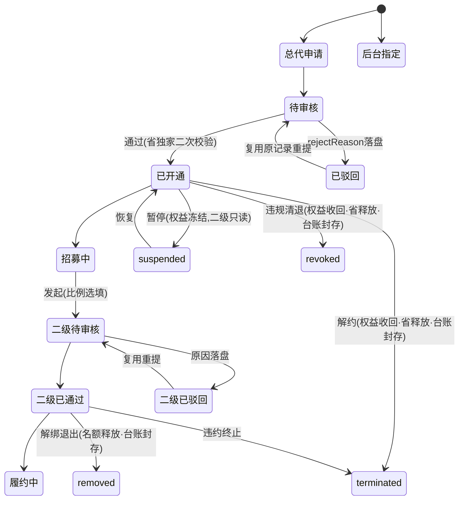

# 省级总代体系迭代执行文档（v0.4 · 全功能开放版 · 待审批）

> 状态：**草案，未经用户书面同意，不得改动任何代码/配置/文案**；本文只做文档规划，不动 demo 代码。
> 版本关系：在 v0.3《评审加固版》基础上，按已拍板口径把全部「待核定/占位」转为**可运行 demo 默认值**，并把原占位的终止态、O4 在线签署、自身余额提现、台账打印+CSV、税算全链路转为正式功能。**v0.2、v0.3 文件保留未改**；v0.3 正确内容与 28 条任务骨架全部保留，新增任务接续编号。
> v0.4 核心变化：新增 **D27（占位转 demo 默认值：清单+设定逻辑+复核责任人）**、**D28（全功能开放范围）**；D25/D26 由占位转完整实现；所有税数字标注「模拟测算，非税务意见，非实际代扣金额」，法定/财务数值旁标「demo 默认模拟值，生产上线前由财务/税务专业复核」。
> 审批方式：用户在本文档上批注或回复「同意/按此执行」后才进入 M1；任一决策被修改需回到对应轮次重新确认。

---

## 0. 一页结论

- **替换什么**：旧「企业合伙人」（入驻类型 `partner`、full 完整二级分销、团队管理、¥0 审核入驻、种子 u8）整体下线，替换为**省级总代 → 二级合作分代理商**两层代理体系。u9=个人合伙人、u10=平台运营、u7=游客不动；新演示账号 u11（四川总代）/u12（成都二级）。
- **不替换什么**：个人合伙人（8%/2% 返佣比例、¥50 门槛、T+1 结算、审核队列、申请页）原样保留，**仅叠加税算列**；建筑/中介现有邀请返佣与佣金提现保留；平台 Phase 0「不经手交易资金、不对测算收益付款」原则不变。
- **商业模式（v0.4 全开放、可跑通）**：每省独家 1 名总代（企业申请+平台指定双轨）；名额上限=max(10,本省地级市数)、平台按省核定；二级真实消费实付×50% 为总盘、按约定 0–50% 拆分（仅测算）；T+7 退款冻结期；台账分「二级分账测算」「总代自身收益（demo 默认 10%）」两独立分区；**金税四期税算全链路**（方案A劳务报酬默认/方案B经营所得备用可切换）；本省无限查看；**终止态闭环**（解约/收回/解绑/权益即时收回/台账封存只读/名额省释放）；**O4 二级《合作协议》在线签署闭环**（复用现有 esign）；**自身余额提现对新身份开放**（佣金/测算收益仍不可提）；台账**打印视图+CSV 导出都实现**。
- **交付**：M1–M4 四阶段、32 条任务，每阶段独立验收；每条任务带【责任 Agent】【所需 Skills】【部署与执行要求】【验收方式】。

---

## 1. 迭代背景与目标

### 1.1 背景（同 v0.3，事实修正保留）

| 线 | 现有实现（源码已核实） | v0.4 处理 |
|---|---|---|
| 企业合伙人（`partner`） | `entry.html` 三选一；`entryTypes.partner` ¥0 人工审核；`distTier=full` 一级12%/3%；有团队；监控200；5折；种子 **u8（周航，databus.js:150/1914）** | 整体下线替换 |
| 个人合伙人（`isIndividualPartner`） | `auth-partner.html` 独立申请；8%/2% **返佣比例非税率**；无团队；¥50 起提；种子 u9（孙小美） | 保留；仅叠加税算列（D25） |

旧企业合伙人走「海报邀请绑定→Rebate 返佣→冻结结算进钱包→可提现」线上资金闭环，与新体系「平台不对测算收益付款、仅测算台账」根本冲突，故独立建模，不在旧引擎打补丁。

### 1.2 迭代目标
1. 用两层代理体系替代企业合伙人，规则见第 3 章。
2. 个人合伙人/建筑中介返佣零误伤（规则、费率、门槛、结算、队列不变，仅叠加税算列）。
3. 平台不对测算收益付款、不垫付、不产生佣金提现；**自身经营余额提现走现有 wallet/withdraw 规则**。
4. 省独家、同省、名额按省核定、平台审核四道约束系统内可校验可拦截。
5. v0.4：税算、冻结期、自身比例、消费枚举、终止态、签署、下载全部以 demo 默认值完整跑通，无空占位。

### 1.3 非目标（v0.4 已剔除原占位项，仅保留真正不做的）
- 不做真实后端/服务端结算、生产级 RBAC/审计；demo 为 localStorage Mock，前端可绕过处生产由服务端二次校验。
- **税不做申报/扣缴/开票/完税凭证/实名认证**：demo 仅按公式模拟计算与展示，所有税数字标「模拟测算，非税务意见，非实际代扣金额」；真实税率/征收方式由财务税务生产复核。
- 不做二级再发展下级（严格两层、一省）；不改造个人合伙人规则与建筑中介返佣。
- 不改造 franchise 资质加盟（线上加盟费 ¥29,800）；franchise 付费 ≠ 代理线上零付费，文案区隔。
- 不做移动端独立适配/打印 PDF 版式；不做短信/Push/邮件触达（状态仅页面可见）；不做列表搜索筛选分页；不做总代转让/继承/主体过户、多省授权、跨省招募、跨级发展。
- 生产侧线下合同金额/发票链条/扣缴义务人认定不在 demo 落地（见 §3.8 与第 10 章「仍需确认」）。

---

## 2. 决策记录（含 v0.3 五轮结论 + v0.4 拍板）

| 编号 | 决策点 | 结论 | v0.4 备注 |
|---|---|---|---|
| D1 | 替换范围 | 只替换企业合伙人；个人合伙人保留 | v0.3 修订保留：规则费率不变，仅叠加税算列 |
| D2 | 总代产生方式 | 双轨：表单申请审核 / 后台直接指定 | 不变 |
| D3 | 分公司主体 | 总代须注册平台方分公司并核验，成本自担，demo 不展示金额 | 不变 |
| D4 | 省级独家 | 每省仅 1 名；仅 approved 占位；双轨通过二次校验、冲突回滚 | v0.4 补：revoked/terminated 后省释放可重授（§3.9） |
| D5 | 二级主体 | 合法工商公司即可，不要求分公司 | 不变 |
| D6 | 二级地区 | 必须与总代同省（省内可跨市），跨省禁止 | 不变 |
| D7 | 名额上限 | max(10,本省地级市数)，平台按省核定、总代不可自定；计数含全部状态；省表落 `js/data.js provinceAgentQuota` | v0.4：直辖市/自治州/地区/盟计数给 demo 默认规则（§5.5），生产复核 |
| D8 | 二级唯一绑定 | 一公司绑一总代；uscc 归一化去重；rejected 不占；removed/terminated 释放绑定 | 不变 |
| D9 | 50% 测算基数 | 二级**真实消费实付**（闭合枚举）×50%=总盘；充值/免费积分/规费/退款不计 | v0.4：枚举转闭合清单（§3.3） |
| D10 | 比例录入 | 发起选填、通过后补录修改留痕；台账拆二级约定所得/总代自留，仅测算 | 不变 |
| D11 | 资金口径 | **佣金/测算收益不可提现、不进 BalanceStore；自身经营余额可提现（走现有 wallet/withdraw 规则）**；旧返佣佣金提现对新身份关闭 | **v0.4 修订**：余额提现由待核定转为开放 |
| D12 | 台账与退款 | 逐笔/月汇总；**T+7 冻结期（demo 默认）**；冻结期剔除、出冻结正常退款红字冲减、后台特殊退款 clawbackRef 等额冲减；**打印视图+CSV 导出都实现**；财务字段齐套 | **v0.4 修订**：T+7、双格式下载落地 |
| D13 | 本省无限查看 | 授权省免解锁/企业库全量/监控无限；跨省普通规则；省份归一化、默认拒绝、不 mark | 不变 |
| D14 | 行为记录 | 总代看名下二级全量日志；平台全量留存；总代本人行为亦留痕；身份失效即时收回权益 | 不变 |
| D15 | 审核流 | 复用 EntryReview 队列；admin 不落盘需双端桥接（A/B/C，§5.3） | v0.4：终止态操作同走桥接 |
| D16 | 二级自身能力 | 普通企业全能力（发布/接单/订单/自身钱包充值消费/余额提现），不可发展下级 | v0.4：补余额提现 |
| D17 | 二级标识 | 标签「二级合作分代理商」，资料页（含他方查看）可见归属总代/授权省/签署状态 | v0.4：补签署状态位 |
| D18 | 旧入口处置 | 旧 partner 全下线；定点清除 u8，不按标签批量删（保 u10/u9/u7） | 不变 |
| D19 | 保留项 | 个人合伙人全链路；base/limited 返佣/钱包/提现；franchise；Phase 0 资金原则 | v0.3 修订保留：个人合伙人仅叠加税算列 |
| D20 | 总代申请资料 | 复用表单加类型：分公司执照/意向省/公司资料；M2-1 补字段差距表 | 不变 |
| D21 | 比例上限 | 约定分给二级 0–50%；0%=全自留；倒挂断言防御；超界拦截不留存 | 不变 |
| D22 | 总代缴费 | 线下执行、线上 ¥0、无付费入口不展示金额 | 不变 |
| D23 | 总代经营能力 | 保留普通企业经营（发布/接单/订单/自身钱包充值消费/余额提现），**不含旧邀请返佣** | v0.4：补余额提现 |
| D24 | 演示账号 | 新增 u11（四川总代 n/21）/u12（成都二级，约定20%）；u9/u10/u7 不动；清除定点 u8 | v0.4：补签署/余额/终止态种子 |
| D25 | 金税四期代扣税 | 新体系台账+个人合伙人提现都接税算；个人合伙人规则不变仅叠加列；**v0.4：由占位转完整计算链路（方案A劳务报酬默认/方案B经营所得可切换），税率表入 MOCK 可配置块；R-01~R-10 保留并补税算独立复算断言** | v0.4 完整实现 |
| D26 | 总代自身收益线 | 单列分区不混算；自身真实消费×**demo 默认10%**；两线各自冲减；仅测算不付款 | v0.4：比例由占位转 10% 默认 |
| **D27** | **占位转 demo 默认值** | 全部待核定项给 demo 默认值+设定逻辑+可调整条件+复核责任人，清单见 §2.3；生产前由对应责任人复核 | v0.4 新增 |
| **D28** | **全功能开放范围** | 终止态闭环、O4 在线签署、自身余额提现开放、打印+CSV、税算全链路五项由占位转正式，见 §2.4 | v0.4 新增 |

### 2.1 待确认遗留项（不阻塞 demo，第 10 章单列）
O1 命名徽章配色、O3 行为记录保留时长、身份叠加/兼任、生产真实税务参数与线下合同发票链——均给 demo 默认跑通，最终值见 §10「仍需确认」。

### 2.2 v0.3 评审问题落位索引（保留）
S-01/B-01/P-01/F-02 账号撞号→D24/§5.4/M3-9/M4-4；S-02/P-02/F-03 桥接→D15/§5.3/M2-2；P-03/F-23 资金口径→D11/M3-7（v0.4 余额开放）；P-06/F-08 MonitorStore→M4-2；F-24/F-01 只读叠加/legacyDistributor→M1-2/M3-7；F-04/F-05 full 摘除→M4-3；F-07/P-19 省份归一→M4-1；P-05/S-07/F-22 驳回重提→M2-4；P-11 非目标→§1.3；P-12 审批栏→第9章。

### 2.3 D27 占位转 demo 默认值清单（可在配置块调整，生产复核）

| 占位项 | v0.4 demo 默认值 | 设定逻辑（为何取此值，仅演示） | 可调整条件（配置块·谁可改） | 生产复核责任人 |
|---|---|---|---|---|
| 税方案 | 默认 **A 劳务报酬**；B 经营所得备用可切换 | 评审可现场切换两种主流口径对比 | `MOCK.business.withholdingTax.activeScheme`；产品/财务可改 | 财务/税务 |
| A 减除费用 | 单笔≤4000 减 800；>4000 减 20% | 沿用现行劳务报酬预扣减除口径，便于评审理解 | `withholdingTax.labor.deduction` 规则；财务可改 | 财务/税务 |
| A 预扣率表（模拟） | 应纳税所得≤20000：20%/速扣0；20000–50000：30%/速扣2000；>50000：40%/速扣7000 | 模拟三级超额累进结构，仅演示「税率表→速算扣除→税额」链路 | `withholdingTax.labor.brackets[]`；财务可改 | 财务/税务 |
| B 经营所得附征率 | levyRate=1%（按佣金收入直接计） | 常见核定征收附征率量级模拟，演示切换对比 | `withholdingTax.business.levyRate`；财务可改 | 财务/税务 |
| 冻结期 T+N | **T+7（7 个自然日）** | 覆盖一周售后/退款窗口，可观察 frozen→settled 两态 | `MOCK.business.agentLedger.frozenDays`；产品+财务可改 | 产品+财务 |
| 自身收益比例 | **10%**（自身真实消费实付×10%） | 窄于二级 50% 总盘、避免争口径，演示自身线独立 | `MOCK.business.agentLedger.selfRate`；管理评审可改 | 管理评审 |
| 消费枚举（闭合） | 计入：订单成交实付净额/积分解锁实付/增值服务实付；不计入：钱包充值/免费积分/入驻认证规费/退款冲减笔 | 白名单制防充值刷盘、防双计 | `agentLedger.eligibleTypes/excludedTypes`；产品可改 | 产品 |
| 台账下载 | **打印视图 + CSV 导出都实现** | 评审同时看版式与原始数据 | `agentLedger.export{print,csv}` 开关；产品可改 | 产品 |
| 省计数规则 | 直辖市按 1 计；自治州/地区/盟与地级市同级计入；cityCount<10 保底取 10 | 给省表一个可跑默认规则，避免空缺 | `provinceAgentQuota.countRule`；平台规则可改 | 平台规则 |
| 税数字标注 | 全部「模拟测算，非税务意见，非实际代扣金额」 | 合规免责，避免被读作真实承诺 | 固定文案，产品维护 | 合规 |

### 2.4 D28 全功能开放范围（原占位→正式）

| 原占位项 | v0.4 正式实现 | 落位 |
|---|---|---|
| 终止态（§3.9） | 总代 active/suspended/terminated/revoked；二级 approved/removed/terminated；解约/独家收回/暂停恢复/二级解绑/违规清退；权益即时收回；台账封存只读；名额与省释放；后台操作入口+留痕 | M1-7 骨架 / M2-7 后台操作 / M4-8 回归 |
| O4 二级《合作协议》 | 复用现有 esign（`engchain-esign`/EsignStore）：发起→待签署→已签署/已拒签；协议版本号/合同编号/签署时间/双方签署人留痕；状态写回 sub-agents；二级资料页可见 | M3-8 |
| 自身余额提现 | 总代/二级可提 BalanceStore 自有余额，走现有 wallet/withdraw 规则与门槛；佣金/测算收益仍不可提 | M3-7 |
| 台账下载 | 打印视图 + CSV 导出都实现，财务字段齐套 | M3-5 |
| 税算全链路 | 税前→税率表→速算扣除→代扣税额→税后实发，新体系台账+个人合伙人提现接入，方案 A/B 可切换 | M1-5 / M3-4 |

---

## 3. 新商业模式定义

### 3.1 角色关系（同 v0.3）

```mermaid
graph TD
    PF[平台方] -->|审核指定/直接开通| AG[省级总代·每省独家1名<br/>须注册分公司·名额按省核定]
    AG -->|发起招募·平台审核·同省| SUB[二级合作分代理商·公司<br/>免费入驻·不可再发展下级]
    SUB -->|真实消费实付闭合枚举·T+7冻结| LED[二级分账测算: 消费×50%总盘<br/>约定比例拆分·仅测算]
    AG -->|自身真实消费×10%| SELF[总代自身收益线·独立分区·仅测算]
    LED --> TAX[税算: 税前→税率表→速扣→代扣税→税后实发·模拟]
    SELF --> TAX
    AG -->|查看二级行为日志| SUB
    PF -->|全量留存(含总代本人)| LOG[(行为记录)]
    AG -.本省无限查看.-> PROV[本省供需/企业库/监控]
    SUB -.本省无限查看.-> PROV
    AG <-->|O4在线签署| SUB
```

### 3.2 角色权益矩阵（v0.4：余额提现开放，佣金/测算收益仍关闭）

| 能力 | 省级总代 | 二级合作分代理商 |
|---|---|---|
| 主体要求 | 企业+平台方分公司 | 合法工商公司 |
| 入驻费用 | 线上 ¥0 无付费入口；费用线下另行执行（D22） | ¥0，总代发起 |
| 产生方式 | 申请审核/后台指定 | 总代发起→平台通过 |
| 区域 | 绑定唯一省（独家） | 必须同省 |
| 下级名额 | max(10,本省地级市数)，平台核定，含全部状态计数 | 不可发展下级 |
| 本省无限查看 | ✅ 免解锁/企业库全量/监控无限 | ✅ 同左 |
| 跨省查看 | 普通规则 | 普通规则 |
| 普通经营（发布/接单/订单） | ✅（D23，不含返佣） | ✅（D16） |
| 钱包充值/余额消费（自身经营） | ✅ | ✅ |
| **自身余额提现（wallet/withdraw）** | ✅ 开放，走现有规则与门槛（D11 v0.4） | ✅ 开放，走现有规则与门槛 |
| **佣金/测算收益提现** | ❌ 关闭，不进 BalanceStore | ❌ 关闭 |
| 旧邀请返佣中心/团队/海报 | ❌ legacyDistributor=false | ❌ |
| 测算台账 | 两分区（二级分账/自身收益10%）、逐笔、拆分、冲减、税算列、打印+CSV | 仅本人约定所得（不见自留/自身收益区） |
| 比例录入 | 可为名下二级录入/修改（留痕） | 不可改 |
| O4 协议 | 发起签署 | 待签/已签/已拒签 |
| 行为记录 | 看二级全量；本人亦留痕 | 不看他人 |
| 积分折扣 | 默认回落 1.0（不沿用 0.5 折） | 同左 |

### 3.3 分佣测算规则（D9/D10/D12/D21/D26，仅测算）

1. **计入总盘的消费行为（闭合枚举，D27）**：① 订单成交实付净额；② 积分解锁实付；③ 增值服务实付。
2. **不计入**：钱包充值（形成可提现余额）、免费积分面值、入驻费/认证费等平台规费、退款/冲减笔。同一笔资金充值与消费只计一次，消费按实付只计一次。
3. **T+7 冻结期（demo 默认 `frozenDays=7` 自然日）**：消费先入 `frozen`，满 7 日无退款转 `settled` 计入；冻结期内退款直接剔除、不进总盘。
4. **总盘**：某二级 settled 真实消费实付合计 ×50%。
5. **拆分**：二级约定所得=总盘×约定比例（0–50%）；总代自留=总盘−约定所得（50%–100%，demo 不再向第三方分配）；0%=全自留。
6. **退款/冲减三层**：① 冻结期退款→直接剔除；② 出冻结正常退款/售后→先冲当月红字留痕，当月不足转次月，部分按比例，无后续挂账；③ 后台特殊原因退款→登记 `clawbackRef` 等额冲减。两线各自独立冲减不交叉。
7. **自身收益线（D26，demo 默认 10%）**：总代自身 settled 真实消费实付 ×10%，独立分区。
8. **资金隔离**：全部测算数字只在代理台账，**不写 BalanceStore、不可提现**；自身余额提现仅指 BalanceStore 内自有经营余额（§3.7/D11）。
9. **比例约束（D21）**：0–50%，超界拦截不留存；倒挂断言防御。

### 3.4 审核流（D15 + 驳回重提 + 终止态，同 v0.3 状态机，补终止边）



**校验纯函数（提交与后台通过两处调用）**：省独家（仅 approved 占位、通过二次校验、冲突回滚）、同省（省份归一化）、唯一绑定（uscc 归一化）、名额（读省表 quotaCap，含全部状态）、自指/互斥（总代本人不可被发起为二级、一人一省）。

### 3.5 本省无限查看（D13，同 v0.3）
公共 `isProvinceFreeUnlock(rec)`；detail.js 主锁 + company/index.html 独立 PW 双锁接入；省份归一化、默认拒绝、同省才放行、不 mark、排除 trade 保证金；MonitorStore `_limitForIdentity`+follow 守卫两处加本省无限分支，候选先按授权省过滤，外省维持原额度。身份失效即时收回全部本省权益。

### 3.6 总代自身收益模型（D26，demo 默认 10%）

| 要素 | 定义 |
|---|---|
| 基数 | 总代自身 settled 真实消费实付（同 D9 闭合枚举，不含充值/规费/免费积分） |
| 比例 | **demo 默认 10%（`selfRate` 可配置，生产由管理评审复核）** |
| 与二级总盘 | 两分区独立：「二级分账测算」「总代自身收益」，不合并/不互补贴/不相加为一行 |
| 资金 | 仅测算、不付款、不进 BalanceStore、不可提现 |
| 冲减 | 自身线退款冲自身线，独立留痕 |
| 边界 | 与旧 base 12%/3% 返佣是两套数字，总代不参与旧返佣发放 |

### 3.7 金税四期税算全链路（D25，方案A默认/B可切换）

**链路**：税前金额 → 适用税率表 → 速算扣除 → 代扣税额 → 税后实发。两处接入：新体系台账逐笔/月账单；个人合伙人 8%/2% 佣金提现预览。

**配置块 `MOCK.business.withholdingTax`（可配置，demo 默认 A）**：

```
withholdingTax: {
  activeScheme: 'labor',            // 'labor'(A默认) | 'business'(B备用)，可切换
  labor: {
    deduction: { lt: 4000, flat: 800, pctAbove: 0.20 },  // ≤4000减800；>4000减20%
    brackets: [                      // 模拟三级超额累进预扣率表
      { upTo: 20000,  rate: 0.20, quickDeduction: 0 },
      { upTo: 50000,  rate: 0.30, quickDeduction: 2000 },
      { upTo: Infinity, rate: 0.40, quickDeduction: 7000 }
    ]
  },
  business: { levyRate: 0.01 }       // B 核定征收附征1%：代扣税=税前佣金×1%
}
```

**公式（方案A 劳务报酬）**：应纳税所得额 = 税前佣金 − 减除费用；代扣税额 = max(0, 应纳税所得额×税率 − 速算扣除)；税后实发 = 税前佣金 − 代扣税额。
**方案B**：代扣税额 = 税前佣金 × 1%；税后实发 = 税前佣金 − 代扣税额。

**demo 复算示例（供对账，非税务意见）**：

| 税前佣金 | 方案A 减除 | 应纳税所得 | 适用档 | 代扣税额 | 税后实发 |
|---|---|---|---|---|---|
| 1,000 | 800 | 200 | 20%/0 | 40 | 960 |
| 8,000 | 1,600(20%) | 6,400 | 20%/0 | 1,280 | 6,720 |
| 30,000 | 6,000 | 24,000 | 30%/2000 | 5,200 | 24,800 |
| 60,000 | 12,000 | 48,000 | 30%/2000 | 12,400 | 47,600 |
| 8,000（方案B） | — | — | 1%附征 | 80 | 7,920 |

**个人合伙人零误伤**：8%/2% 返佣费率、¥50 门槛、T+1 结算、提现审核状态机、申请页、审核队列全部不动；8%/2% 是返佣比例不是税率；税算为新增独立并列列，不改原 fee/到账金额、不冲减可提现余额。仅改 `pages/distribution/withdraw.html`，`wallet/withdraw.html` 不动。
**合规标注**：所有税数字旁标「模拟测算，非税务意见，非实际代扣金额」；不开票、不申报、不实名、不出完税凭证。

### 3.8 合规定位抗辩（B-07，书面陈述；生产线下事项仍需专业）
两层封顶、总代本人直招、入门免费、收益挂钩二级自身真实消费而非发展人数、平台不经手测算收益、不承诺固定收益、全程留痕。生产线下必备（demo 不落地）：总代费用合同主体/金额/收款凭证/退费；发票链条（开票方向、平台是否被认定扣缴义务人）；付款/交付/解除/违约/保密/争议条款——由律师/税务生产核定。

### 3.9 终止态闭环（D28 正式实现，原占位转正式）

**总代状态机**：`active`（正常）/`suspended`（暂停：不可发起、已有二级只读、本省权益冻结，可恢复）/`terminated`（解约：权益收回、省独家释放、台账封存只读）/`revoked`（违规清退：权益收回、省释放、台账封存只读，不可恢复）。
**二级状态机**：`approved`（履约中）/`removed`（解绑退出：名额释放、台账封存只读）/`terminated`（违约终止：名额释放、台账封存只读）。

**后台操作入口（经 M2-2 桥接落库）**：解约、独家收回、暂停/恢复、二级解绑、违规清退；每操作留痕 `{operator, at, reason, fromStatus, toStatus}`。
**即时收回**：操作生效即收回该主体本省无限查看/发起/比例录入/监控权益；`entryAccess` 对应资格位同步失效。
**释放规则**：terminated/revoked 释放省独家占用（可重新授权）；removed/terminated 释放名额与公司唯一绑定。
**封存只读**：终止后台账与行为记录不可改不可删，仅只读查看；封存标记 `sealedAt`。

### 3.10 身份叠加规则（B-12）
1. 总代/二级关闭旧邀请返佣线（base 12%/3%、limited 6%）；D23「经营能力」仅指发布/接单/订单/自身充值消费/余额提现，不含推广返佣。
2. 自然人/企业能否兼任个人合伙人、能否并行 construction/agency、franchise 与代理能否同主体：demo 默认不叠加，最终见 §10「仍需确认」。

### 3.11 O4 二级《合作协议》在线签署闭环（D28，复用现有 esign）

**复用资产（已核实）**：`pages/esign/`（index/sign/h5-sign/records/template-list/preview/detail）、`EsignStore`（localStorage `engchain-esign`）、合同状态机 `draft/pending_mine/signing/completed/rejected/expired/withdrawn/voided`、签署方 `signed/rejected`、存证 `evidence.certNo/timestamp`、`templateId/code/sentAt/completedAt`、h5-sign 对方签署。

**流程**：总代在二级管理点「发起协议」→ 选新增模板 `t-subagent`（二级合作协议，归入 coop 合作框架类）→ 经 `EsignStore.sendContract` 发起 → 二级在 h5-sign/待签列表签署或拒签 → 全部方签完 `completed` / 一方拒签 `rejected`。
**留痕**：协议版本号（demo `v1.0`）、合同编号 `code`、发起时间 `sentAt`、完成时间 `completedAt`、双方签署人/签署方式、存证编号（demo 模拟）。
**写回与展示**：签署状态写入 `sub-agents[].signature{contractId,code,version,status,signedAt,signers}`；二级资料页（含他方查看）展示签署状态（待签署/已签署/已拒签）；拒签记录原因 `rejectReason`。
**协议最低必备条款（正式文本，非占位）**：①授权省份（同省）与独家边界；②名额与唯一绑定；③分配比例为线下约定、平台不对测算收益付款；④两层封顶不得再发展下级；⑤行为合规（不得骚扰/造假/冒用平台名义）；⑥退出/解绑与违约（衔接 §3.9 终止态）；⑦保密与企业库数据使用限制；⑧协议终止后权益收回。

---

## 4. 现状触点盘点（同 v0.3，源码已核实；v0.4 新增落点已并入）

### 4.1 App 端（节选 v0.4 相关新增/改动）
| 触点 | v0.4 处置 |
|---|---|
| `pages/wallet/withdraw.html` | 余额提现对总代/二级开放（走现有 isResident 等价资格位，沿用其最低额/手续费/审核状态机，不改写规则） |
| `pages/distribution/withdraw.html` | 佣金提现对新身份关闭；仅此处叠加个人合伙人税算列 |
| `pages/esign/*` | 复用承载 O4；新增 `t-subagent` 模板；签署结果回写 sub-agents |
| 其余 entry/profile/distribution/agreement/monitor/company/search/guide/help/all-functions/home 等 | 同 v0.3 处置（门控/清零/文案/本省无限） |

### 4.2 数据/逻辑层
| 文件 | v0.4 落点 |
|---|---|
| `js/data.js` | `entryTypes.partner` 迁总代；新增 `provinceAgentQuota`（含 countRule）、`withholdingTax`（完整 A/B 配置）、`agentLedger`（frozenDays/selfRate/eligibleTypes/excludedTypes/export） |
| `js/domain.js` | full 三处摘除；legacyDistributor 资格位；个人合伙人统一 individualPartner；Rebate.createFromEvent 对新身份 return |
| `js/stores.js` | entryAccess 只读叠加；MonitorStore 本省无限；EsignStore 复用；BalanceStore 余额提现资格位放开给新身份（自身余额） |
| `js/detail.js` / `company/index.html` | 公共 isProvinceFreeUnlock 双锁 |
| `js/common.js` | 新四键补 KEY_TO_EVENT 或通用 store-change 兜底 |
| `js/databus.js` | 四键播种/重置；u11/u12 种子（含签署/余额/终止态）；u8 定点清除 |

### 4.3 后台（admin-vue）
EntryReview.vue 经桥接落盘+四道校验+rejectReason；新增终止态操作（解约/收回/暂停恢复/解绑/清退）与省独家/二级列表；新建独立视图避开 Agent.vue；旧分销三页仅核对无 full 残留；todo 文案同步。

---

## 5. 执行方案

### 5.1 新增存储（localStorage，纯 Mock）

| Key | v0.4 内容 |
|---|---|
| `engchain-province-agents` | `{uid, province, branchCompany{}, status: active/suspended/terminated/revoked, appointedAt, appointedBy, source, rejects[], statusLog[{operator,at,reason,from,to}], provinceHistory[], sealedAt}` |
| `engchain-sub-agents` | `{id, parentUid, company{name,uscc归一化,license,legal,contact}, province, ratioToSub, status: pending/approved/rejected/removed/terminated, createdAt, reviewedAt, rejectReason, rejects[], ratioLog[], signature{contractId,code,version,status,signedAt,signers}, statusLog[], sealedAt}` |
| `engchain-agent-ledger` | 逐笔 `{serialNo, month, line: subLedger/selfLedger, subUid/ownerUid, subject, type, grossAmount(税前), amount, orderId, at, frozenStatus: frozen/settled/clawed, refundOf, clawbackRef, taxScheme, taxRate, taxAmount, netAmount(税后实发), taxNo, taxPeriod, balance}` + 两线独立月汇总缓存（带版本号/失效重算） |
| `engchain-agent-behavior` | `{actor, action, target, targetId, province, companyName, sourcePage, idemKey, at}` |

**财务字段（齐套）**：流水号/时间/主体/类型/金额/订单号/冻结状态/冲减记录/税项/余额/税前金额/代扣税率/代扣税额/税后实发/税单号。红冲负数笔+原笔标记；金额分位四舍五入；月汇总层 ×50%。

### 5.2 新增 App 页面（`pages/province-agent/`）
1. 总代工作台：身份卡（授权省独家、n/quotaCap、状态徽标、本省权益说明）、二级管理列表（含签署状态/终止操作入口可见性）、发起二级、台账（两分区、税算列、打印+CSV）、行为记录。
2. 发起二级表单：公司名/uscc/执照/法人/联系人/省份（默认带省，跨省拦截）/约定比例（选填0–50%）。
3. 二级视角页：身份卡（归属总代/授权省/签署状态）；仅本人约定所得；自身余额提现入口（走 wallet）。

### 5.3 双端桥接（D15，M2-2 拍板，不编造实现）
- 方案A 共享种子导出（admin 导出 JSON→App 导入落盘）；方案B 统一 seed/场景工厂承接；方案C 桥接模块直写共享 localStorage+storage 事件。demo 建议 B/C 最小闭环；终止态操作与审核同走所选方案。验收：后台动作→App 刷新身份/状态/权益可观察，失败回滚不落占位。

### 5.4 演示账号（D24 v0.4 补种子）
| 账号 | 角色 | 演示数据 |
|---|---|---|
| u11（空闲） | 四川省独家总代 | n/21；两分区台账（自身收益10%示例）；一笔充值不进基数；一笔 frozen（T+7 未到）；一笔 settled；一笔特殊退款冲减；税算列（方案A）；一笔自身经营余额可提现；一份已发起待签/已签协议；无佣金提现入口 |
| u12（空闲） | 二级（归属 u11，成都，约定20%） | 本人约定所得；一笔 settled 消费、一笔冻结期退款、一笔特殊冲减；税算列；已签署协议示例；自身余额可提现；无佣金入口 |

u9（个人合伙人）/u10（平台运营）/u7（游客）不动；u8 为定点清除对象。播种接入 DEMO_SCENARIOS/reset 等价函数，硬刷新可复现。

### 5.5 省→地级市 Mock 表（D7，`js/data.js provinceAgentQuota`）
| provinceCode | provinceName | cityCount | quotaCap | countRule(demo默认) | remark |
|---|---|---|---|---|---|
| 510000(示例编码) | 四川省 | 21（演示示例） | max(10,21)=21 | 地级市同级计入 | demo 示例，生产重新核定 |
| 其余省 | 配置块内补录 | 按 cityCount 现算 | max(10,cityCount) | 直辖市按1；自治州/地区/盟同级；<10保底10 | 规则可在 countRule 调整，生产复核 |

省名与 editor.html:700 34 省清单逐字对齐映射；核定动作后台留痕；总代无自定名额输入。

---

## 6. 执行路径与阶段验收（32 条；保留 v0.3 的 28 条骨架，新增 M1-7/M1-8? 见下编号）

> 说明：v0.3 原 M1-1~M1-6、M2-1~M2-6、M3-1~M3-8、M4-1~M4-8 骨架全部保留并按 v0.4 升级；新增任务接续编号。每条含【责任 Agent】【所需 Skills】【部署与执行要求】【验收方式】。

### M1 · 身份与数据层（不可见改动）—— 8 条（原6条 + 新增 M1-7/M1-8）

#### M1-1 新代理存储读写模块（四键+两分区+税项/冻结/冲减/终止/签署字段）
| 要素 | 内容 |
|---|---|
| 前置/触发 | 首个任务；模块初始化读写四键 |
| 系统行为 | 按 §5.1 schema CRUD；台账 line 分区/frozenStatus/refundOf/clawbackRef/税项/封存 sealedAt；sub-agents.signature；状态 statusLog；月汇总版本化 |
| 可观察结果 | 四键字段齐全（verifier-hub 关键词）；缺键 try/catch 回退空表不报错；旧记录无新字段兼容 |
| 成功/边界 | 构造总代+二级+frozen/settled/冲减+签署+终止字段完整落盘；无键/旧记录不报错 |
| 回归项 | 既有 engchain-* 键不受影响 |
| 【责任 Agent】 | 系统迭代工程师（主责）、专家前端工程师协作 |
| 【所需 Skills】 | verifier-hub：四键/字段/无承诺值校验；doubao-data-analysis：复算总盘/拆分/冲减/税项结构 |
| 【部署与执行要求】 | stores 侧新模块；禁止回写 entry.types/auth.partner/BalanceStore；配置值走 data.js 配置块 |
| 【验收方式】 | 冒烟读四键断言字段；node --check；无页面改动 |

#### M1-2 entryAccess 只读叠加 + legacyDistributor 资格位（F-24/F-01）
| 要素 | 内容 |
|---|---|
| 前置/触发 | M1-1；登录/身份派生 |
| 系统行为 | 叠加 isProvinceAgent/isSubAgent/agentProvince/agentQuotaUsed；legacyDistributor 布尔位；dist/isDistributor 读该位；终止态（suspended/terminated/revoked/removed）资格位同步失效 |
| 可观察结果 | 新身份 dist=false；终止态权益位 false；u8/u9/u1/u2 deriveIdentity 改动前深相等 |
| 成功/边界 | 已认证无旧资格 dist=false；终止后即时收回；新存储缺失回退 |
| 回归项 | u8/u9/u1/u2 entryAccess 深相等（R-01/R-09） |
| 【责任 Agent】 | 专家前端工程师（主责）、系统迭代工程师 |
| 【所需 Skills】 | doubao-product-qa：旧身份深相等基线；verifier-hub：校验未回写 entry.types/auth.partner |
| 【部署与执行要求】 | stores.js entryAccess/deriveIdentity；禁止写新身份入 entry.types/auth.partner；不改旧默认 |
| 【验收方式】 | 冒烟深相等断言；新身份/终止态资格位断言 |

#### M1-3 校验纯函数集（四道+自指/互斥+名额按省表）
| 要素 | 内容 |
|---|---|
| 前置/触发 | M1-1、M1-4；提交/后台通过调用 |
| 系统行为 | 省独家（仅 approved、通过二次校验、冲突回滚）、同省归一、uscc 唯一绑定、名额读省表含全部状态、自指、一人一省；终止态释放后省/名额可重新占用 |
| 可观察结果 | 各拦截返回错误码；名额读表不写死 10 |
| 成功/边界 | 合法通过；四川满21拦截；重复省/重复绑定/自指/一人多省拦截；terminated 后可重授 |
| 回归项 | 旧建筑/中介入驻校验不变 |
| 【责任 Agent】 | 系统迭代工程师（主责） |
| 【所需 Skills】 | doubao-data-analysis：名额计数与 max(10,cityCount) 复算；verifier-hub：无写死10残留 |
| 【部署与执行要求】 | 独立纯函数模块两处复用；禁止散落页面；省表数值在配置块 |
| 【验收方式】 | 成功/边界逐断言；node --check |

#### M1-4 省→地级市 Mock 表 + countRule 落位（D7/D27）
| 要素 | 内容 |
|---|---|
| 前置/触发 | 名额校验、n/quotaCap 展示 |
| 系统行为 | data.js 新增 provinceAgentQuota 独立块；countRule：直辖市按1、自治州/地区/盟同级、<10保底10；省名与 editor.html:700 对齐映射 |
| 可观察结果 | 四川 cityCount=21/quotaCap=21；规则对其余省可算 |
| 成功/边界 | 省名别名归一命中；无匹配回退待填配置 |
| 回归项 | data.js 既有配置不被深合并破坏 |
| 【责任 Agent】 | 系统迭代工程师（主责）、商业模式规划师核口径 |
| 【所需 Skills】 | doubao-data-analysis：max(10,cityCount) 与 countRule 核验；verifier-hub：仅四川填示例、其余为配置占位非编造数值 |
| 【部署与执行要求】 | data.js MOCK.business 独立块，不塞 franchise nationalRegions；无总代自定名额输入 |
| 【验收方式】 | 查表断言四川=21；countRule 三例（直辖市/自治州/小省<10）可算 |

#### M1-5 税算配置块完整化（D25/D27，方案A默认/B可切换）
| 要素 | 内容 |
|---|---|
| 前置/触发 | 新体系台账税算列、个人合伙人提现税算列 |
| 系统行为 | `withholdingTax` 完整配置：activeScheme=labor；labor.deduction（≤4000减800/>4000减20%）、labor.brackets 三级表；business.levyRate=0.01；方案可切换；税算纯函数（应纳税所得/税额/税后） |
| 可观察结果 | 配置可读写、A/B 可切换；复算示例（§3.7 表）数字一致 |
| 成功/边界 | 切换 B 后税额=税前×1%；负数税额取0；缺配置回退不崩溃 |
| 回归项 | 8%/2% 费率、¥50 门槛、原 fee/到账不变（R-01~R-04） |
| 【责任 Agent】 | 商业模式规划师（口径）、系统迭代工程师（配置/纯函数） |
| 【所需 Skills】 | doubao-data-analysis：按 §3.7 五例独立复算税额/税后；doubao-compliance-assessment-public：模拟标注/不承诺税率评估；verifier-hub：无真实承诺税率写成定论 |
| 【部署与执行要求】 | data.js 独立块；纯函数独立可测；不改 8%/2% 返佣配置；全部税数字带模拟标注 |
| 【验收方式】 | 五例对账复算全绿；A/B 切换；个人合伙人原费率回归 |

#### M1-6 消费枚举闭合清单 + T+7 冻结 + 自身10% 配置（D9/D12/D26/D27）
| 要素 | 内容 |
|---|---|
| 前置/触发 | 台账引擎读取 |
| 系统行为 | `agentLedger.eligibleTypes`（订单实付净额/解锁实付/增值实付）、`excludedTypes`（充值/免费积分/规费/退款笔）、`frozenDays=7`、`selfRate=0.10` 配置块 |
| 可观察结果 | 枚举白名单可配置；frozenDays/selfRate 可调 |
| 成功/边界 | 充值被排除；冻结笔不计；自身线按10%算 |
| 回归项 | 旧返佣结算不漂移 |
| 【责任 Agent】 | 系统迭代工程师（主责）、商业模式规划师 |
| 【所需 Skills】 | doubao-data-analysis：白名单/冻结/自身比例复算；verifier-hub：枚举清单与 D27 一致 |
| 【部署与执行要求】 | data.js 配置块；禁止把充值/余额写入基数 |
| 【验收方式】 | 充值不进 ledger 断言；frozen/settled 分流；自身10%复算 |

#### M1-7 终止态状态机骨架（D28，新增）
| 要素 | 内容 |
|---|---|
| 前置/触发 | M1-1、M1-2；状态流转被调用 |
| 系统行为 | 总代 active/suspended/terminated/revoked、二级 approved/removed/terminated 状态转换纯函数；合法边校验（suspended↔active、terminated/revoked 不可逆、removed/terminated 释放）；statusLog 追加；sealedAt 封存标记；权益位失效钩子 |
| 可观察结果 | 非法跳转被拒；合法转换落 statusLog；封存只读标记置位 |
| 成功/边界 | active→suspended→active；active→terminated；approved→removed；不可逆状态不可回；终止后省/名额释放 |
| 回归项 | 正常 approved/active 流转不受影响 |
| 【责任 Agent】 | 系统迭代工程师（主责）、产品经理（状态边评审） |
| 【所需 Skills】 | doubao-product-manager：状态机用户故事/验收标准；verifier-hub：状态枚举与 §3.9 一致；doubao-data-analysis：释放/封存规则复算 |
| 【部署与执行要求】 | 独立状态机模块；只读封存钩子不删数据；禁止提供恢复 terminated/revoked 的入口 |
| 【验收方式】 | 每条合法/非法边断言；封存只读；释放可重占 |

#### M1-8 冒烟脚本载体 + 播种/重置机制（P-07，含新种子）
| 要素 | 内容 |
|---|---|
| 前置/触发 | M1-1~M1-7；阶段验收 |
| 系统行为 | 冒烟脚本载体（scripts/smoke-m1.js，node 直跑）；四键播种函数与 reset 等价骨架；含冻结/终止/签署占位种子结构 |
| 可观察结果 | 成功/边界/回归三类断言输出；硬刷新可复现 |
| 成功/边界 | M1 全绿；重置回种子值 |
| 回归项 | 旧种子重置不受影响 |
| 【责任 Agent】 | QA回归工程师（主责）、系统迭代工程师 |
| 【所需 Skills】 | doubao-product-qa：基线用例与通过标准；verifier-hub：三类断言覆盖 |
| 【部署与执行要求】 | 脚本独立不进生产；断言写预期存储值/数字 |
| 【验收方式】 | 全绿；重置可复现；三表记录 |

### M2 · 申请与审核开通（含桥接、终止态后台操作）—— 7 条（原6 + 新增 M2-7）

#### M2-1 总代表单新类型 + 字段差距表（D20/D22）
| 要素 | 内容 |
|---|---|
| 前置/触发 | M1；企业选「省级总代」提交 |
| 系统行为 | 新类型：分公司执照/许可证/法人/意向省/公司资料；¥0「确认提交」分支，无付费入口/金额 |
| 可观察结果 | 字段齐全；提交→待审核；页面无价格/支付按钮 |
| 成功/边界 | 缺分公司执照/意向省拦截；fee 恒0 |
| 回归项 | 建筑/中介表单、个人合伙人申请页不动 |
| 【责任 Agent】 | 产品经理（主责）、专家前端工程师 |
| 【所需 Skills】 | doubao-product-manager：PRD/字段差距表/验收；html：表单改造；doubao-marketing-material-review：零付费文案扫描 |
| 【部署与执行要求】 | entry-form/entry.html；禁止付费入口；O1 命名待确认 |
| 【验收方式】 | 走查提交；无价格露出；旧三类入驻回归 |

#### M2-2 双端审核桥接方案选定与落地（S-02/F-03/P-02，阻断）
| 要素 | 内容 |
|---|---|
| 前置/触发 | M1-1/M1-3；评审会拍板 A/B/C |
| 系统行为 | 按方案打通 admin→App 落盘；通过执行四道校验；驳回 rejectReason 落盘回显；终止态操作同走此桥接 |
| 可观察结果 | 后台通过→App 身份/省/名额可见；驳回原因可见；终止操作→App 权益即时收回 |
| 成功/边界 | 端到端生效；省冲突失败回滚不落占位；note 必填持久化 |
| 回归项 | 个人合伙人审核队列不受影响 |
| 【责任 Agent】 | 系统迭代工程师（主责）、专家前端工程师 |
| 【所需 Skills】 | doubao-product-qa：端到端用例；verifier-hub：落盘键/字段一致；doubao-critical-reading-companion：桥接论证链自检 |
| 【部署与执行要求】 | EntryReview.vue+桥接模块（方案待定不编造）；不假设现状已持久化；demo 接受手动整页刷新并列复验 |
| 【验收方式】 | 端到端存储键/字段/身份；失败回滚；终止操作可观察 |

#### M2-3 后台直接指定开通（事务式）
| 要素 | 内容 |
|---|---|
| 前置/触发 | M2-2；后台指定 |
| 系统行为 | 先校验全约束再落库，任一失败不落占位；新视图/动作避开 Agent.vue |
| 可观察结果 | 指定成功→省独家占位；冲突→错误无残留 |
| 成功/边界 | 指定与申请轨同路径；冲突回滚 |
| 回归项 | 现有用户列表/委托代理页不动 |
| 【责任 Agent】 | 系统迭代工程师（主责） |
| 【所需 Skills】 | doubao-product-manager：动作落点/权限；verifier-hub：无 Agent.vue 误改 |
| 【部署与执行要求】 | Detail 动作或新独立视图+路由（避开 /users/agent）；禁止改名复用 |
| 【验收方式】 | 指定成功/冲突回滚两场景 |

#### M2-4 驳回重提闭环 + rejectReason 落盘（P-05/S-07/F-22）
| 要素 | 内容 |
|---|---|
| 前置/触发 | M2-2；驳回后补资料重提 |
| 系统行为 | 一公司一记录，rejected→回退 pending；rejects[] 保留历史；rejectReason 落盘；名额按有效记录计数 |
| 可观察结果 | 重提回 pending、历史保留、不新建重复记录 |
| 成功/边界 | 驳回→补→重提→再审核；唯一绑定含/不含 rejected 口径明确 |
| 回归项 | 旧入驻驳回/重提不变 |
| 【责任 Agent】 | 产品经理（主责）、系统迭代工程师 |
| 【所需 Skills】 | doubao-product-manager：状态边/用户故事；verifier-hub：rejects[]/rejectReason 落盘 |
| 【部署与执行要求】 | 申请进度态+状态机；禁止删驳回历史 |
| 【验收方式】 | 驳回→重提→通过全路径；原因可见 |

#### M2-5 旧 partner 入口软下线（并存期隔离，S-04/B-02）
| 要素 | 内容 |
|---|---|
| 前置/触发 | M2-1；并存期 |
| 系统行为 | entry 旧卡片置灰/隐藏、提交拦截；distribution seed 停止注入；旧已提交隔离/作废 |
| 可观察结果 | 无法再经旧入口提交 partner；不写旧返佣 seed |
| 成功/边界 | 新数据不与旧返佣混杂 |
| 回归项 | 个人合伙人申请入口不受影响 |
| 【责任 Agent】 | 专家前端工程师（主责）、系统迭代工程师 |
| 【所需 Skills】 | verifier-hub：旧入口不可达/seed 不注入；doubao-product-qa：并存期基线 |
| 【部署与执行要求】 | entry/entry-form/distribution seed；勿关个人合伙人；M4 再彻底清除 |
| 【验收方式】 | 旧提交被拦；个人合伙人可申请 |

#### M2-6 省独家冲突提示（不做推送）
| 要素 | 内容 |
|---|---|
| 前置/触发 | M2-2/M2-3；重复开通同省 |
| 系统行为 | 页面提示「该省已独家授权」；仅落状态，无短信/Push/邮件 |
| 可观察结果 | 冲突提示出现；无外发通道 |
| 成功/边界 | 双轨冲突均拦截；pending 不占省 |
| 回归项 | 现有通知四桶不新增 |
| 【责任 Agent】 | 专家前端工程师 |
| 【所需 Skills】 | doubao-compliance-assessment-public：提示合规；verifier-hub：无推送代码 |
| 【部署与执行要求】 | 提交/通过拦截处；禁止新增触达通道 |
| 【验收方式】 | 提示可见、无外发 |

#### M2-7 终止态后台操作入口（D28，新增）
| 要素 | 内容 |
|---|---|
| 前置/触发 | M1-7、M2-2；后台执行解约/独家收回/暂停恢复/二级解绑/违规清退 |
| 系统行为 | 经桥接调用 M1-7 状态机；写 statusLog{operator,at,reason,from,to}；即时收回权益位；释放省/名额/绑定；台账置 sealedAt 只读；suspended 可恢复、terminated/revoked 不可逆 |
| 可观察结果 | 后台操作→App 刷新后状态徽标/权益/名额/省占用按 §3.9 变化；台账只读 |
| 成功/边界 | 暂停可恢复；解约/清退释放省可重授；解绑释放名额；非法跳转被拒；封存不可改 |
| 回归项 | active/approved 主体与个人合伙人不受影响 |
| 【责任 Agent】 | 系统迭代工程师（主责）、产品经理（操作口径）、专家前端工程师（后台视图） |
| 【所需 Skills】 | doubao-product-manager：操作入口与权限口径；verifier-hub：statusLog/释放/封存字段落盘；doubao-compliance-assessment-public：终止操作合规留痕；doubao-product-qa：终止态端到端回归 |
| 【部署与执行要求】 | 新后台视图经桥接落库，不直写 App localStorage 假设；禁止提供恢复 terminated/revoked 按钮；封存只标记不删数据 |
| 【验收方式】 | 五类操作各走成功/边界；权益即时收回；省/名额释放可重占；台账只读 |

### M3 · 工作台与测算台账（税算/两分区/签署/余额开放/打印CSV）—— 9 条（原8 + 新增 M3-8，原 M3-8 播种顺延为 M3-9）

#### M3-1 总代工作台 / 发起表单 / 二级视角页（D17）
| 要素 | 内容 |
|---|---|
| 前置/触发 | M2；u11/u12 登录 |
| 系统行为 | 身份卡（授权省、n/quotaCap、状态徽标）、二级列表（签署状态/操作入口可见性）、发起表单、二级页仅见本人约定所得；他方资料页显示归属总代/省/签署状态 |
| 可观察结果 | u11 卡 n/21；u12 不见自留/自身收益区 |
| 成功/边界 | 发起→通过→列表；跨省拦截；比例选填 |
| 回归项 | 普通企业页面无回流 |
| 【责任 Agent】 | 产品经理（主责）、专家前端工程师 |
| 【所需 Skills】 | html：新页/组件；doubao-product-manager：信息架构/验收；verifier-hub：无 n/10 残留 |
| 【部署与执行要求】 | pages/province-agent/；无 n/10 残留；O1 命名待确认 |
| 【验收方式】 | 两角色走查；u12 不见自留/自身收益 |

#### M3-2 台账引擎：消费白名单/T+7冻结/50%总盘/三层冲减（D9/D12）
| 要素 | 内容 |
|---|---|
| 前置/触发 | M1-1/M1-3/M1-4/M1-6；消费/退款/特殊退款 |
| 系统行为 | 充值不进基数；frozen 满 T+7 转 settled；冻结期退款剔除；出冻结退款先冲当月红字、不足转次月、部分按比例、无后续挂账；特殊退款 clawbackRef 等额冲减；月汇总 ×50% |
| 可观察结果 | 充值+消费：总盘仅含消费；冻结不计；冲减等额 |
| 成功/边界 | 示例：消费10,000（不含充值）→总盘5,000→20%→约定1,000/自留4,000；充值不进 ledger；部分退款按比例；无后续挂账 |
| 回归项 | 旧 Rebate 结算不漂移（R-09） |
| 【责任 Agent】 | 系统迭代工程师（主责）、商业模式规划师 |
| 【所需 Skills】 | doubao-data-analysis：50%/拆分/冲减/去重复算；doubao-compliance-assessment-public：充值不计入/资金不碰；verifier-hub：充值金额不出现于 ledger |
| 【部署与执行要求】 | 台账计算模块；充值/余额不入基数；frozenDays 在配置块；金额分位四舍五入 |
| 【验收方式】 | 充值+消费+三类退款复算；月账单数字正确 |

#### M3-3 两分区列示：二级分账 / 自身收益10%（D26）
| 要素 | 内容 |
|---|---|
| 前置/触发 | M3-2；月账单/逐笔 |
| 系统行为 | 流水 line 字段；月汇总两张独立小计不相加；自身线=自身 settled 消费×10%；两线各自冲减 |
| 可观察结果 | 两个独立分区卡片、分行汇总 |
| 成功/边界 | 两线各自小计正确；10% 在配置块可改；冲减不交叉 |
| 回归项 | u12 不见自身收益区 |
| 【责任 Agent】 | 商业模式规划师（主责）、系统迭代工程师 |
| 【所需 Skills】 | doubao-data-analysis：两线独立复算；doubao-product-analysis：自身线≠旧返佣边界 |
| 【部署与执行要求】 | ledger line+两分区；selfRate 配置；禁止合并/互补贴 |
| 【验收方式】 | 两分区独立小计；10% 复算 |

#### M3-4 税算完整链路列（新体系台账+个人合伙人提现，D25）
| 要素 | 内容 |
|---|---|
| 前置/触发 | M1-5；台账/提现预览 |
| 系统行为 | 两处增税前/代扣税率/代扣税额/税后实发/税单号占位列；方案 A/B 可切换；个人合伙人仅改 distribution/withdraw.html，原 fee/到账不改 |
| 可观察结果 | 按 §3.7 五例复算一致；税项与原金额分列；带「模拟测算」标注 |
| 成功/边界 | 提现预览出现税前/代扣/税后；A/B 切换；负数税取0；不冲减可提现余额 |
| 回归项 | R-01~R-10 全绿（§7.3），R-08 补税算独立复算断言 |
| 【责任 Agent】 | 系统迭代工程师（主责）、QA回归工程师 |
| 【所需 Skills】 | doubao-data-analysis：税列独立复算（不改原金额）；doubao-compliance-assessment-public：仅展示不开票；doubao-product-qa：独立回归 |
| 【部署与执行要求】 | ledger 税项字段+distribution/withdraw.html；不动 wallet/withdraw.html、不改 8%/2%/¥50/队列 |
| 【验收方式】 | R-01~R-10 通过；五例对账；税项分列 |

#### M3-5 台账打印视图 + CSV 导出都实现（D12/D28）
| 要素 | 内容 |
|---|---|
| 前置/触发 | M3-2/M3-3；台账点打印/导出 |
| 系统行为 | 打印视图（window.print 月账单两分区+税列排版）；CSV 导出（财务字段齐套：流水号/时间/主体/类型/金额/订单号/冻结状态/冲减记录/税项/余额/税前/代扣税率/代扣税额/税后实发/税单号）；导出内容=当前月账单两分区 |
| 可观察结果 | 打印视图可呼出；CSV 含齐套字段与正确数值；无导出审批 |
| 成功/边界 | 两分区+税列出现在导出；空台账导出表头；不做 PDF 版式 |
| 回归项 | 旧页面无下载入口污染 |
| 【责任 Agent】 | 专家前端工程师（主责）、产品经理（列结构） |
| 【所需 Skills】 | html：打印视图/CSV 组件；verifier-hub：CSV 列与 §5.1 字段一致；doubao-data-analysis：导出数字与页面复算一致 |
| 【部署与执行要求】 | 工作台台账页；export{print,csv} 开关配置；不做导出审批/留痕/权限分级 |
| 【验收方式】 | 打印呼出；CSV 字段齐套+数字对账 |

#### M3-6 比例录入 / 补改 / 留痕（D10/D21）
| 要素 | 内容 |
|---|---|
| 前置/触发 | M3-1；发起选填/通过后补改 |
| 系统行为 | 0–50% 校验，0%=全自留；ratioLog 留痕；超界拦截不留存 |
| 可观察结果 | ratioLog 追加；>50% 被拦 |
| 成功/边界 | 补改后按新比例重算并留痕；0% 允许；倒挂防御 |
| 回归项 | 比例不改写总盘 |
| 【责任 Agent】 | 产品经理（主责）、系统迭代工程师 |
| 【所需 Skills】 | doubao-data-analysis：比例拆分复算；verifier-hub：ratioLog 留痕/0–50% 拦截 |
| 【部署与执行要求】 | 发起表单+修改交互；不留存超界比例 |
| 【验收方式】 | 合法/超界/0% 三场景；留痕可见 |

#### M3-7 佣金/测算收益不可提现 + 自身余额提现开放 + 旧返佣全出口门控（D11/F-01/F-06）
| 要素 | 内容 |
|---|---|
| 前置/触发 | M1-2；新身份进旧返佣各页/提现 |
| 系统行为 | 佣金提现关闭、测算收益不进 BalanceStore 不可提；**自身余额提现（wallet/withdraw）对总代/二级开放，沿用现有最低额/手续费/审核状态机不改写规则**；earnings/withdraw(佣金)/team/poster/distribution index/share/all-functions/home chip/help/guide 按 legacyDistributor 否定门控 |
| 可观察结果 | 新身份进不了旧返佣中心/佣金提现/团队/海报；可进 wallet/withdraw 提自身余额；无佣金数据/测算余额 |
| 成功/边界 | 自身余额可提、佣金/测算不可提；直达 URL 也被拒；个人合伙人/旧 base/limited 正常 |
| 回归项 | u9 返佣中心/提现正常；u8（M4前）不漂移；R-13 |
| 【责任 Agent】 | 专家前端工程师（主责）、系统迭代工程师 |
| 【所需 Skills】 | doubao-product-qa：全出口门控矩阵+余额开放回归；verifier-hub：逐出口否定分支；doubao-compliance-assessment-public：资金不碰红线 |
| 【部署与执行要求】 | 各旧出口+资格位+wallet 资格位；只隐藏按钮不够须防直达；不改写 wallet 既有门槛规则 |
| 【验收方式】 | 五身份×出口矩阵；自身余额可提/佣金测算不可提双断言（R-13） |

#### M3-8 O4《二级合作协议》在线签署闭环（D28，新增）
| 要素 | 内容 |
|---|---|
| 前置/触发 | M2 二级已通过；总代发起协议、二级签署/拒签 |
| 系统行为 | 复用 EsignStore/`engchain-esign`，新增 t-subagent 模板（coop 类）；sendContract→signing/pending_mine→completed/rejected；留痕 version(v1.0)/code/sentAt/completedAt/双方签署人/存证；写回 sub-agents.signature；二级资料页与他方查看展示状态；拒签带 rejectReason |
| 可观察结果 | 发起→待签→已签/已拒签流转；signature 落盘；资料页状态更新；合同正文含 §3.11 八条必备条款 |
| 成功/边界 | 双方签完 completed；一方拒签 rejected 并记录原因；未签状态在资料页可见；不影响二级基础权益 |
| 回归项 | 现有材料/设备/劳务/框架等 esign 合同与次数包不受影响；个人合伙人不强制签署 |
| 【责任 Agent】 | 系统迭代工程师（主责复用 esign）、专家前端工程师（协议页）、商业模式规划师（条款） |
| 【所需 Skills】 | doubao-contract-drafting：t-subagent 协议正式条款起草（非占位）；doubao-contract-reviewer：条款合规审查；html：签署入口/状态展示；verifier-hub：signature 字段/版本号/时间/签署人落盘；doubao-product-qa：签署闭环回归（R-12） |
| 【部署与执行要求】 | 复用现有 esign 模块不改其既有合同逻辑；新增模板独立；签署状态写回 sub-agents；demo 存证编号模拟标注 |
| 【验收方式】 | 发起/签署/拒签三路径；写回与资料页可见；既有 esign 合同回归 |

#### M3-9 u11/u12 播种 + 硬刷新重置（P-07/A-07，原 M3-8 顺延）
| 要素 | 内容 |
|---|---|
| 前置/触发 | M3-1~M3-8；演示加载/重置 |
| 系统行为 | 播种 u11（n/21、两分区、充值不进基数、frozen、settled、特殊冲减、税算、自身余额、待签/已签协议、终止态示例位）、u12（20%、本人所得、冻结退款、冲减、税算、已签协议、自身余额、行为日志）；重置还原四键 |
| 可观察结果 | 硬刷新数字不变可重复 |
| 成功/边界 | 两账号主路径脚本走通；重置清残留；u9/u10 不被覆盖 |
| 回归项 | R-01~R-10；u9/u10 原样 |
| 【责任 Agent】 | QA回归工程师（主责）、系统迭代工程师 |
| 【所需 Skills】 | doubao-product-qa：播种基线/复现证据；verifier-hub：u11/u12 落盘且 u9/u10 未变 |
| 【部署与执行要求】 | DEMO_SCENARIOS/reset 等价函数；禁覆盖 u9/u10；示例数字标注仅测算 |
| 【验收方式】 | 播种→走查→重置→硬刷新复现 |

### M4 · 本省无限查看 + 旧入口清零 + 文案 + 全量回归 —— 8 条（保留原 M4-1~M4-8，内容升级）

#### M4-1 免解锁本省钩子（双锁+归一+不 mark，F-07/P-19）
| 要素 | 内容 |
|---|---|
| 前置/触发 | M1-2；本省查看 |
| 系统行为 | 公共 isProvinceFreeUnlock；detail.js 主锁+company/index.html 独立 PW 双调用；归一化/默认拒绝/同省放行/不 mark/排除 trade 保证金；终止态主体权益位 false 时钩子不放行 |
| 可观察结果 | 本省免98积分、跨省锁定、不写 engchain-unlocked |
| 成功/边界 | 省名别名命中；误调 mark 禁止；trade 不免；终止态不放行 |
| 回归项 | 普通用户解锁不变 |
| 【责任 Agent】 | 专家前端工程师（主责） |
| 【所需 Skills】 | doubao-product-qa：本省/跨省/误放开/终止态用例；verifier-hub：无 mark、默认拒绝 |
| 【部署与执行要求】 | detail.js+company/index.html；不做全国放开；省字段取新存储授权省 |
| 【验收方式】 | 本省放行/跨省拦截/不持久化/终止态收回 |

#### M4-2 MonitorStore 本省无限 + 候选过滤（P-06/F-08/F-21）
| 要素 | 内容 |
|---|---|
| 前置/触发 | M1-2、M4-1；关注企业 |
| 系统行为 | _limitForIdentity 加本省无限分支；follow 守卫同步；候选补 province 先本省过滤；改旧文案；新键监听 |
| 可观察结果 | 超30/50家本省仍成功、外省受限、非全国无限；终止态不可关注 |
| 成功/边界 | 本省无限/外省受限；无省字段不误放开；终止态拦截 |
| 回归项 | 建筑30/中介50 旧额度不变 |
| 【责任 Agent】 | 专家前端工程师（主责）、系统迭代工程师 |
| 【所需 Skills】 | doubao-data-analysis：限额复算；verifier-hub：Store 层+页面两处都改、本省过滤存在 |
| 【部署与执行要求】 | stores.js MonitorStore+monitor/index.html；不只改页面；旧文案同步 |
| 【验收方式】 | 超额本省成功/外省拦截 |

#### M4-3 tiers.full 摘除防漂移 + 档位键统一（F-04/F-05/F-18）
| 要素 | 内容 |
|---|---|
| 前置/触发 | M3-7；配置加载/结算/渲染 |
| 系统行为 | CONFIG_PATCH 删 full、validate 删两条、applyOverride 同步；个人合伙人全程 individualPartner；清 `==='full'` 硬编码（hasSecond/L2/标签映射）；base/limited 仅旧持有人 |
| 可观察结果 | full 不可经 ConfigAPI 写回；个人合伙人费率/L2 不断链 |
| 成功/边界 | 摘除后 base/limited/个人合伙人结算不漂移；旧 settled 原样、新渲染按保留档裁剪 |
| 回归项 | R-09；8%/2%、base/limited 不变 |
| 【责任 Agent】 | 系统迭代工程师（主责） |
| 【所需 Skills】 | doubao-data-analysis：费率/结算复算；verifier-hub：三处无 full 残留；doubao-product-qa：引擎回归 |
| 【部署与执行要求】 | domain.js；禁止只删 data.js 的 full；不改 base/limited/个人合伙人费率 |
| 【验收方式】 | 三处无 full；旧三档结算断言 |

#### M4-4 旧 partner 入口/seed/文案定点清零（u8，S-04/B-02/P-09/F-14）
| 要素 | 内容 |
|---|---|
| 前置/触发 | M2-5、M4-3；M4 全清 |
| 系统行为 | 按残留对照表逐项勾销：databus u8 定点、admin mock u8、distribution seed(RB001-007)、rules 参与资格/来源/FAQ、agreement frz-5/data-fallback、entry-result/entry-review、profile 宫格/锁文案、co-create、guide、all-functions、wallet 徽标、platform dashboard、preview START_SEED/签名/导航、monitor 对比表 |
| 可观察结果 | 全仓无旧企业合伙人残留露出（个人合伙人除外） |
| 成功/边界 | 新演示无旧 partner 文案/徽章/seed；定点 u8 不按标签批量删（保 u10/u9/u7） |
| 回归项 | u9 全链路；旧 base/limited |
| 【责任 Agent】 | 专家前端工程师（主责）、系统迭代工程师、QA核对 |
| 【所需 Skills】 | verifier-hub：全仓关键词勾销；doubao-marketing-material-review：对外文案扫描；doubao-product-qa：残留回归 |
| 【部署与执行要求】 | §4 全清单；误伤个人合伙人/franchise；u10 partner 标记是否摘除列入核定 |
| 【验收方式】 | 对照表打勾；grep 残留为0（保留线除外） |

#### M4-5 存量旧数据版本化迁移清理（S-16/F-13）
| 要素 | 内容 |
|---|---|
| 前置/触发 | M4-4；老浏览器启动 |
| 系统行为 | seed/schema 版本号，按版本迁移：清 engchain-dist-seeded-v1、旧 Rebate/Referral 残留、u8 旧身份回退；明确 resetAll 与自动迁移分工 |
| 可观察结果 | 老环境升级后无旧 partner 身份/返佣单/邀请残留 |
| 成功/边界 | 迁移后干净；新用户空表正常播种；不删 franchise/个人合伙人数据 |
| 回归项 | 个人合伙人/franchise 保留 |
| 【责任 Agent】 | 系统迭代工程师（主责） |
| 【所需 Skills】 | verifier-hub：迁移键清单；doubao-product-qa：老环境回归 |
| 【部署与执行要求】 | 启动迁移模块；不以全局重置为唯一手段 |
| 【验收方式】 | 注入旧残留→迁移→干净 |

#### M4-6 协议文案改写（frz-5/零付费区隔/rules 来源/O4 正式条款，B-09/B-15/F-14）
| 要素 | 内容 |
|---|---|
| 前置/触发 | M4-4、M3-8；查看协议/规则 |
| 系统行为 | frz-5 改代理条款；franchise 加盟费≠代理零付费区隔；rules 删「充值返佣」来源与旧参与资格；data-fallback 200 改；O4 t-subagent 正式条款并入协议体系 |
| 可观察结果 | 协议/规则数字一致（50%、省核定名额、同省、独家、线上零付费、两分区、10%、T+7、税算模拟标注） |
| 成功/边界 | 无旧合伙人/充值返佣表述；个人合伙人条款保留 |
| 回归项 | franchise 付费链路不动 |
| 【责任 Agent】 | 商业模式规划师（口径）、专家前端工程师（文案） |
| 【所需 Skills】 | doubao-marketing-material-review：合规扫描；doubao-contract-reviewer：O4 条款审查；doubao-contract-drafting：正式条款定稿；verifier-hub：数字一致性 |
| 【部署与执行要求】 | agreement/user.html、rules.html；不改 franchise 付费条款 |
| 【验收方式】 | 文案数字一致；合规扫描通过 |

#### M4-7 README 全量对齐 + admin todo/mock 清理（S-20/F-10/F-11/F-19）
| 要素 | 内容 |
|---|---|
| 前置/触发 | M4-4；文档/后台维护 |
| 系统行为 | README 与 u1–u10 对齐后补登 u11/u12（含签署/余额/终止态说明）；todo 文案同步/计数并入新数据源或注明；旧分销三页改「核对无 full 残留」；mock T6 uid=u7 改号/移除 |
| 可观察结果 | README id/角色/手机/用途一致；todo 无旧「合伙人入驻」口径 |
| 成功/边界 | 无漏号错号；finance 佣金流水与返佣流水区分 |
| 回归项 | 后台个人合伙人筛选项不动 |
| 【责任 Agent】 | 系统迭代工程师（主责）、QA核对 |
| 【所需 Skills】 | verifier-hub：README 与种子一致；doubao-product-qa：后台用例 |
| 【部署与执行要求】 | README、todo/index.vue、mock/distribution.js；编号定稿前不补登 |
| 【验收方式】 | 账号表逐行核对；todo 文案/计数断言 |

#### M4-8 全量交叉回归与终验（R-01~R-14 + 矩阵 + 内联脚本校验）
| 要素 | 内容 |
|---|---|
| 前置/触发 | M4-1~M4-7；终验 |
| 系统行为 | §7 矩阵；R-01~R-14；抽无 src 的 script 块纯语法解析；五档身份主页截图对比无回流 |
| 可观察结果 | 通过/边界/回归三表全绿；内联脚本零语法错误 |
| 成功/边界 | 终验全绿后发布；任一 R 失败/资金隔离失败→回滚（第9章） |
| 回归项 | 全部旧体系+R-11~R-14 |
| 【责任 Agent】 | QA回归工程师（主责）、全体协作 |
| 【所需 Skills】 | doubao-product-qa：发布判断/回归证据；verifier-hub：章节/关键词/占位符/数字一致性终检；doubao-critical-reading-companion：定稿论证链自检 |
| 【部署与执行要求】 | 验收记录；内联脚本校验纳入冒烟；不改既有 CSS 类造成回流 |
| 【验收方式】 | 三表全绿+内联零错误+截图对比 |

---

## 7. 全量交叉验证清单

### 7.1 身份门控矩阵（五身份 × 关键能力）

| 能力 | 建筑 | 中介 | 个人合伙人 | 总代 | 二级 |
|---|---|---|---|---|---|
| 旧邀请返佣中心 | ✅base | ✅limited | ✅8%/2% | ❌ | ❌ |
| 佣金提现（distribution） | ✅ | ✅ | ✅ | ❌ | ❌ |
| **自身余额提现（wallet）** | ✅ | ✅ | ✅ | ✅（D11 v0.4） | ✅（D11 v0.4） |
| 测算收益提现 | ❌ | ❌ | — | ❌ | ❌ |
| 自身充值/余额消费 | ✅ | ✅ | — | ✅ | ✅ |
| 团队管理 | ❌ | ❌ | ❌ | ✅二级管理 | ❌ |
| 本省免解锁/监控无限 | ❌ | ❌ | ❌ | ✅ | ✅ |
| 发展下级 | ❌ | ❌ | ❌ | ✅同省·省核定名额 | ❌ |
| 普通发布/接单 | ✅ | ✅ | — | ✅不含返佣 | ✅ |
| O4 协议 | — | — | 不适用 | ✅发起 | ✅签署 |
| 税算展示 | — | — | ✅叠加（不改规则） | ✅台账 | ✅台账 |

### 7.2 必查风险项
1. 个人合伙人零误伤（D25）：费率/¥50/T+1/队列/申请页不变，仅叠加税算列。
2. 旧返佣引擎隔离：full 三处摘除后 base/limited/个人合伙人不漂移（R-09）。
3. 资金隔离：台账两分区+税项不进 BalanceStore、不可提；自身余额提现仅指 BalanceStore 自有余额。
4. 省边界：无限查看仅授权省、默认拒绝、终止态收回。
5. 名额：含全部状态、读省表 max(10,cityCount)、无写死10/自定。
6. 比例 0–50%、0%全自留、超界不存。
7. 线上零付费（D22）；franchise 付费区隔。
8. 命名不混淆；协议/页面/后台数字同口径。
9. 桥接按方案验收，demo 接受手动刷新并列复验。
10. 充值不入 ledger；税数字带模拟标注。
11. 账号不撞号：u9/u10/u7 不动，新体系 u11/u12，清除定点 u8。
12. 终止态：封存只读不删、释放可重占、不可逆状态无恢复入口。
13. 签署闭环：既有 esign 合同/次数包不受影响。

### 7.3 个人合伙人税算独立回归 R-01~R-10（保留，R-08 补复算）

| 编号 | 回归点 | 断言（改动前后一致） |
|---|---|---|
| R-01 | 8%/2% 费率不变 | Rebate tier1=8/tier2=2；earnings 展示与月汇总 fee 不变 |
| R-02 | ¥50 门槛不变 | 低于50 仍拦截；minWithdraw=50 未改 |
| R-03 | 提现本金/到账预览 | 原手续费/到账逻辑保留；税列并列不改写 |
| R-04 | 可提现余额口径 | BalanceStore.available() 不变；税算不冲减余额 |
| R-05 | 提现记录兼容 | pending/paid/rejected 与字段不变；税列新增可选、旧记录不报错 |
| R-06 | 申请页/队列零改动 | auth-partner.html、个人合伙人审核条目、徽章不变；不进新税审批 |
| R-07 | 无团队线 | 不出现下级/团队/自身收益；个人合伙人记录不进 agent-ledger |
| R-08 | **税算列独立可复算（v0.4 补）** | 按 §3.7 五例，税前→税率表→速扣→税额→税后独立复算一致；A/B 切换正确；税列与返佣 fee 分列不替换；负数税取0 |
| R-09 | 旧引擎不漂移 | full 摘除中 base/limited/个人合伙人费率结算不漂移 |
| R-10 | 硬刷新可复现 | 改 localStorage 后 Ctrl+Shift+R，余额/费率/门槛/记录回种子 |

**v0.4 新增回归**：
| 编号 | 回归点 | 断言 |
|---|---|---|
| R-11 | 终止态流转 | 五类操作成功/非法边；权益即时收回；省/名额释放可重占；台账封存只读；不可逆无恢复入口 |
| R-12 | O4 签署闭环 | 发起→待签→已签/已拒签；version/code/signedAt/signers 落盘；资料页可见；既有 esign 合同/次数包不变 |
| R-13 | 余额提现双口径 | 自身余额可提（走现有门槛）；佣金/测算收益不可提；新身份进不了佣金提现；u9/旧 base/limited 正常 |
| R-14 | 打印+CSV | 两分区+税列齐套字段导出；数字与页面复算一致；空台账导出表头 |

### 7.4 验收方法总则
五身份走主路径；独立 JS `node --check` + 内联 script 纯语法解析；localStorage 手测+硬刷新复验；播种/重置可复现；R-01~R-14 逐条过；五档主页截图无回流；输出通过/边界/回归三表。

---

## 8. 风险与对策（v0.4 增补）

| 风险 | 对策 |
|---|---|
| 税算被误读为真实税率/承诺 | 全数字「模拟测算，非税务意见，非实际代扣金额」；生产前财务税务复核（D27） |
| 余额提现开放误放给佣金/测算收益 | 双口径门控：wallet 自身余额放行，distribution 佣金与台账测算永久关闭（R-13） |
| 终止态误删台账/误恢复不可逆 | 封存只读标记、不删数据；terminated/revoked 无恢复入口（M1-7/M2-7） |
| 签署闭环污染既有 esign | 新增 t-subagent 独立模板，不改既有合同/次数逻辑（R-12） |
| 误删个人合伙人入口 | M1 先隔离+legacyDistributor，定点 u8 不按标签批量删 |
| 充值被计入总盘刷盘 | 白名单闭合枚举，充值显式排除（M1-6/M3-2） |
| full 只删 data.js 删不掉 | CONFIG_PATCH/validate/applyOverride 三处同改（M4-3） |

---

## 9. 审批栏（v0.4 补栏位）

### 9.1 决策认可
| 项 | 状态 | 签批人 | 签批日期 |
|---|---|---|---|
| D1–D28 是否全部认可（含 D25/D26 v0.4 完整实现、D27 默认值、D28 开放范围） | ☐同意 ☐需修改 | | |
| D27 各 demo 默认值是否认可（可在配置块调整） | ☐同意 ☐调整（批注） | | |
| 是否同意 M1→M4（32 条）执行 | ☐同意 ☐调整 | | |

### 9.2 阶段签批
| 阶段 | 验收人 | 结论 | 签批日期 |
|---|---|---|---|
| M1 身份与数据层（8条） | | ☐通过 ☐不通过 | |
| M2 申请审核+桥接+终止操作（7条） | | ☐通过 ☐不通过；桥接方案 ☐A ☐B ☐C | |
| M3 工作台/台账/税算/签署/余额/下载（9条） | | ☐通过 ☐不通过 | |
| M4 无限查看/清零/终验（8条） | | ☐通过 ☐不通过 | |

### 9.3 变更记录（v0.3 → v0.4 对照）
| 决策/章节 | v0.3 | v0.4 | 重确认日期 | 批人 |
|---|---|---|---|---|
| D25 税 | 占位、税率待核定 | 完整税算链路，方案A默认/B可切换，五例复算 | | |
| D26 自身比例 | 占位10%待核定 | demo 默认10%，配置可调 | | |
| D11 余额提现 | 待核定不开放 | 自身余额开放，佣金/测算仍关闭 | | |
| D12 T+N/下载 | T+N占位、打印占位+CSV列结构 | T+7、打印+CSV都实现 | | |
| §3.9 终止态 | 占位不实现 | 正式状态机+后台操作+封存释放 | | |
| O4 协议 | 占位不起草 | 复用 esign 在线签署闭环+正式条款 | | |
| D9 消费枚举 | 待列清 | 闭合清单（三计入/四不计入） | | |
| D7 省计数 | 直辖市口径待核定 | demo 默认 countRule，生产复核 | | |
| 任务数 | 28 | 32（M1+2、M2+1、M3+1） | | |

### 9.4 demo 默认值核定复核栏（生产前由责任人复核，非阻塞 demo）
| 默认值 | 复核责任人 | 复核结论 | 复核日期 |
|---|---|---|---|
| 劳务报酬减除/三级预扣率表/经营所得1% | 财务/税务 | | |
| T+7 冻结期 | 产品+财务 | | |
| 自身收益10% | 管理评审 | | |
| 消费闭合枚举 | 产品 | | |
| 省 countRule | 平台规则 | | |

### 9.5 回滚条件
- 任一阶段不通过→回退该阶段起始种子，不进下一阶段。
- R-01~R-10 任一失败/资金隔离失败/税算改原费率余额→回滚 M3-4 税算改动。
- full 摘除导致 base/limited/个人合伙人漂移→回滚 M4-3。
- 签署/终止/余额回归失败→回滚对应任务种子；回滚主责+QA 复核。

---

## 10. 仍需用户最终确认（不阻塞 demo 跑通）

| 待确认点 | v0.4 demo 临时处理 | 最终责任 |
|---|---|---|
| O1 对外命名与徽章配色 | 暂用「省级总代（省代）/二级合作分代理商」，配色待定 | 产品 |
| O3 行为记录字段与保留时长 | demo 全量保留 | 产品 |
| 个人能否兼任个人合伙人/多入驻类型；franchise 与代理能否同主体 | demo 默认不叠加 | 管理评审 |
| 生产真实税率/征收方式/起征点/速算扣除/经营所得附征率 | demo 模拟值，标「非税务意见」 | 财务/税务 |
| 线下总代费用合同主体/金额/凭证、发票链条、扣缴义务人认定 | demo 不落地 | 律师/税务 |
| 省表真实 cityCount 与直辖市/自治州官方口径 | 四川21示例+countRule 默认 | 平台规则 |

---

> 本文为 v0.4 全功能开放版；v0.2/v0.3 保留未改。用户书面同意后从 M1 实施，每阶段验收通过再进下一阶段。所有税数字为 demo 模拟测算，非税务意见、非实际代扣金额。
