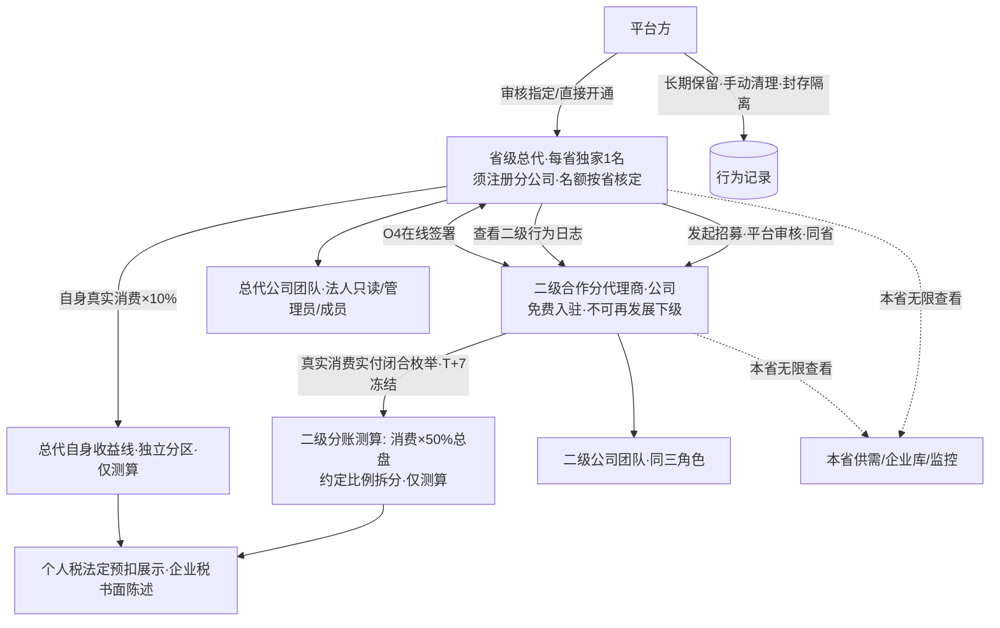
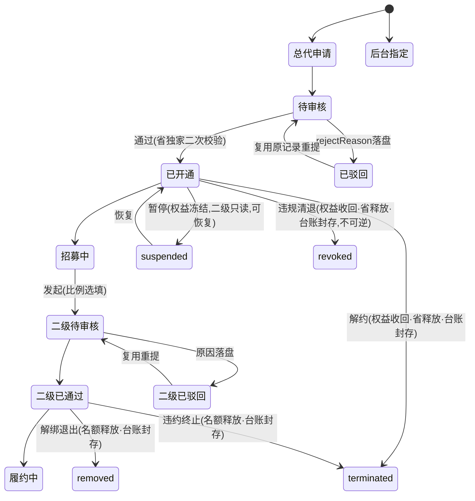

# 省级总代体系迭代执行文档（v0.5 · 现行法税规修订版 · 待审批）

> 状态：**草案，未经用户书面同意，不得改动任何代码/配置/文案**；本文只做文档规划，不动 demo 代码。
> 版本关系：在 v0.4《全功能开放版》基础上，按 v0.5 已拍板口径修订——O1 命名固定/徽章交 UI、O3 行为记录长期保留+手动清理、兼任允许叠加、税务按 2026 现行法重写（个人法定值/企业书面陈述/删除 1% 占位）、新增两层公司团队管理（OrgsStore 三角色）。**v0.2/v0.3/v0.4 文件保留未改**；v0.4 的 32 条任务骨架全部保留并升级，新增任务接续编号。
> v0.5 核心变化：新增 **D29（O1 命名固定+徽章交 UI 设计）**、**D30（O3 长期保留+手动清理+封存隔离）**、**D31（兼任允许叠加·已定稿）**、**D32（税务按现行法重写：个人法定/企业书面/删 1%）**、**D33（两层公司团队管理与三角色）**；新增回归 R-15~R-18；文末附「v0.5 更新项一致性审计表」。
> 税务边界：个人税为**法定规则引用**（仍标「模拟测算，非税务意见，非实际代扣金额」）；企业税为**书面税目陈述、demo 不实算**；不开票、不申报、不实名、不出完税凭证。
> 审批方式：用户批注或回复「同意/按此执行」后才进入 M1；任一决策被修改需回到对应轮次重新确认。

---

## 0. 一页结论

- **替换什么**：旧「企业合伙人」（入驻类型 `partner`、full 完整二级分销、团队管理、¥0 审核入驻、种子 u8）整体下线，替换为**省级总代（省代）→ 二级合作分代理商**两层代理体系。u9=个人合伙人、u10=平台运营、u7=游客不动；新演示账号 u11（四川总代）/u12（成都二级）。
- **不替换什么**：个人合伙人（8%/2% 返佣比例、¥50 门槛、T+1 结算、审核队列、申请页）原样保留，**仅叠加税算列**；建筑/中介现有邀请返佣与佣金提现保留；平台 Phase 0「不经手交易资金、不对测算收益付款」原则不变。
- **商业模式（v0.5）**：每省独家 1 名总代；名额=max(10,本省地级市数)；二级真实消费实付×50% 总盘、0–50% 拆分（仅测算）；T+7 冻结；台账两分区（二级分账/自身收益 10%）；**个人税按 2026 现行法（劳务报酬法定预扣率表二；经营所得五级法定表+附征率留空），企业税仅书面陈述不实算**；本省无限查看；终止态闭环；O4 在线签署；自身余额提现开放（佣金/测算收益仍不可提）；打印+CSV；**两层公司各自团队管理（法人只读/管理员操作/成员日常运营）**；**身份允许叠加、各收益线独立、权限并集**。
- **交付**：M1–M4 四阶段、**39 条任务**；每条带【责任 Agent】【所需 Skills】【部署与执行要求】【验收方式（成功/边界/回归）】。

---

## 1. 迭代背景与目标

### 1.1 背景（事实修正保留）

| 线 | 现有实现（源码已核实） | v0.5 处理 |
|---|---|---|
| 企业合伙人（`partner`） | `entry.html` 三选一；`entryTypes.partner` ¥0 人工审核；`distTier=full` 一级12%/3%；有团队；监控200；5折；种子 **u8（周航，databus.js:150/1914）** | 整体下线替换 |
| 个人合伙人（`isIndividualPartner`） | `auth-partner.html` 独立申请；8%/2% **返佣比例非税率**；无团队；¥50 起提；种子 u9（孙小美） | 保留；仅叠加税算列（D25/D32） |

旧企业合伙人走「海报邀请绑定→Rebate 返佣→冻结结算进钱包→可提现」线上资金闭环，与新体系「平台不对测算收益付款、仅测算台账」根本冲突，故独立建模，不在旧引擎打补丁。

### 1.2 迭代目标
1. 两层代理替代企业合伙人，规则见第 3 章。
2. 个人合伙人/建筑中介返佣零误伤（规则、费率、门槛、结算、队列不变，仅叠加税算列）。
3. 平台不对测算收益付款、不垫付、不产生佣金提现；自身经营余额走现有 wallet/withdraw 规则。
4. 省独家、同省、名额按省核定、平台审核四道约束可校验可拦截。
5. v0.5：税按现行法定规则引用、企业税书面不实算、团队三角色落地、兼任并集、行为记录长期保留。

### 1.3 非目标（仅保留真正不做的）
- 不做真实后端/服务端结算、生产级 RBAC/审计；demo 为 localStorage Mock，前端可绕过处生产由服务端二次校验。
- **税不做申报/扣缴/开票/完税凭证/实名认证**：个人税仅按法定规则展示预扣环节，企业税仅书面陈述；所有税数字标「模拟测算，非税务意见，非实际代扣金额」。
- 不做二级再发展下级（严格两层、一省）；不改造个人合伙人规则与建筑中介返佣。
- 不改造 franchise 资质加盟（线上加盟费 ¥29,800）；franchise 付费 ≠ 代理线上零付费，文案区隔。
- 不做移动端独立适配/打印 PDF 版式；不做短信/Push/邮件触达；不做列表搜索筛选分页；不做总代转让/继承/主体过户、多省授权、跨省招募、跨级发展。
- 生产侧线下合同金额/发票链条/扣缴义务人认定不在 demo 落地（§3.8、第 10 章）。

---

## 2. 决策记录（D1–D28 承 v0.4；新增 D29–D33）

| 编号 | 决策点 | 结论 | 备注 |
|---|---|---|---|
| D1 | 替换范围 | 只替换企业合伙人；个人合伙人保留 | 规则费率不变，仅叠加税算列 |
| D2 | 总代产生方式 | 双轨：表单申请审核 / 后台直接指定 | 不变 |
| D3 | 分公司主体 | 总代须注册平台方分公司并核验，成本自担，demo 不展示金额 | 不变 |
| D4 | 省级独家 | 每省仅 1 名；仅 approved 占位；双轨二次校验、冲突回滚；terminated/revoked 后省释放可重授 | §3.9 |
| D5 | 二级主体 | 合法工商公司即可，不要求分公司 | 不变 |
| D6 | 二级地区 | 必须与总代同省（省内可跨市），跨省禁止 | 不变 |
| D7 | 名额上限 | max(10,本省地级市数)，平台核定、总代不可自定；计数含全部状态；**只数签约二级公司，不数公司内团队成员**（D33） | §5.5 |
| D8 | 二级唯一绑定 | 一公司绑一总代；uscc 归一化去重；rejected 不占；removed/terminated 释放绑定 | 不变 |
| D9 | 50% 测算基数 | 二级真实消费实付（闭合枚举）×50%=总盘；充值/免费积分/规费/退款不计 | §3.3 |
| D10 | 比例录入 | 发起选填、通过后补录修改留痕；台账拆二级约定所得/总代自留，仅测算 | 不变 |
| D11 | 资金口径 | 佣金/测算收益不可提现、不进 BalanceStore；自身经营余额可提现（走 wallet/withdraw）；旧返佣佣金提现对新身份关闭 | 不变 |
| D12 | 台账与退款 | T+7 冻结；冻结剔除/出冻结红字冲减/特殊退款 clawbackRef 等额冲减；打印+CSV 都实现；财务字段齐套 | 不变 |
| D13 | 本省无限查看 | 授权省免解锁/企业库全量/监控无限；跨省普通；归一化、默认拒绝、不 mark | 不变 |
| D14 | 行为记录 | 平台全量留存（**v0.5 D30 长期保留**）；总代看名下二级全量；本人亦留痕；身份失效即时收回权益 | v0.5 修订 |
| D15 | 审核流 | 复用 EntryReview 队列；admin 不落盘需双端桥接（A/B/C，§5.3）；终止态操作同走桥接 | 不变 |
| D16 | 二级自身能力 | 普通企业全能力（发布/接单/订单/自身充值消费/余额提现），不可发展下级 | 不变 |
| D17 | 二级标识 | 标签「二级合作分代理商」，资料页（含他方查看）可见归属总代/授权省/签署状态 | 不变 |
| D18 | 旧入口处置 | 旧 partner 全下线；定点清除 u8，不按标签批量删（保 u10/u9/u7） | 不变 |
| D19 | 保留项 | 个人合伙人全链路；base/limited 返佣/钱包/提现；franchise；Phase 0 资金原则 | 个人合伙人仅叠加税算列 |
| D20 | 总代申请资料 | 复用表单加类型：分公司执照/意向省/公司资料 | 不变 |
| D21 | 比例上限 | 约定分给二级 0–50%；0%=全自留；倒挂防御；超界拦截不留存 | 不变 |
| D22 | 总代缴费 | 线下执行、线上 ¥0、无付费入口不展示金额 | 不变 |
| D23 | 总代经营能力 | 普通经营（发布/接单/订单/自身充值消费/余额提现），不含旧邀请返佣 | 不变 |
| D24 | 演示账号 | u11（四川总代 n/21）/u12（成都二级，约定20%）；u9/u10/u7 不动；清除定点 u8 | 补团队/兼任/清理种子 |
| D25 | 税算接入 | 新体系台账+个人合伙人提现都接税算；个人合伙人规则不变仅叠加列；R-01~R-10 保留补复算 | v0.5 由 D32 按现行法重写 |
| D26 | 自身收益线 | 单列分区不混算；自身真实消费×demo 默认10%；两线各自冲减；仅测算 | 不变 |
| D27 | demo 默认值 | 占位转默认值+设定逻辑+可调整条件+复核责任人（§2.3）；v0.5 税项行被 D32 法定值替换 | 部分被 D32 更新 |
| D28 | 全功能开放 | 终止态闭环/O4 签署/余额开放/打印CSV/税算链路转正式 | 不变 |
| **D29** | **O1 命名固定 + 徽章交 UI** | 对外名称固定「**省级总代（省代）**」「**二级合作分代理商**」；徽章配色/层级视觉交 UI 设计师 agent 出方案（不沿用个人合伙人紫色）；约束：与现有五档身份徽章可区分、打印不依赖彩色（灰度可辨）；任务含五档现有徽章清单作设计输入与验收标准 | v0.5 新增 |
| **D30** | **O3 行为记录长期保留** | 替代 v0.4「全量/保留期占位」：默认长期保留、不清；后台提供「按自定义时间范围手动清理」入口，默认不触发；清理动作留操作日志（操作人/时间/范围/条数）；**封存台账（§3.9 terminated/revoked/removed）不可被清理，与行为记录清理隔离** | v0.5 新增 |
| **D31** | **兼任允许叠加（已定稿）** | 资格位并存、各收益线独立结算互不混算、权限取并集、身份卡并列。**定稿边界**：①自然人可持个人合伙人身份同时在某代理公司任 admin/member，但**自然人不能登记为总代/二级主体**（新体系主体法定为公司，总代/二级申请需公司主体，自然人身份位不开放该申请；可任职≠可登记为主体）；②一公司**不可同时为总代+二级**（省独家/唯一绑定/自指互斥拦截），可叠加普通建筑/中介入驻类型、经营能力保留；③franchise（付费加盟 ¥29,800）与代理允许同主体并存，两线独立结算、文案区隔；**franchise 付费不抵代理线「线上零付费」——零付费仅指代理线本身，不否定 franchise 自身付费**；④并集只放既有资格位，不新增公司主体资格 | v0.5 新增，本轮定稿 |
| **D32** | **税务按现行法重写** | 个人（自然人）：方案A 劳务报酬用 61 号公告第八条+预扣率表二**法定真实值**，补注预扣率非最终税负、年度并入综合所得 3%–45% 汇算多退少补；方案B **删除 levyRate=1% 占位**，改法定五级超额表（5%–35%）；**核定附征率定稿为 `deemedLevyRate=null`：不填、不设默认值、禁止默认1%，生产前由公司注册地主管税务机关按行业核定**；补 2025 年第16号公告口径。**生产所得定性三要件判定顺序（定稿）**：①是否办理市场主体登记 ②是否持续经营 ③是否存在雇佣关系→据此定劳务报酬/经营所得；公司主体走企业税书面陈述。企业（总代/二级公司，平台不付款仅测算）：税目书面陈述不实算（增值税经纪代理6%/小规模3%减按1%、企业所得税25%/小微实际5%、附加税费）；个人/企业分两张表不套用；每条附法规名/公告号/现行有效/来源 URL | v0.5 新增（替换 v0.4 税模拟口径） |
| **D33** | **两层公司团队管理** | 复用 OrgsStore（js/orgs.js）；三角色：法定代表人只读/管理员操作/成员日常运营；owner 全权拆为 legalRep 只读 + 主管理员 admin/canManage；邀请/加入/移除/移交/认领保留并补边界；数据归企业；成员不计名额 | v0.5 新增 |

### 2.1 定稿与生产补全说明（第 10 章仅列外部生产补全）
D31 叠加边界、D32 附征率 null、所得定性判定顺序、线下合同/发票/扣缴边界、省表 countRule、O1 徽章约束均已定稿（见各节）；第 10 章仅列不阻塞 demo 的外部生产补全项（生产真实税率复核、线下合同律师/税务、省表全量落数），不再作为待用户拍板项。

### 2.3 D27 默认值清单（v0.5 更新：税行由 D32 法定值替换，其余保留）

| 项 | v0.5 取值 | 设定逻辑/性质 | 可调整条件 | 复核责任人 |
|---|---|---|---|---|
| 税方案 | 默认 A 劳务报酬；B 经营所得仅结构对比可切换 | 法定规则引用（非模拟） | `withholdingTax.activeScheme`；财务/税务可改 | 财务/税务 |
| A 减除费用 | ≤4000 减 800；>4000 减 20% | **法定固定值**（61号公告第八条） | `labor.deduction` | 财务/税务 |
| A 预扣率表二 | ≤20000 20%/0；20000–50000 30%/2000；>50000 40%/7000 | **法定固定值**（预扣率，非最终税负） | `labor.brackets[]` | 财务/税务 |
| B 经营所得 | 法定五级表 5%/10%/20%/30%/35%；附征率 `deemedLevyRate=null`（定稿：不填/不设默认/禁1%） | 法定五级表；附征率地方口径无全国统一值，**禁止默认1%**，生产前注册地主管局按行业核定 | `business.statutoryBrackets` | 财务/税务 |
| 冻结期 T+N | T+7（7 自然日） | demo 演示窗口 | `agentLedger.frozenDays`；产品+财务 | 产品+财务 |
| 自身收益比例 | 10%（自身 settled 消费×10%） | demo 默认，独立分区 | `agentLedger.selfRate`；管理评审 | 管理评审 |
| 消费闭合枚举 | 计入：订单实付净额/解锁实付/增值实付；不计入：充值/免费积分/规费/退款笔 | 白名单防刷 | `eligibleTypes/excludedTypes`；产品 | 产品 |
| 台账下载 | 打印视图+CSV 都实现 | 评审版式+原始数据 | `export{print,csv}`；产品 | 产品 |
| 省计数规则 | 直辖市按1；自治州/地区/盟同级；<10保底10；四川21示例 | demo 默认，生产补真实计数 | `provinceAgentQuota.countRule`；平台规则 | 平台规则 |
| 行为记录 | 长期保留，默认不清；手动按范围清理，封存隔离（D30） | 合规留痕 | 后台清理入口；平台/合规 | 合规 |
| 税数字标注 | 「模拟测算，非税务意见，非实际代扣金额」 | 免责固定文案 | 固定文案，产品维护 | 合规 |

---

## 3. 新商业模式定义

### 3.1 角色关系

### 3.2 角色权益矩阵（v0.5：兼任并集、团队三角色、余额开放）

| 能力 | 省级总代（公司） | 二级合作分代理商（公司） | 说明 |
|---|---|---|---|
| 主体要求 | 企业+平台方分公司 | 合法工商公司 | D3/D5 |
| 入驻费用 | 线上 ¥0；费用线下另行执行（D22） | ¥0，总代发起 | 无付费入口 |
| 区域 | 绑定唯一省（独家） | 必须同省 | D4/D6 |
| 下级名额 | max(10,本省地级市数)，**只数签约二级公司，不数公司内成员** | 不可发展下级 | D7/D33 |
| 本省无限查看 | ✅ | ✅ | D13 |
| 普通经营（发布/接单/订单） | ✅（不含返佣） | ✅ | D16/D23 |
| 钱包充值/余额消费 | ✅ | ✅ | — |
| 自身余额提现（wallet） | ✅ 走现有规则门槛 | ✅ 走现有规则门槛 | D11 |
| 佣金/测算收益提现 | ❌ 不进 BalanceStore | ❌ | D11 |
| 旧邀请返佣中心/团队/海报 | ❌ legacyDistributor=false | ❌ | 旧线关闭 |
| 测算台账 | 两分区、逐笔、拆分、冲减、税列、打印+CSV | 仅本人约定所得（不见自留/自身收益区） | D9/D26 |
| 比例录入 | 管理员可录入/修改（留痕） | 不可改 | D10/D33 |
| O4 协议 | 管理员发起签署 | 待签/已签/已拒签 | §3.11 |
| 团队管理 | 法人只读/管理员操作/成员日常（§3.12） | 同三角色 | D33 |
| 行为记录 | 看名下二级全量；本人亦留痕 | 不看他人；长期保留 D30 | D14/D30 |
| 叠加身份（D31，已定稿） | 可与个人合伙人/其他类型/franchise 并存，各线独立；自然人可任职不可登记主体、公司不可总代+二级 | 同左 | §3.10 |
| 积分折扣 | 默认回落 1.0 | 同左 | 不沿用0.5折 |

### 3.3 分佣测算规则（D9/D10/D12/D21/D26，仅测算）
1. **计入总盘消费（闭合枚举）**：①订单成交实付净额；②积分解锁实付；③增值服务实付。
2. **不计入**：钱包充值、免费积分面值、入驻/认证等平台规费、退款/冲减笔。充值与消费只计一次，消费按实付只计一次。
3. **T+7 冻结期（`frozenDays=7` 自然日）**：消费先入 `frozen`，满 7 日无退款转 `settled`；冻结期退款直接剔除。
4. **总盘**：二级 settled 真实消费实付合计 ×50%。
5. **拆分**：二级约定所得=总盘×约定比例（0–50%）；总代自留=总盘−约定所得；0%=全自留。
6. **退款三层**：①冻结期退款剔除；②出冻结正常退款先冲当月红字、不足转次月、部分按比例、无后续挂账；③后台特殊退款 `clawbackRef` 等额冲减。两线独立冲减不交叉。
7. **自身收益线（D26，10%）**：总代自身 settled 消费×10%，独立分区。
8. **资金隔离**：测算数字只在代理台账，不写 BalanceStore、不可提现；自身余额提现仅指 BalanceStore 自有经营余额。
9. **比例约束**：0–50%，超界拦截不留存，倒挂防御。

### 3.4 审核流与终止态状态机（D15/D28，同 v0.4）

**校验纯函数（提交/后台通过两处调用）**：省独家（仅 approved、二次校验、冲突回滚）、同省归一、uscc 唯一绑定、名额（读省表 quotaCap，含全部状态，**只数签约公司不数成员**）、自指、一人一省；终止态释放后省/名额可重占。

### 3.5 本省无限查看（D13）
公共 `isProvinceFreeUnlock(rec)`；detail.js 主锁 + company/index.html 独立 PW 双锁；归一化、默认拒绝、同省放行、不 mark、排除 trade 保证金；MonitorStore `_limitForIdentity`+follow 守卫加本省无限分支，候选先按授权省过滤；身份失效即时收回。

### 3.6 总代自身收益模型（D26，10%）
基数=自身 settled 真实消费实付（同闭合枚举）；比例 `selfRate=0.10` 可配置；两分区独立不合并/不互补贴；仅测算不付款不进 BalanceStore；自身线退款冲自身线；与旧 base 12%/3% 返佣是两套数字。

### 3.7 税务规则（D32，个人/企业分两张表，不得套用同一张）

> 免责：本页所有税为按法定规则的**模拟展示**，非税务意见、非实际代扣金额、非完税凭证；demo 不申报、不扣缴、不开票、不实名。生产前所得定性/征收方式/税率由财务税务专业复核。

#### 3.7.A 个人主体（自然人：个人合伙人 8%/2% 返佣；新体系若由自然人取得）——按次预扣展示

**所得性质（生产前三要件判定顺序，定稿）**：按 ①是否办理市场主体登记 → ②是否持续经营 → ③是否存在雇佣关系 依次判定：未登记、非持续经营、无雇佣关系的推荐/介绍返佣按**劳务报酬所得**（《个人所得税法实施条例》国务院令第707号第六条第（二）项，劳务报酬含介绍/经纪/代办服务）；办理个体工商户/个独登记并持续经营才落入经营所得。2025年第16号公告官方解读将平台「经纪、代理、推广」服务所得列入劳务报酬，未登记的销售货物/运输为经营所得。demo 默认按方案A 劳务报酬预扣展示，生产定性以主管税务机关认定为准。

**方案A 劳务报酬预扣预缴（法定固定值，默认启用）**
- 法律依据：《个人所得税法》（2018第七次修正，现行有效）第二条/第十一条；《个人所得税扣缴申报管理办法（试行）》国家税务总局公告2018年第61号第八条（现行有效）；配套2018年第56号公告附件2预扣率表二。
- 减除费用（61号公告第八条）：每次收入 ≤4000 减 **800**；>4000 减 **20%**。
- **个人所得税预扣率表二（居民个人劳务报酬预扣预缴，法定固定值）**：

| 级数 | 预扣预缴应纳税所得额（收入−减除费用） | 预扣率 | 速算扣除数(元) |
|---|---|---|---|
| 1 | 不超过 20,000 | 20% | 0 |
| 2 | 超过 20,000 至 50,000 | 30% | 2,000 |
| 3 | 超过 50,000 | 40% | 7,000 |

- 公式：预扣预缴应纳税所得额=每次收入−减除费用；预扣税额=max(0, 应纳税所得额×预扣率−速算扣除数)；税后(预扣口径)=收入−预扣税额。
- **关键补注（防误导）**：20%/30%/40% 是**预扣预缴率，不是最终税负**；年度并入综合所得适用 3%–45% 七级超额累进汇算，多退少补（个税法第十一条；61号公告第八条末款）。demo 只展示预扣环节，不得称「最终应纳税额」。
- 按次/按月（61号公告第十一条、实施条例第十四条）：一次性收入以取得为一次；同一项目连续性收入以一个月内为一次。

**法定复算示例（供对账，非税务意见）**：

| 税前收入 | 减除 | 应纳税所得 | 适用档 | 预扣税额 | 税后(预扣口径) |
|---|---|---|---|---|---|
| 1,000 | 800 | 200 | 20%/0 | 40 | 960 |
| 8,000 | 1,600(20%) | 6,400 | 20%/0 | 1,280 | 6,720 |
| 30,000 | 6,000 | 24,000 | 30%/2,000 | 5,200 | 24,800 |
| 60,000 | 12,000 | 48,000 | 30%/2,000 | 12,400 | 47,600 |

**方案B 经营所得（备用结构对比，删除 v0.4 的 1% 占位）**
- 法定五级超额累进（个税法税率表二，按年，需成本费用损失，非按笔附征）：

| 级数 | 全年应纳税所得额 | 税率 | 速算扣除数(元) |
|---|---|---|---|
| 1 | ≤30,000 | 5% | 0 |
| 2 | 30,000–90,000 | 10% | 1,500 |
| 3 | 90,000–300,000 | 20% | 10,500 |
| 4 | 300,000–500,000 | 30% | 40,500 |
| 5 | >500,000 | 35% | 65,500 |

- **核定附征率（定稿）**：无全国统一法定值，demo 维持 `deemedLevyRate=null` 不填、不设默认值、**禁止默认 1% 写成规则**；生产前由公司注册地主管税务机关按行业核定。权益性投资个独/合伙一律查账征收（财政部税务总局2021年第41号公告）。
- demo 处理：方案B 仅展示法定五级表结构，`deemedLevyRate=null` 时**仅展示五级表、不产税额**，不与方案A 矛盾。
- **需向主管局确认清单（生产补全，非待用户拍板）**：①所属行业与税目归类；②征收方式（查账/核定）；③地方附征率区间（省/市口径，无全国统一值）。

**2025年第16号公告替代口径（注明不实现）**：合规互联网平台对从业人员劳务报酬可选用累计预扣法（3%–45%、按月扣5000减除），与按次三级预扣并列；demo 不实现该方法，仅在说明页注明存在。

**个人合伙人零误伤**：8%/2% 返佣费率、¥50 门槛、T+1 结算、提现审核状态机、申请页、审核队列全部不动；8%/2% 是返佣比例不是税率；税算为新增独立并列列，不改原 fee/到账金额、不冲减可提现余额。仅改 `pages/distribution/withdraw.html`，`wallet/withdraw.html` 不动。

#### 3.7.B 企业主体（总代公司/二级公司；平台不付款、仅台账测算）——书面税目陈述，demo 不实算

| 税种 | 书面规则（现行有效） | 依据 | demo 处理 |
|---|---|---|---|
| 增值税·一般纳税人 | 分销/代理/经纪归入「现代服务—商务辅助—经纪代理服务」，税率 **6%** | 《增值税法》2026-01-01施行第十条（三）；财税〔2016〕36号附件1税目注释 | 仅展示，不计算 |
| 增值税·小规模 | 征收率3%（增值税法第十一条）；2026-01-01至2027-12-31 **3%减按1%**；月10万/季30万以下免征；按次起征点1000元 | 财政部税务总局2026年第10号公告；税务总局2026年第4号公告 | 仅展示，不计算 |
| 企业所得税 | 基本税率 **25%**（企业所得税法第四条） | 《企业所得税法》现行有效 | 仅展示，不计算 |
| 小型微利优惠 | 减按25%计应纳税所得额×20%，**实际税负5%**（至2027-12-31；条件：所得≤300万/从业≤300人/资产≤5000万） | 财政部税务总局2023年第12号公告第三条/第五条 | 仅展示，不计算 |
| 附加税费 | 城建税市区7%/县城镇5%/其他1%（城建税法第四条）；教育费附加3%（国务院令448号）；地方教育附加2%（财综〔2010〕98号）；小规模/小微/个体户六税两费减半（至2027-12-31） | 城建税法；2023年第12号公告第二条 | 仅展示，不计算 |

**扣缴边界（D32）**：个税法第九条——以支付所得方为扣缴义务人；平台**仅在实际向自然人支付劳务报酬返佣时**承担个税预扣预缴义务（61号公告第二条全员全额扣缴）；**企业主体之间**的代理/分销收入由企业自行申报增值税与企业所得税，境内付款方对境内企业不负企业所得税扣缴义务（源泉扣缴仅针对非居民，企业所得税法第三十七条），境内交易也不代扣增值税（增值税法第十五条仅境外主体）。demo 平台不经手企业收益、不付款，故对企业主体无代扣义务，台账数字仅内部测算。

**来源 URL（现行有效，2026-10-22 核实）**：
- 个人所得税法：npc.gov.cn/c2/c30834/201905/t20190521_281591.html ；fgk.chinatax.gov.cn/zcfgk/c100009/c5193028/content.html
- 实施条例（707号）：fgk.chinatax.gov.cn/zcfgk/c100010/c5194444/content.html
- 61号公告：chinatax.gov.cn/chinatax/n810341/n810765/n3359382/201812/c4182700/content.html
- 56号公告/预扣率表二：fgk.chinatax.gov.cn/zcfgk/c100015/c5200946/content.html
- 2025年第16号公告：fgk.chinatax.gov.cn/zcfgk/c100012/c5241472/content.html ；官方解读 fgk.chinatax.gov.cn/zcfgk/c100015/c5241475/content.html
- 2021年第41号公告：mof.gov.cn/jrttts/202112/t20211231_3780298.htm
- 增值税法：gov.cn/yaowen/liebiao/202412/content_6994557.htm
- 2026年第10号公告：mof.gov.cn/jrttts/202602/t20260203_3983175.htm ；政策法规库 fgk.chinatax.gov.cn/zcfgk/c102416/c5247434/content.html
- 2026年第4号公告：fgk.chinatax.gov.cn/zcfgk/c100012/c5247426/content.html
- 企业所得税法：npc.gov.cn/npc/c2/c30834/201905/t20190521_296654.html
- 2023年第12号公告：fgk.chinatax.gov.cn/zcfgk/c102416/c5210453/content.html
- 城建税法：m.mof.gov.cn/czxw/202008/t20200812_3566258.htm ；教育费附加：gov.cn/gongbao/content/2005/content_91662.htm
- 禁止传销条例（444号）：gov.cn/gongbao/content/2005/content_80604.htm

### 3.8 合规定位抗辩（书面陈述；生产线下事项需专业）
两层封顶、总代本人直招、代理线上零付费、报酬挂钩二级自身真实消费而非发展人数（规避《禁止传销条例》444号第七条拉人头/入门费/团队计酬）、平台不经手测算收益、不承诺固定收益、全程留痕。

**线下合同/发票/扣缴义务人（定稿，demo 不落地，生产必备，律师/税务负责）**：
1. **费用合同**：平台与总代公司签费用合同（主体/金额/退费/违约/交付/解除/保密/争议条款），demo 不落地。
2. **发票链条**：平台收取总代费用→向公司开具服务费发票；**测算收益平台不付款，故不开票**。
3. **扣缴义务人边界**：仅限「平台实际向自然人支付劳务报酬」时平台为个税扣缴义务人；企业间收入由企业自行申报，平台不代扣。

### 3.9 终止态闭环（D28，正式）
总代 `active/suspended/terminated/revoked`；二级 `approved/removed/terminated`。后台经桥接执行解约/独家收回/暂停恢复/二级解绑/违规清退，留痕 `{operator,at,reason,from,to}`；即时收回权益位；terminated/revoked 释放省、removed/terminated 释放名额与绑定；**封存只读**（sealedAt，不可改不可删）；terminated/revoked 不可逆无恢复入口。**封存台账不参与 D30 行为记录清理。**

### 3.10 身份叠加规则（D31，允许叠加，已定稿）
1. **资格位并存**：entryAccess 各资格位为独立布尔，叠加不互相关闭；并集只放既有资格位，不新增公司主体资格。
2. **各收益线独立结算不混算**：个人合伙人 8%/2% 返佣线、新体系两分区测算线、旧 base/limited 返佣线、franchise 线各算各的，不互抵、不合并。
3. **权限取并集**：页面门控=任一资格位命中即放行对应入口；叠加后个人合伙人仍可进其返佣中心/提现，新身份工作台独立，互不替代。
4. **身份卡并列展示**：各叠加身份徽标并列呈现，不合并为单一身份；各线收益在各自页面查看。
5. **资金口径不变**：新体系佣金/测算收益仍不可提；个人合伙人提现线按原规则，税列仅展示不改到账。
6. **主体边界（定稿）**：
   - **自然人**：可持个人合伙人身份，同时在某代理公司任 admin/member（可任职）；**自然人不能登记为总代/二级主体**——新体系主体法定为公司，总代/二级申请需公司主体，自然人身份位不开放该申请（可任职≠可登记为主体）。
   - **企业**：一公司**不可同时为总代+二级**（省独家/唯一绑定/自指互斥已有拦截）；可叠加普通建筑/中介入驻类型，经营能力保留。
   - **franchise（付费加盟 ¥29,800）**：与代理允许同主体并存，两线独立结算、文案区隔；**franchise 付费不抵代理线「线上零付费」，零付费仅指代理线本身，不否定 franchise 自身付费**。

### 3.11 O4 二级《合作协议》在线签署闭环（D28，复用 esign）
复用 `pages/esign/`、EsignStore（`engchain-esign`）、状态机 `draft/pending_mine/signing/completed/rejected/expired/withdrawn/voided`、签署方 signed/rejected、evidence、h5-sign。新增 `t-subagent` 模板（coop 类）：发起→待签署→已完成/已拒签；留痕 version/code/sentAt/completedAt/双方签署人/存证；写回 `sub-agents[].signature{contractId,code,version,status,signedAt,signers}`；资料页（含他方查看）展示；拒签带 rejectReason。八条必备条款：①同省授权与独家边界；②名额与唯一绑定；③比例线下约定、平台不付款；④两层封顶不得再发展；⑤行为合规；⑥退出/解绑/违约（衔接§3.9）；⑦保密与企业库数据限制；⑧终止后权益收回。

### 3.12 两层公司团队管理（D33，复用 OrgsStore）

**复用资产（已核实 js/orgs.js）**：三档 owner/admin/member；`canManage(orgId)=owner||admin`（orgs.js:395-399）；`myRole`(:400-404)；邀请 invites、加入申请 joins、移除 removeMember(:408，现仅 owner)、角色变更 patch.role(:622)、企业主移交 transfer verify-pending/owner-confirm(:696-712)、owner 认领 ownerClaims(:91)；成员关系「只是任职，绝不回写个人资质」(orgs.js:22)。旧 `pages/distribution/team.html`（海报邀伙伴返佣树）随旧返佣线下线，**不复用**。

**新体系三角色权限矩阵**：

| 操作 | 法定代表人 legalRep（只读） | 管理员 admin（canManage 操作） | 成员 member（日常运营） |
|---|---|---|---|
| 查看企业资料/成员列表/台账（只读） | ✅ 全部只读 | ✅ | ❌ 不见资金测算 |
| 发起二级/录改比例/看协议/解约解绑操作 | ❌ 不可操作 | ✅ | ❌ |
| 成员邀请/审批/移除/角色变更 | ❌ | ✅（扩展自 owner 仅管理员/主管理员） | ❌ |
| 发布/接单/订单日常运营 | —（非运营岗） | ✅ | ✅ |
| 台账/测算收益/比例/协议/资金 | 只读可见，不可改 | 可见可操作 | ❌ 不可见 |
| 企业主移交/认领 | 不夺权 | 按现有 transfer/ownerClaims 流程 | ❌ |

**owner→legalRep/admin 映射与迁移**：
- 现有 owner 全权拆为：`legalRep`（只读，对接执照法定代表人字段 `legalRep`，company/index.html:246 / orgEntity.legal）+ 主管理员（操作，对应 admin/canManage）。
- legalRep 是执照派生的只读展示位，**不进 canManage、不自动获得操作权**；legalRep 与 admin 可为不同自然人。
- 存量 owner 迁移：迁移期保留 canManage 向后兼容（不致现有企业失权）；新体系新建企业的操作角色落在 admin，legalRep 仅展示。
- 移交/认领规则保留（transfer verify-pending/owner-confirm、ownerClaims 审核），补边界：**内部移交只变更操作人，不改变企业代理身份归属、不影响已签协议/台账/省独家**。

**邀请/加入/移除流程**：成员经 company/index.html:148-183 `requestJoin` 提交 joins→管理员审批；管理员可邀请（invites）、审批加入、移除成员（removeMember 权限由仅 owner 扩为 canManage）、变更角色(patch.role)。成员离职移除后，其在企业下的发布/接单/订单资源**归属企业主体不删除**；成员个人账号的叠加身份（如个人合伙人）不受影响（orgs.js:22 任职不回写个人资质）。

**数据归属**：台账/协议/比例/收益线归企业主体（province-agents/sub-agents 记录），成员变更不携带、不清零企业数据。

**名额口径**：团队成员**不计入**省独家名额；名额只数签约二级公司记录（D7）。

---

## 4. 现状触点盘点（v0.5 新增落点并入）

### 4.1 App 端
| 触点 | v0.5 处置 |
|---|---|
| `pages/wallet/withdraw.html` | 自身余额提现对总代/二级开放，沿用现有门槛/手续费/审核状态机 |
| `pages/distribution/withdraw.html` | 佣金提现对新身份关闭；仅此处叠加个人合伙人法定税列 |
| `pages/esign/*` | 复用承载 O4；新增 t-subagent；签署回写 sub-agents |
| `js/orgs.js` / 企业成员管理页 | 复用承载团队三角色；legalRep 只读位、canManage 操作、成员日常；移除权限扩为 canManage |
| 其余 entry/profile/monitor/company/search/guide/help/all-functions/home | 同 v0.4（门控/清零/本省无限/叠加并集） |

### 4.2 数据/逻辑层
| 文件 | v0.5 落点 |
|---|---|
| `js/data.js` | provinceAgentQuota(countRule)、withholdingTax（个人法定 A/B + 企业书面税目块，非计算）、agentLedger(frozenDays/selfRate/枚举/export) |
| `js/domain.js` | full 三处摘除；legacyDistributor；individualPartner；叠加资格位并存不互关（D31） |
| `js/stores.js` | entryAccess 叠加只读；MonitorStore 本省无限；EsignStore 复用；BalanceStore 自身余额放开；OrgsStore 三角色适配 |
| `js/orgs.js` | canManage/removeMember 权限适配新三角色；legalRep 只读派生；迁移映射 |
| `js/detail.js` / `company/index.html` | isProvinceFreeUnlock 双锁；legalRep 展示；joins 审批入口 |
| `js/common.js` | 新键 KEY_TO_EVENT / 通用兜底 |
| `js/databus.js` | 播种/重置；u11/u12（含团队/兼任/清理种子）；u8 定点清除 |

### 4.3 后台（admin-vue）
EntryReview.vue 经桥接落盘+四道校验+rejectReason；终止态操作；**行为记录手动清理入口（按时间范围、操作日志、封存隔离）**；新视图避开 Agent.vue；旧分销三页核对无 full 残留；todo 同步。

---

## 5. 执行方案

### 5.1 新增存储（localStorage，纯 Mock）
| Key | 内容 |
|---|---|
| `engchain-province-agents` | `{uid, province, branchCompany{}, status, appointedAt, appointedBy, source, rejects[], statusLog[], provinceHistory[], sealedAt, orgId, legalRep, admins[]}` |
| `engchain-sub-agents` | `{id, parentUid, company{name,uscc,license,legalRep,contact}, province, ratioToSub, status, createdAt, reviewedAt, rejectReason, rejects[], ratioLog[], signature{}, statusLog[], sealedAt, orgId}` |
| `engchain-agent-ledger` | 逐笔 `{serialNo, month, line: subLedger/selfLedger, subject, type, grossAmount(税前), amount, orderId, at, frozenStatus, refundOf, clawbackRef, taxScheme, taxRate, taxAmount, netAmount, taxNo, balance}` + 两线月汇总缓存（版本号/失效重算）；**企业税目不进计算列** |
| `engchain-agent-behavior` | `{actor, action, target, targetId, province, companyName, sourcePage, idemKey, at, sealed}`；**清理日志 `engchain-behavior-cleanup-log[]{operator,at,rangeStart,rangeEnd,count}`** |

财务字段（齐套）：流水号/时间/主体/类型/金额/订单号/冻结状态/冲减记录/税项/余额/税前/代扣税率/代扣税额/税后实发/税单号。

### 5.2 新增 App 页面（`pages/province-agent/`）
1. 总代工作台：身份卡（授权省独家、n/quotaCap、状态徽标、叠加身份并列）、二级列表（签署/操作可见性）、发起二级、台账（两分区/税列/打印+CSV）、行为记录、**团队管理入口（按三角色显隐）**。
2. 发起二级表单：公司名/uscc/执照/法人/联系人/省份（默认带省，跨省拦截）/约定比例（0–50%选填）。
3. 二级视角页：身份卡（归属总代/省/签署/叠加身份）；仅本人约定所得；自身余额提现；**团队管理入口（按三角色显隐，仅本公司成员，不显示总代专属比例录入/O4协议发起/解约解绑）**。
4. 团队管理页（复用 OrgsStore 成员管理）：成员列表/邀请/审批/移除/角色变更，按 legalRep/admin/member 显隐。

### 5.3 双端桥接（D15）
方案A 共享种子导出 / B 统一 seed 工厂 / C 桥接模块直写共享 localStorage+事件；demo 建议 B/C；审核、终止态、行为清理同走。验收：后台动作→App 刷新可观察，失败回滚不落占位。

### 5.4 演示账号（D24 v0.5 补种子）
| 账号 | 角色 | 演示数据 |
|---|---|---|
| u11 | 四川独家总代 | n/21；两分区台账（自身10%）；充值不进基数；frozen/settled/特殊冲减；个人法定税列（方案A）；自身余额可提；已签/待签协议；1名管理员+1名成员团队示例；一条个人合伙人叠加示例（供R-15）；无佣金提现入口 |
| u12 | 二级（归属u11，成都，20%） | 本人约定所得；settled/冻结退款/冲减；税列；已签协议；自身余额可提；团队示例；无佣金入口 |

u9/u10/u7 不动；u8 定点清除；播种接入 DEMO_SCENARIOS/reset，硬刷新可复现。

### 5.5 省→地级市 Mock 表（D7，data.js provinceAgentQuota）
| provinceCode | provinceName | cityCount | quotaCap | countRule(demo默认) | remark |
|---|---|---|---|---|---|
| 510000(示例编码) | 四川省 | 21（演示示例） | max(10,21)=21 | 地级市同级计入 | demo示例，生产重新核定 |
| 其余省 | 配置块补录 | 按 cityCount 现算 | max(10,cityCount) | 直辖市按1；自治州/地区/盟同级；<10保底10 | 规则可调，生产补真实官方计数 |

省名与 editor.html:700 34 省清单对齐映射；核定留痕；总代无自定名额输入。

---

## 6. 执行路径与阶段验收（39 条；v0.4 的 32 条骨架保留升级，新增接续编号）

### M1 · 身份与数据层 —— 11 条（v0.4 8 条 + 新增 M1-9/M1-10/M1-11）

#### M1-1 新代理存储读写模块（四键+两分区+税项/冻结/冲减/终止/签署/团队/清理日志）
| 要素 | 内容 |
|---|---|
| 前置/触发 | 首个任务；初始化读写四键 |
| 系统行为 | 按 §5.1 schema CRUD；台账 line 分区/frozenStatus/refundOf/clawbackRef/税项/sealedAt；signature；statusLog；behavior-cleanup-log；月汇总版本化；企业税目不进计算 |
| 可观察结果 | 四键+清理日志字段齐全；缺键 try/catch 回退空表不报错；旧记录兼容 |
| 成功/边界 | 总代+二级+frozen/settled/冲减+签署+终止+团队+清理日志完整落盘；无键/旧记录不报错 |
| 回归项 | 既有 engchain-* 键不受影响 |
| 【责任 Agent】 | 系统迭代工程师（主责）、专家前端工程师 |
| 【所需 Skills】 | verifier-hub：四键/清理日志/字段校验；doubao-data-analysis：总盘/拆分/冲减/税项结构复算 |
| 【部署与执行要求】 | stores 新模块；禁止回写 entry.types/auth.partner/BalanceStore；配置走 data.js |
| 【验收方式】 | 冒烟读四键+日志断言字段；node --check；无页面改动 |

#### M1-2 entryAccess 叠加资格位 + legacyDistributor + 并集逻辑（F-24/F-01/D31）
| 要素 | 内容 |
|---|---|
| 前置/触发 | M1-1；登录/身份派生 |
| 系统行为 | 叠加 isProvinceAgent/isSubAgent/agentProvince/agentQuotaUsed/individualPartner 等独立布尔并存（D31 并集，不互关）；legacyDistributor 布尔位；终止态资格位失效 |
| 可观察结果 | 新身份 dist=false；叠加个人合伙人位仍 true；终止态权益位 false；u8/u9/u1/u2 深相等 |
| 成功/边界 | 叠加不关闭个人合伙人入口；终止即时收回；缺存储回退 |
| 回归项 | u8/u9/u1/u2 entryAccess 深相等（R-01/R-09）；注：u8 深相等基线仅 M1 时点有效，M4-4 定点清除 u8 后不再断言 u8 |
| 【责任 Agent】 | 专家前端工程师（主责）、系统迭代工程师 |
| 【所需 Skills】 | doubao-product-qa：旧身份深相等基线；verifier-hub：未回写 entry.types/auth.partner；doubao-product-manager：并集资格位规则评审 |
| 【部署与执行要求】 | stores.js entryAccess/deriveIdentity；禁止新身份入 entry.types/auth.partner；叠加位独立不互覆盖 |
| 【验收方式】 | 深相等断言；叠加并集断言（R-15）；终止态收回断言 |

#### M1-3 校验纯函数集（四道+自指/互斥+名额只数公司）
| 要素 | 内容 |
|---|---|
| 前置/触发 | M1-1、M1-4；提交/后台通过 |
| 系统行为 | 省独家、同省归一、uscc 唯一绑定、名额读省表含全部状态且**只数签约二级公司不数成员**、自指、一人一省；终止释放后可重占 |
| 可观察结果 | 各拦截返回错误码；名额读表不写死10、不含团队成员 |
| 成功/边界 | 合法通过；四川满21拦截；重复省/绑定/自指/一人多省拦截；成员数不计入；terminated 后可重授 |
| 回归项 | 旧建筑/中介入驻校验不变 |
| 【责任 Agent】 | 系统迭代工程师（主责） |
| 【所需 Skills】 | doubao-data-analysis：名额计数/max(10,cityCount)/成员不计入复算；verifier-hub：无写死10、无成员计数 |
| 【部署与执行要求】 | 独立纯函数两处复用；省表数值在配置块 |
| 【验收方式】 | 成功/边界逐断言；node --check；成员不计名额断言（R-16 配套） |

#### M1-4 省→地级市 Mock 表 + countRule（D7/D27）
| 要素 | 内容 |
|---|---|
| 前置/触发 | 名额校验、n/quotaCap 展示 |
| 系统行为 | provinceAgentQuota 独立块；countRule 直辖市1/自治州地区盟同级/<10保底10；省名与 editor.html:700 对齐；**港澳台本期不纳入**；生产前按民政部行政区划表一次性落全量 |
| 可观察结果 | 四川21/quotaCap21；其余省可算；港澳台无记录不参与计数 |
| 成功/边界 | 别名归一命中；无匹配回退配置补录；港澳台不返回名额 |
| 回归项 | data.js 既有配置不被深合并破坏 |
| 【责任 Agent】 | 系统迭代工程师（主责）、商业模式规划师 |
| 【所需 Skills】 | doubao-data-analysis：max(10,cityCount)/countRule 核验；verifier-hub：仅四川示例、其余为配置补录 |
| 【部署与执行要求】 | data.js MOCK.business 独立块；无总代自定名额 |
| 【验收方式】 | 四川=21；countRule 三例可算 |

#### M1-5 税算配置块（D32 法定值：个人A/B + 企业书面税目，删1%）
| 要素 | 内容 |
|---|---|
| 前置/触发 | 台账税列、个人合伙人提现税列、企业税说明页 |
| 系统行为 | `withholdingTax`：activeScheme=labor；labor 法定减除+预扣率表二（20/30/40%，0/2000/7000）；business 法定五级表（5/10/20/30/35%，0/1500/10500/40500/65500）+`deemedLevyRate=null`（定稿：不填/不设默认/禁1%）；企业税目块仅展示不计算；税算纯函数（应纳税所得/预扣税额/税后）；附生产所得定性三要件判定顺序（登记/持续经营/雇佣关系）配置说明 |
| 可观察结果 | A 法定四例复算一致；B 切换仅展示五级表、不输出1%税额；企业税目无数值计算；附征率 null 无默认值 |
| 成功/边界 | 负数税取0；deemedLevyRate=null 时B仅展示五级表不产税额；缺配置回退；企业税目不混进个人表 |
| 回归项 | 8%/2%、¥50、原 fee/到账不变（R-01~R-04） |
| 【责任 Agent】 | 商业模式规划师（口径/法条）、系统迭代工程师（配置/纯函数） |
| 【所需 Skills】 | doubao-data-analysis：法定四例独立复算；doubao-compliance-assessment-public：法定引用/不承诺税负/16号公告口径；verifier-hub：无 levyRate=0.01、无承诺最终税负 |
| 【部署与执行要求】 | data.js 独立块；纯函数独立可测；不改8%/2%；个人/企业分两块；全税数字带模拟标注 |
| 【验收方式】 | 法定四例对账；B无1%；企业税目不计算；个人合伙人原费率回归（R-18） |

#### M1-6 消费枚举闭合清单 + T+7 + 自身10% 配置（D9/D12/D26）
| 要素 | 内容 |
|---|---|
| 前置/触发 | 台账引擎读取 |
| 系统行为 | eligibleTypes/excludedTypes 白名单；frozenDays=7；selfRate=0.10 |
| 可观察结果 | 白名单可配；frozenDays/selfRate 可调 |
| 成功/边界 | 充值排除；冻结不计；自身10% |
| 回归项 | 旧返佣结算不漂移 |
| 【责任 Agent】 | 系统迭代工程师（主责）、商业模式规划师 |
| 【所需 Skills】 | doubao-data-analysis：白名单/冻结/自身比例复算；verifier-hub：枚举与 §3.3 一致 |
| 【部署与执行要求】 | data.js 配置块；充值/余额不入基数 |
| 【验收方式】 | 充值不进 ledger；frozen/settled 分流；自身10%复算 |

#### M1-7 终止态状态机骨架（D28）
| 要素 | 内容 |
|---|---|
| 前置/触发 | M1-1、M1-2；状态流转 |
| 系统行为 | 总代 active/suspended/terminated/revoked、二级 approved/removed/terminated；合法边校验；statusLog；sealedAt；权益位失效钩子 |
| 可观察结果 | 非法边被拒；合法转换落日志；封存标记置位 |
| 成功/边界 | suspended↔active；terminated/revoked 不可逆；removed/terminated 释放；封存只读 |
| 回归项 | 正常 approved/active 不受影响 |
| 【责任 Agent】 | 系统迭代工程师（主责）、产品经理 |
| 【所需 Skills】 | doubao-product-manager：状态边/验收；verifier-hub：状态枚举与§3.9一致；doubao-data-analysis：释放/封存复算 |
| 【部署与执行要求】 | 独立状态机；封存只标记不删；无 terminated/revoked 恢复入口 |
| 【验收方式】 | 合法/非法边断言；封存只读；释放可重占 |

#### M1-8 冒烟脚本载体 + 播种/重置（P-07，含团队/兼任/清理种子）
| 要素 | 内容 |
|---|---|
| 前置/触发 | M1-1~M1-7、M1-9~M1-11；阶段验收 |
| 系统行为 | scripts/smoke-m1.js；四键+清理日志播种/reset 骨架；含冻结/终止/签署/团队/叠加/清理种子结构 |
| 可观察结果 | 成功/边界/回归三类断言；硬刷新可复现 |
| 成功/边界 | M1 全绿；重置回种子 |
| 回归项 | 旧种子重置不受影响 |
| 【责任 Agent】 | QA回归工程师（主责）、系统迭代工程师 |
| 【所需 Skills】 | doubao-product-qa：基线用例/通过标准；verifier-hub：三类断言覆盖 |
| 【部署与执行要求】 | 脚本独立不进生产；断言写预期存储值/数字 |
| 【验收方式】 | 全绿；重置可复现；三表记录 |

#### M1-9 团队角色骨架 + owner→legalRep/admin 映射迁移（D33，新增）
| 要素 | 内容 |
|---|---|
| 前置/触发 | M1-1；OrgsStore 适配 |
| 系统行为 | 新三角色 legalRep(只读)/admin(canManage 操作)/member(日常)；存量 owner 迁移映射：迁移期保留 canManage 兼容，legalRep 从执照 legalRep 派生只读、不进 canManage；orgId 关联到 province-agents/sub-agents |
| 可观察结果 | legalRep 无操作位；admin 有 canManage；member 无资金位；存量 owner 不失权 |
| 成功/边界 | legalRep≠admin 不同自然人可行；迁移不改变企业代理归属；成员任职不回写个人资质 |
| 回归项 | 现有 OrgsStore 普通企业成员管理/移交/认领不破坏 |
| 【责任 Agent】 | 系统迭代工程师（主责）、专家前端工程师、产品经理（角色口径） |
| 【所需 Skills】 | doubao-product-manager：三角色权限/迁移映射验收；verifier-hub：legalRep 只读/canManage 字段落盘；doubao-data-analysis：权限位复算 |
| 【部署与执行要求】 | js/orgs.js 适配+迁移函数；不改普通企业既有邀请/移交/认领流程；legalRep 仅派生展示 |
| 【验收方式】 | 三角色权限位断言；owner 迁移兼容；移交不改企业归属（R-16） |

#### M1-10 行为记录长期保留 + 手动清理函数 + 封存隔离（D30，新增）
| 要素 | 内容 |
|---|---|
| 前置/触发 | M1-1；行为写入/后台清理 |
| 系统行为 | 默认长期保留不清；清理函数按自定义时间范围删除**非封存**行为记录；写清理日志{operator,at,rangeStart,rangeEnd,count}；sealed 封存台账记录不参与清理（隔离） |
| 可观察结果 | 默认无清理动作；清理后日志可见操作人/范围/条数；封存记录仍在 |
| 成功/边界 | 空范围/越界时间拦截；封存记录不可被清理；清理不误删台账 |
| 回归项 | 正常行为写入/查询不变 |
| 【责任 Agent】 | 系统迭代工程师（主责）、合规口径由商业模式规划师 |
| 【所需 Skills】 | doubao-compliance-assessment-public：留痕/清理合规；verifier-hub：清理日志字段/封存隔离断言；doubao-product-qa：清理边界回归 |
| 【部署与执行要求】 | behavior 存储+清理函数；封存标记 sealed 优先判断；禁止提供「一键清空全部」；后台视图落点：admin 行为记录页提供时间范围选择器（rangeStart/rangeEnd）+清理操作按钮+清理日志四要素（操作人/时间/范围/条数）展示区，清理动作与日志经 M2-2 双端桥接落盘（不单列新任务） |
| 【验收方式】 | 范围清理成功/空范围拦截/封存不可删/日志落盘（R-17） |

#### M1-11 兼任并集资格位骨架（D31，已定稿）
| 要素 | 内容 |
|---|---|
| 前置/触发 | M1-2；同一主体持多身份 |
| 系统行为 | 各资格位独立布尔并存；收益线标识（individualPartner/agentSubLedger/selfLedger/legacyRebate/franchise）独立；门控并集函数 `hasAny(flags)`；身份卡并列数组；**边界拦截：自然人身份位不开放总代/二级主体申请；一公司不可同时为总代+二级（省独家/唯一绑定/自指互斥）；franchise 与代理并存、付费独立** |
| 可观察结果 | 叠加时各 flag 同时为 true；收益线不混算；自然人无公司代理申请入口；总代公司不可再登记为二级 |
| 成功/边界 | 关闭新身份不清除个人合伙人位；任一 flag 命中放行对应既有入口；并集不新增公司主体资格；franchise 付费不冲抵代理线零付费 |
| 回归项 | 单身份行为不变；franchise 自身付费与代理线零付费互不混淆 |
| 【责任 Agent】 | 产品经理（主责，口径已定稿）、系统迭代工程师 |
| 【所需 Skills】 | doubao-product-manager：并集规则/用户故事；verifier-hub：资格位并存；doubao-data-analysis：各线独立复算；doubao-compliance-assessment-public：主体边界合规 |
| 【部署与执行要求】 | entryAccess 叠加层；禁止用单一身份覆盖；自然人主体申请位关闭；公司总代/二级互斥位；franchise 线独立标识 |
| 【验收方式】 | 叠加并集/各线独立/不互关/主体边界断言（R-15） |

### M2 · 申请与审核开通（桥接+终止操作）—— 7 条（保留 v0.4）

#### M2-1 总代表单新类型 + 字段差距表（D20/D22/D29）
| 要素 | 内容 |
|---|---|
| 前置/触发 | M1；企业选「省级总代（省代）」提交（命名按 D29 固定） |
| 系统行为 | 分公司执照/许可证/法人/意向省/公司资料；¥0 确认提交，无付费入口/金额 |
| 可观察结果 | 字段齐全；提交→待审核；无价格/支付按钮 |
| 成功/边界 | 缺执照/意向省拦截；fee 恒0 |
| 回归项 | 建筑/中介表单、个人合伙人申请页不动 |
| 【责任 Agent】 | 产品经理（主责）、专家前端工程师 |
| 【所需 Skills】 | doubao-product-manager：PRD/差距表/验收；html：表单；doubao-marketing-material-review：零付费文案扫描 |
| 【部署与执行要求】 | entry-form/entry.html；禁止付费入口；名称用 D29 固定文案 |
| 【验收方式】 | 走查提交；无价格；旧三类入驻回归 |

#### M2-2 双端审核桥接（S-02/F-03/P-02，阻断）
| 要素 | 内容 |
|---|---|
| 前置/触发 | M1-1/M1-3；评审拍板 A/B/C |
| 系统行为 | 打通 admin→App 落盘；四道校验；rejectReason 落盘；终止态/清理操作同走 |
| 可观察结果 | 后台通过→App 身份/省/名额可见；驳回原因可见；终止/清理→App 可观察 |
| 成功/边界 | 端到端；省冲突回滚不落占位；note 持久化 |
| 回归项 | 个人合伙人审核队列不受影响 |
| 【责任 Agent】 | 系统迭代工程师（主责）、专家前端工程师 |
| 【所需 Skills】 | doubao-product-qa：端到端用例；verifier-hub：落盘键/字段；doubao-critical-reading-companion：桥接论证自检 |
| 【部署与执行要求】 | EntryReview.vue+桥接模块（方案不编造）；不假设已持久化；接受手动刷新并列复验 |
| 【验收方式】 | 端到端键/字段/身份；失败回滚；终止/清理可观察 |

#### M2-3 后台直接指定开通（事务式）
| 要素 | 内容 |
|---|---|
| 前置/触发 | M2-2；后台指定 |
| 系统行为 | 先校验全约束再落库，失败不落占位；新视图避开 Agent.vue |
| 可观察结果 | 指定成功→省独家；冲突→错误无残留 |
| 成功/边界 | 指定与申请同路径；冲突回滚 |
| 回归项 | 现有用户列表/委托代理页不动 |
| 【责任 Agent】 | 系统迭代工程师（主责） |
| 【所需 Skills】 | doubao-product-manager：动作落点/权限；verifier-hub：无 Agent.vue 误改 |
| 【部署与执行要求】 | Detail 动作或新独立视图（避开 /users/agent）；禁止改名复用 |
| 【验收方式】 | 指定成功/冲突回滚 |

#### M2-4 驳回重提闭环 + rejectReason 落盘（P-05/S-07/F-22）
| 要素 | 内容 |
|---|---|
| 前置/触发 | M2-2；驳回后补资料重提 |
| 系统行为 | 一公司一记录，rejected→pending；rejects[] 保留；rejectReason 落盘；名额按有效记录 |
| 可观察结果 | 重提回 pending、历史保留、不新建重复 |
| 成功/边界 | 驳回→补→重提→再审核；唯一绑定口径明确 |
| 回归项 | 旧入驻驳回/重提不变 |
| 【责任 Agent】 | 产品经理（主责）、系统迭代工程师 |
| 【所需 Skills】 | doubao-product-manager：状态边/故事；verifier-hub：rejects[]/rejectReason 落盘 |
| 【部署与执行要求】 | 申请进度态+状态机；禁止删驳回历史 |
| 【验收方式】 | 驳回→重提→通过；原因可见 |

#### M2-5 旧 partner 入口软下线（并存期隔离，S-04/B-02）
| 要素 | 内容 |
|---|---|
| 前置/触发 | M2-1；并存期 |
| 系统行为 | 旧卡片置灰/隐藏、提交拦截；distribution seed 停注入；旧提交隔离 |
| 可观察结果 | 无法经旧入口提交 partner；不写旧返佣 seed |
| 成功/边界 | 新旧不混杂 |
| 回归项 | 个人合伙人申请入口不受影响 |
| 【责任 Agent】 | 专家前端工程师（主责）、系统迭代工程师 |
| 【所需 Skills】 | verifier-hub：旧入口不可达/seed 不注入；doubao-product-qa：并存基线 |
| 【部署与执行要求】 | entry/entry-form/distribution seed；勿关个人合伙人；M4 彻底清 |
| 【验收方式】 | 旧提交被拦；个人合伙人可申请 |

#### M2-6 省独家冲突提示（不做推送）
| 要素 | 内容 |
|---|---|
| 前置/触发 | M2-2/M2-3；重复开通同省 |
| 系统行为 | 页面提示「该省已独家授权」；仅落状态，无外发通道 |
| 可观察结果 | 提示出现；无短信/Push/邮件 |
| 成功/边界 | 双轨冲突拦截；pending 不占省 |
| 回归项 | 现有通知四桶不新增 |
| 【责任 Agent】 | 专家前端工程师 |
| 【所需 Skills】 | doubao-compliance-assessment-public：提示合规；verifier-hub：无推送代码 |
| 【部署与执行要求】 | 提交/通过拦截处；禁新增触达 |
| 【验收方式】 | 提示可见、无外发 |

#### M2-7 终止态后台操作入口（D28）
| 要素 | 内容 |
|---|---|
| 前置/触发 | M1-7、M2-2；后台解约/收回/暂停恢复/解绑/清退 |
| 系统行为 | 经桥接调状态机；statusLog；即时收回权益；释放省/名额/绑定；sealedAt 只读；suspended 可恢复、terminated/revoked 不可逆 |
| 可观察结果 | 操作→App 状态/权益/名额/省按§3.9 变化；台账只读 |
| 成功/边界 | 暂停可恢复；解约/清退释放可重授；解绑释放名额；非法边拒；封存不可改 |
| 回归项 | active/approved/个人合伙人不受影响 |
| 【责任 Agent】 | 系统迭代工程师（主责）、产品经理、专家前端工程师 |
| 【所需 Skills】 | doubao-product-manager：操作口径；verifier-hub：statusLog/释放/封存；doubao-compliance-assessment-public：留痕合规；doubao-product-qa：端到端回归 |
| 【部署与执行要求】 | 新后台视图经桥接；无 terminated/revoked 恢复按钮；封存只标记 |
| 【验收方式】 | 五类操作成功/边界；即时收回；释放重占；台账只读 |

### M3 · 工作台/台账/税/签署/余额/下载/团队/UI —— 12 条（v0.4 9 条 + 新增 M3-10/M3-11/M3-12）

#### M3-1 总代工作台/发起表单/二级视角页（D17/D29/D31）
| 要素 | 内容 |
|---|---|
| 前置/触发 | M2；u11/u12 登录 |
| 系统行为 | 身份卡（授权省、n/quotaCap、状态徽标、**叠加身份并列**）、二级列表（签署/操作可见性）、发起表单、二级页仅见本人约定所得；他方资料页显示归属/省/签署/叠加 |
| 可观察结果 | u11 卡 n/21；u12 不见自留/自身收益；叠加徽标并列 |
| 成功/边界 | 发起→通过→列表；跨省拦截；比例选填；并集门控 |
| 回归项 | 普通企业页面无回流 |
| 【责任 Agent】 | 产品经理（主责）、专家前端工程师 |
| 【所需 Skills】 | html：新页/组件；doubao-product-manager：信息架构/验收；verifier-hub：无 n/10 残留 |
| 【部署与执行要求】 | pages/province-agent/；无 n/10；名称用 D29 固定文案；叠加位并列不合并 |
| 【验收方式】 | 两角色走查；u12 不见自留；叠加并列（R-15） |

#### M3-2 台账引擎：白名单/T+7/50%总盘/三层冲减（D9/D12）
| 要素 | 内容 |
|---|---|
| 前置/触发 | M1-1/M1-3/M1-4/M1-6；消费/退款/特殊退款 |
| 系统行为 | 充值不进基数；frozen 满 T+7 转 settled；冻结退款剔除；出冻结先冲当月红字、不足转次月、部分按比例、无挂账；clawbackRef 等额冲减；月汇总×50% |
| 可观察结果 | 总盘仅含消费；冻结不计；冲减等额 |
| 成功/边界 | 消费10,000→总盘5,000→20%→约定1,000/自留4,000；充值不进；部分按比例；无挂账 |
| 回归项 | 旧 Rebate 不漂移（R-09） |
| 【责任 Agent】 | 系统迭代工程师（主责）、商业模式规划师 |
| 【所需 Skills】 | doubao-data-analysis：50%/拆分/冲减/去重复算；doubao-compliance-assessment-public：充值不计/资金不碰；verifier-hub：充值金额不进 ledger |
| 【部署与执行要求】 | 台账模块；充值/余额不入基数；frozenDays 配置；分位四舍五入 |
| 【验收方式】 | 充值+消费+三类退款复算；月账单正确 |

#### M3-3 两分区列示：二级分账/自身10%（D26）
| 要素 | 内容 |
|---|---|
| 前置/触发 | M3-2；月账单/逐笔 |
| 系统行为 | line 字段；两张独立小计不相加；自身线=自身 settled×10%；各自冲减 |
| 可观察结果 | 两独立分区卡片、分行汇总 |
| 成功/边界 | 两线小计正确；10% 可改；冲减不交叉 |
| 回归项 | u12 不见自身收益区 |
| 【责任 Agent】 | 商业模式规划师（主责）、系统迭代工程师 |
| 【所需 Skills】 | doubao-data-analysis：两线独立复算；doubao-product-analysis：自身线≠旧返佣 |
| 【部署与执行要求】 | ledger line+两分区；selfRate 配置；禁合并/互补贴 |
| 【验收方式】 | 两分区独立小计；10%复算 |

#### M3-4 税算完整链路列（新体系台账+个人合伙人提现，D25/D32）
| 要素 | 内容 |
|---|---|
| 前置/触发 | M1-5；台账/提现预览 |
| 系统行为 | 两处增税前/预扣率/预扣税额/税后实发/税单号；方案A法定、B仅结构；个人合伙人仅改 distribution/withdraw.html，原 fee/到账不改；公司台账（总代/二级）仅展示企业书面税目、不跑个人 A/B 预扣，A/B 个人税列仅用于自然人/个人合伙人提现 |
| 可观察结果 | 法定四例复算一致；税项与原金额分列；带模拟标注；B无1% |
| 成功/边界 | 提现预览税前/预扣/税后；A切换；负数税取0；不冲减可提现余额 |
| 回归项 | R-01~R-10 全绿，R-08/R-18 法定复算 |
| 【责任 Agent】 | 系统迭代工程师（主责）、QA回归工程师 |
| 【所需 Skills】 | doubao-data-analysis：法定税列独立复算（不改原金额）；doubao-compliance-assessment-public：仅展示不开票/预扣非最终税负；doubao-product-qa：独立回归 |
| 【部署与执行要求】 | ledger 税项字段+distribution/withdraw.html；不动 wallet/withdraw.html、不改8%/2%/¥50/队列 |
| 【验收方式】 | R-01~R-10；法定四例对账；税项分列；B无1%（R-18） |

#### M3-5 台账打印视图 + CSV 导出（D12/D28）
| 要素 | 内容 |
|---|---|
| 前置/触发 | M3-2/M3-3；台账打印/导出 |
| 系统行为 | 打印视图（window.print 两分区+税列）；CSV（财务字段齐套：流水号/时间/主体/类型/金额/订单号/冻结状态/冲减记录/税项/余额/税前/预扣率/预扣税额/税后实发/税单号）；导出=当前月两分区 |
| 可观察结果 | 打印可呼出；CSV 字段齐套数值正确；无导出审批 |
| 成功/边界 | 两分区+税列进导出；空台账导表头；不做PDF |
| 回归项 | 旧页面无下载污染 |
| 【责任 Agent】 | 专家前端工程师（主责）、产品经理 |
| 【所需 Skills】 | html：打印/CSV 组件；verifier-hub：CSV 列与§5.1一致；doubao-data-analysis：导出数字对账 |
| 【部署与执行要求】 | 工作台台账页；export 开关；不做审批/留痕/权限分级 |
| 【验收方式】 | 打印呼出；CSV 齐套+对账（R-14） |

#### M3-6 比例录入/补改/留痕（D10/D21，管理员操作）
| 要素 | 内容 |
|---|---|
| 前置/触发 | M3-1/M1-9；发起选填/通过后补改（仅 admin） |
| 系统行为 | 0–50% 校验，0%全自留；ratioLog 留痕；超界拦截不留存；legalRep/member 无入口 |
| 可观察结果 | ratioLog 追加；>50% 被拦；非 admin 无操作位 |
| 成功/边界 | 补改按新比例重算留痕；0%允许；倒挂防御 |
| 回归项 | 比例不改写总盘 |
| 【责任 Agent】 | 产品经理（主责）、系统迭代工程师 |
| 【所需 Skills】 | doubao-data-analysis：比例拆分复算；verifier-hub：ratioLog/0–50% 拦截/非admin无入口 |
| 【部署与执行要求】 | 发起表单+修改交互；不留存超界；按三角色显隐 |
| 【验收方式】 | 合法/超界/0%；留痕；权限位（R-16） |

#### M3-7 佣金/测算不可提现 + 自身余额开放 + 旧返佣门控（D11/F-01/F-06/D31）
| 要素 | 内容 |
|---|---|
| 前置/触发 | M1-2/M1-11；新身份/叠加进旧返佣与提现 |
| 系统行为 | 佣金提现关闭、测算不进 BalanceStore；自身余额（wallet）开放沿用门槛；旧返佣各出口按 legacyDistributor 否定门控；**叠加个人合伙人保留其返佣/提现入口（并集）** |
| 可观察结果 | 新身份进不了旧返佣中心/佣金提现/海报；可提自身余额；叠加个人合伙人入口仍在 |
| 成功/边界 | 自身余额可提/佣金测算不可提；直达 URL 被拒；个人合伙人/旧 base/limited 正常 |
| 回归项 | u9 返佣中心/提现正常；R-13/R-15 |
| 【责任 Agent】 | 专家前端工程师（主责）、系统迭代工程师 |
| 【所需 Skills】 | doubao-product-qa：全出口门控矩阵+余额+并集回归；verifier-hub：逐出口否定分支；doubao-compliance-assessment-public：资金不碰 |
| 【部署与执行要求】 | 各旧出口+资格位+wallet 资格位；防直达；不改写 wallet 门槛；叠加位不互关 |
| 【验收方式】 | 身份×出口矩阵；自身余额可提/佣金测算不可提；叠加个人合伙人保留（R-13/R-15） |

#### M3-8 O4《二级合作协议》在线签署闭环（D28）
| 要素 | 内容 |
|---|---|
| 前置/触发 | M2 二级通过；管理员发起、二级签署/拒签 |
| 系统行为 | 复用 EsignStore，新增 t-subagent；sendContract→signing/pending_mine→completed/rejected；version/code/sentAt/completedAt/签署人/存证；写回 signature；资料页展示；拒签带原因 |
| 可观察结果 | 发起→待签→已签/已拒；signature 落盘；资料页更新；含八条条款 |
| 成功/边界 | 双方签完 completed；拒签 rejected 留因；未签可见；不影响基础权益 |
| 回归项 | 既有 esign 合同/次数包不变；个人合伙人不强制签 |
| 【责任 Agent】 | 系统迭代工程师（主责）、专家前端工程师、商业模式规划师 |
| 【所需 Skills】 | doubao-contract-drafting：t-subagent 正式条款；doubao-contract-reviewer：条款审查；html：签署入口/状态；verifier-hub：signature/版本/时间/签署人；doubao-product-qa：R-12 |
| 【部署与执行要求】 | 复用 esign 不改既有逻辑；模板独立；写回 sub-agents；存证模拟标注 |
| 【验收方式】 | 发起/签署/拒签；写回可见；既有 esign 回归（R-12） |

#### M3-9 u11/u12 播种 + 硬刷新重置（P-07/A-07）
| 要素 | 内容 |
|---|---|
| 前置/触发 | M3-1~M3-8、M3-10~M3-12；演示/重置 |
| 系统行为 | 播种 u11（n/21、两分区、充值不进、frozen/settled/冲减、法定税、自身余额、待签/已签、团队 admin+member、叠加个人合伙人示例、清理日志样例）、u12（20%、本人所得、冻结退款、冲减、税、已签、自身余额、团队）；重置还原 |
| 可观察结果 | 硬刷新数字不变可重复 |
| 成功/边界 | 主路径走通；重置清残留；u9/u10 不被覆盖 |
| 回归项 | R-01~R-10；u9/u10 原样 |
| 【责任 Agent】 | QA回归工程师（主责）、系统迭代工程师 |
| 【所需 Skills】 | doubao-product-qa：播种基线/复现；verifier-hub：u11/u12 落盘且 u9/u10 未变 |
| 【部署与执行要求】 | DEMO_SCENARIOS/reset；禁覆盖 u9/u10；示例数字标仅测算 |
| 【验收方式】 | 播种→走查→重置→硬刷新复现 |

#### M3-10 两层公司团队管理页面（D33，新增）
| 要素 | 内容 |
|---|---|
| 前置/触发 | M1-9；admin 进团队管理；成员/法人查看 |
| 系统行为 | 复用 OrgsStore 成员管理页适配：成员列表（角色/状态/加入时间）、邀请 invites、审批 joins、移除（removeMember 扩为 canManage）、角色变更 patch.role；按 legalRep 只读/admin 操作/member 不可见资金显隐；移交/认领入口保留 |
| 可观察结果 | 总代与二级公司各自 admin 均可见本公司全部成员操作按钮；legalRep 只读无按钮；member 只见日常无资金/成员管理；移除后资源归企业；二级公司不显示总代专属比例/协议发起/解约 |
| 成功/边界 | 邀请→审批→加入→移除全路径（总代 admin、二级公司 admin 均可管理本公司成员）；legalRep≠admin；二级公司 admin 不可发展下级/不可录比例/不可发起解约；移除成员不删企业订单/台账；移交不改企业归属；成员不计名额 |
| 回归项 | 普通企业 OrgsStore 成员管理/移交/认领不破坏 |
| 【责任 Agent】 | 专家前端工程师（主责）、系统迭代工程师、产品经理 |
| 【所需 Skills】 | html：团队页/角色显隐；doubao-product-manager：三角色故事/验收；verifier-hub：权限位/成员不计名额；doubao-data-analysis：权限矩阵复算；doubao-product-qa：R-16 |
| 【部署与执行要求】 | 复用 OrgsStore 不另造团队树；旧 distribution/team.html 下线不复用；成员数据归属企业；任职不回写个人资质 |
| 【验收方式】 | 三角色逐操作成功/边界；资源归企业；移交边界；成员不计名额（R-16） |

#### M3-11 O1 徽章配色/层级视觉 UI 设计任务（D29，新增）
| 要素 | 内容 |
|---|---|
| 前置/触发 | 命名已固定；需产出徽章方案 |
| 系统行为 | UI 设计师 agent 先盘点现有五档身份徽章（游客/建筑base/中介limited/个人合伙人/平台运营）作为设计输入，输出省级总代、二级合作分代理商两套徽章配色+层级视觉方案（**不沿用个人合伙人紫色**）；**定稿方向：总代稳重深色（藏青/金棕，贴合现有暖金体系）、二级同色系浅一档形成层级；明度+形状双编码；打印/灰度可辨** |
| 可观察结果 | 设计输入清单（五档现有徽章色值/形状/位置）+ 两套新徽章方案（色板/灰度样例/尺寸/状态态），总代深、二级浅同色系 |
| 成功/边界 | 与五档现有徽章可区分；**打印/灰度模式可辨（明度+形状双编码，不依赖彩色）**；层级关系（总代>二级）清晰；禁用个人合伙人紫色；不改动既有五档徽章 |
| 回归项 | 现有五档徽章渲染不变 |
| 【责任 Agent】 | 专家前端工程师/UI 设计（主责）、产品经理（评审） |
| 【所需 Skills】 | doubao-product-manager：设计输入清单/验收标准；html：徽章静态样例页；verifier-hub：色板/灰度样例/与五档区分断言；doubao-marketing-material-review：视觉对外一致性扫描 |
| 【部署与执行要求】 | 仅产出方案与静态样例，不改既有徽章组件；色值入配置块可调；方案经产品确认后再落地 |
| 【验收方式】 | 五档可区分+灰度可辨+层级清晰三标准；既有徽章不变（设计评审记录） |

#### M3-12 税务说明页：个人/企业分两张表 + 企业税书面陈述（D32，新增）
| 要素 | 内容 |
|---|---|
| 前置/触发 | M1-5；用户查看税说明 |
| 系统行为 | 独立说明页/区块：个人表（方案A法定预扣率表二+汇算补注、方案B五级表+附征率 `deemedLevyRate=null` 定稿不填不设默认、16号公告替代口径注明不实现、生产所得定性三要件判定顺序）；企业表（增值税6%/小规模1%、企业所得税25%/小微5%、附加税费，仅书面不实算）；扣缴边界陈述；需向主管局确认清单（行业/征收方式/地方附征率区间）；来源法规名/公告号/URL |
| 可观察结果 | 个人/企业两表分开不套用；企业表无数值计算列；每条附法规依据；免责文案常驻；附征率 null 无默认税额 |
| 成功/边界 | B附征率 null 仅展示五级表、不显示税额；企业税不进台账计算；16号公告注明 demo 不实现；无「最终税负」承诺 |
| 回归项 | 个人合伙人提现页税列不受说明页影响 |
| 【责任 Agent】 | 商业模式规划师（法条口径，主责）、专家前端工程师（页面） |
| 【所需 Skills】 | doubao-compliance-assessment-public：法定引用/扣缴边界/免责评估；html：说明页；verifier-hub：法规名/公告号/URL 齐全、个人企业分表；doubao-data-analysis：法定四例与说明一致 |
| 【部署与执行要求】 | 新说明页/区块；企业税只读展示；法条来源与核实件一致；不引入未核实税率 |
| 【验收方式】 | 两表分离；企业不实算；依据齐全；免责常驻（R-18 配套） |

### M4 · 本省无限/清零/文案/终验 —— 9 条（v0.4 8 条 + M4-9）

#### M4-1 免解锁本省钩子（双锁+归一+不 mark，F-07/P-19）
| 要素 | 内容 |
|---|---|
| 前置/触发 | M1-2；本省查看 |
| 系统行为 | isProvinceFreeUnlock；detail.js+company/index.html 双调用；归一/默认拒绝/同省放行/不 mark/排除 trade；终止态不放行 |
| 可观察结果 | 本省免98积分、跨省锁定、不写 engchain-unlocked |
| 成功/边界 | 别名命中；禁 mark；trade 不免；终止态拦截 |
| 回归项 | 普通用户解锁不变 |
| 【责任 Agent】 | 专家前端工程师（主责） |
| 【所需 Skills】 | doubao-product-qa：本省/跨省/误放开/终止态；verifier-hub：无 mark、默认拒绝 |
| 【部署与执行要求】 | detail.js+company/index.html；不全国放开；省字段取授权省 |
| 【验收方式】 | 本省放行/跨省拦截/不持久化/终止收回 |

#### M4-2 MonitorStore 本省无限 + 候选过滤（P-06/F-08/F-21）
| 要素 | 内容 |
|---|---|
| 前置/触发 | M1-2、M4-1；关注企业 |
| 系统行为 | _limitForIdentity 本省无限分支；follow 守卫同步；候选先本省过滤；改旧文案；新键监听 |
| 可观察结果 | 超30/50家本省成功、外省受限、非全国无限；终止态不可关注 |
| 成功/边界 | 本省无限/外省受限；无省不误放开；终止拦截 |
| 回归项 | 建筑30/中介50 旧额度不变 |
| 【责任 Agent】 | 专家前端工程师（主责）、系统迭代工程师 |
| 【所需 Skills】 | doubao-data-analysis：限额复算；verifier-hub：Store+页面两处、本省过滤 |
| 【部署与执行要求】 | stores.js MonitorStore+monitor/index.html；不只改页面；旧文案同步 |
| 【验收方式】 | 超额本省成功/外省拦截 |

#### M4-3 tiers.full 摘除防漂移 + 档位键统一（F-04/F-05/F-18）
| 要素 | 内容 |
|---|---|
| 前置/触发 | M3-7；配置加载/结算/渲染 |
| 系统行为 | CONFIG_PATCH 删 full、validate 删两条、applyOverride 同步；个人合伙人全程 individualPartner；清 `==='full'` 硬编码；base/limited 仅旧持有人 |
| 可观察结果 | full 不可写回；个人合伙人费率/L2 不断链 |
| 成功/边界 | 摘除后 base/limited/个人合伙人不漂移；旧 settled 原样、新渲染裁剪 |
| 回归项 | R-09；8%/2%、base/limited 不变 |
| 【责任 Agent】 | 系统迭代工程师（主责） |
| 【所需 Skills】 | doubao-data-analysis：费率/结算复算；verifier-hub：三处无 full；doubao-product-qa：引擎回归 |
| 【部署与执行要求】 | domain.js；禁只删 data.js full；不改 base/limited/个人合伙人费率 |
| 【验收方式】 | 三处无 full；旧三档结算断言 |

#### M4-4 旧 partner 入口/seed/文案定点清零（u8，S-04/B-02/P-09/F-14）
| 要素 | 内容 |
|---|---|
| 前置/触发 | M2-5、M4-3；M4 全清 |
| 系统行为 | 按残留对照表勾销：databus u8 定点、admin mock u8、distribution seed(RB001-007)、rules 资格/来源/FAQ、agreement frz-5/data-fallback、entry-result/entry-review、profile 宫格/锁、co-create、guide、all-functions、wallet 徽标、dashboard、preview START_SEED/签名/导航、monitor 对比表；**旧 distribution/team.html 随旧返佣下线** |
| 可观察结果 | 全仓无旧企业合伙人残留（个人合伙人除外） |
| 成功/边界 | 无旧 partner 文案/徽章/seed；定点 u8 不按标签批量删（保 u10/u9/u7） |
| 回归项 | u9 全链路；旧 base/limited |
| 【责任 Agent】 | 专家前端工程师（主责）、系统迭代工程师、QA |
| 【所需 Skills】 | verifier-hub：全仓关键词勾销；doubao-marketing-material-review：文案扫描；doubao-product-qa：残留回归 |
| 【部署与执行要求】 | §4 全清单；勿伤个人合伙人/franchise；u10 partner 标记摘除列核定 |
| 【验收方式】 | 对照表打勾；grep 残留为0（保留线除外） |

#### M4-5 存量旧数据版本化迁移清理（S-16/F-13）
| 要素 | 内容 |
|---|---|
| 前置/触发 | M4-4；老浏览器启动 |
| 系统行为 | seed/schema 版本号迁移：清 engchain-dist-seeded-v1、旧 Rebate/Referral、u8 旧身份回退；resetAll 与自动迁移分工；**含 owner→legalRep/admin 映射迁移（M1-9）** |
| 可观察结果 | 老环境升级无旧 partner 身份/返佣/邀请残留；团队角色映射完成 |
| 成功/边界 | 迁移干净；新用户空表正常播种；不删 franchise/个人合伙人 |
| 回归项 | 个人合伙人/franchise 保留 |
| 【责任 Agent】 | 系统迭代工程师（主责） |
| 【所需 Skills】 | verifier-hub：迁移键清单；doubao-product-qa：老环境回归 |
| 【部署与执行要求】 | 启动迁移模块；不以全局重置为唯一手段 |
| 【验收方式】 | 注入旧残留→迁移→干净；owner 映射兼容 |

#### M4-6 协议文案改写（frz-5/零付费/rules/O4 正式条款，B-09/B-15/F-14）
| 要素 | 内容 |
|---|---|
| 前置/触发 | M4-4、M3-8；查看协议/规则 |
| 系统行为 | frz-5 改代理条款；franchise≠代理零付费；rules 删「充值返佣」来源/旧资格；data-fallback 200 改；O4 条款并入；**D29 固定命名、团队三角色、长期保留、叠加并集口径入文案** |
| 可观察结果 | 数字一致（50%、省核定名额、同省、独家、零付费、两分区、10%、T+7、法定税标注） |
| 成功/边界 | 无旧合伙人/充值返佣表述；个人合伙人条款保留 |
| 回归项 | franchise 付费链路不动 |
| 【责任 Agent】 | 商业模式规划师（口径）、专家前端工程师（文案） |
| 【所需 Skills】 | doubao-marketing-material-review：合规扫描；doubao-contract-reviewer：O4 审查；doubao-contract-drafting：条款定稿；verifier-hub：数字一致性 |
| 【部署与执行要求】 | agreement/user.html、rules.html；不改 franchise 付费条款 |
| 【验收方式】 | 文案数字一致；合规扫描通过 |

#### M4-7 README 全量对齐 + admin todo/mock 清理（S-20/F-10/F-11/F-19）
| 要素 | 内容 |
|---|---|
| 前置/触发 | M4-4；文档/后台 |
| 系统行为 | README 对齐 u1–u10 后补登 u11/u12（含团队/叠加/清理/终止/签署）；todo 同步/计数并入新数据源；旧分销三页改「核对无 full」；mock T6 uid=u7 改号/移除；**补行为记录清理入口说明** |
| 可观察结果 | README id/角色/手机/用途一致；todo 无旧「合伙人入驻」 |
| 成功/边界 | 无漏号错号；finance 佣金/返佣流水区分 |
| 回归项 | 后台个人合伙人筛选项不动 |
| 【责任 Agent】 | 系统迭代工程师（主责）、QA |
| 【所需 Skills】 | verifier-hub：README 与种子一致；doubao-product-qa：后台用例 |
| 【部署与执行要求】 | README、todo/index.vue、mock/distribution.js；编号定稿前不补登 |
| 【验收方式】 | 账号表逐行核对；todo 文案/计数断言 |

#### M4-8 全量交叉回归与终验（R-01~R-14 + 矩阵 + 内联脚本）
| 要素 | 内容 |
|---|---|
| 前置/触发 | M4-1~M4-7、M4-9；终验 |
| 系统行为 | §7 矩阵；R-01~R-14（R-15~R-18 由 M4-9 专项承接）；抽无 src 的 script 块语法解析；五档主页截图无回流 |
| 可观察结果 | 通过/边界/回归三表全绿；内联零错误 |
| 成功/边界 | 全绿发布；任一 R 失败/资金隔离失败→回滚（§9.5） |
| 回归项 | 全部旧体系+R-11~R-14（R-15~R-18 归 M4-9） |
| 【责任 Agent】 | QA回归工程师（主责）、全体协作 |
| 【所需 Skills】 | doubao-product-qa：发布判断/回归证据；verifier-hub：章节/关键词/数字一致性终检；doubao-critical-reading-companion：定稿论证自检 |
| 【部署与执行要求】 | 验收记录；内联校验入冒烟；不改既有 CSS 造成回流 |
| 【验收方式】 | 三表全绿+内联零错误+截图对比 |

#### M4-9 团队/兼任/清理/法定税专项终验（D30/D31/D32/D33，新增）
| 要素 | 内容 |
|---|---|
| 前置/触发 | M4-8；专项收尾 |
| 系统行为 | R-15 兼任并集、R-16 团队三角色、R-17 清理封存隔离、R-18 法定税复算逐条过；核对企业税书面表无计算、B无1%、成员不计名额、移交不改归属 |
| 可观察结果 | 四专项全绿；审计表（文末）矛盾项均已处置 |
| 成功/边界 | 任一专项失败回滚对应任务种子 |
| 回归项 | 不影响 R-01~R-14 |
| 【责任 Agent】 | QA回归工程师（主责）、系统迭代工程师、商业模式规划师 |
| 【所需 Skills】 | doubao-product-qa：专项回归证据；doubao-data-analysis：法定税/权限/并集复算；verifier-hub：专项关键词/数字终检；doubao-compliance-assessment-public：专项合规复核 |
| 【部署与执行要求】 | 专项验收表并入终验记录；D31 叠加边界已定稿，按定稿断言验收 |
| 【验收方式】 | R-15~R-18 全绿；审计表闭环 |

---

## 7. 全量交叉验证清单

### 7.1 身份门控矩阵（含叠加并集与团队角色）

| 能力 | 建筑 | 中介 | 个人合伙人 | 总代公司(admin/法人/成员) | 二级公司 |
|---|---|---|---|---|---|
| 旧邀请返佣中心 | ✅base | ✅limited | ✅8%/2% | ❌（legacyDistributor=false） | ❌ |
| 佣金提现(distribution) | ✅ | ✅ | ✅ | ❌ | ❌ |
| 自身余额提现(wallet) | ✅ | ✅ | ✅ | ✅ | ✅ |
| 测算收益提现 | ❌ | ❌ | — | ❌ | ❌ |
| 自身充值/余额消费 | ✅ | ✅ | — | ✅ | ✅ |
| 内部成员管理（邀请/审批/移除本公司成员） | ❌ | ❌ | ❌ | admin ✅；法人只读；成员无 | admin ✅（仅本公司成员）；法人只读；成员无 |
| 比例录入/O4协议发起/解约解绑 | ❌ | ❌ | ❌ | 仅 admin ✅ | ❌（二级"不可发展"仅指发展下级；比例/协议发起/解约归总代，二级仅在单独 O4 行签署） |
| 本省免解锁/监控无限 | ❌ | ❌ | ❌ | ✅ | ✅ |
| 发展下级 | ❌ | ❌ | ❌ | ✅同省·省核定名额(只数公司) | ❌ |
| 普通发布/接单 | ✅ | ✅ | — | ✅ | ✅ |
| O4 协议 | — | — | 不适用 | admin 发起 | 签署 |
| 税展示 | — | — | ✅叠加(不改规则) | ✅台账法定/企业书面 | ✅台账 |
| 叠加并集(D31) | 可与其他身份并存，各线独立 | 同左 | 同左 | 同左 | 同左 |

### 7.2 必查风险项
1. 个人合伙人零误伤：费率/¥50/T+1/队列/申请页不变，仅叠加法定税列。
2. 旧引擎隔离：full 摘除后 base/limited/个人合伙人不漂移（R-09）。
3. 资金隔离：两分区+税项不进 BalanceStore；自身余额仅指自有经营余额。
4. 省边界：无限查看仅授权省、默认拒绝、终止收回。
5. 名额：含全部状态、读省表、只数签约公司不数成员、无写死10/自定。
6. 比例 0–50%、0%全自留、超界不存。
7. 线上零付费；franchise 区隔。
8. 法定税：预扣率非最终税负；B 无1%；企业税不实算；个人企业分表。
9. 桥接按方案验收。
10. 充值不入 ledger；税数字带模拟标注。
11. 账号不撞号：u9/u10/u7 不动，u11/u12，定点清 u8。
12. 终止态：封存只读不删、释放可重占、不可逆无恢复入口；封存不被行为清理。
13. 签署闭环：既有 esign 合同/次数包不变。
14. 团队：法人只读不夺权、admin 操作、成员不见资金；数据归企业；成员不计名额。
15. 兼任：资格位并存、各线独立、权限并集，不互关（D31 已定稿；自然人可任职不可登记主体、公司不可总代+二级、franchise 并存零付费仅代理线）。

### 7.3 回归用例 R-01~R-18

**个人合伙人税算独立回归 R-01~R-10（保留，R-08/R-18 法定复算）**

| 编号 | 回归点 | 断言 |
|---|---|---|
| R-01 | 8%/2% 费率不变 | tier1=8/tier2=2；earnings/月汇总 fee 不变 |
| R-02 | ¥50 门槛不变 | 低于50拦截；minWithdraw=50 未改 |
| R-03 | 提现本金/到账预览 | 原手续费/到账保留；税列并列不改写 |
| R-04 | 可提现余额口径 | BalanceStore.available() 不变；税算不冲减余额 |
| R-05 | 提现记录兼容 | pending/paid/rejected 字段不变；旧记录不报错 |
| R-06 | 申请页/队列零改动 | auth-partner.html/审核条目/徽章不变；不进新税审批 |
| R-07 | 无团队线 | 不出现下级/团队/自身收益；个人合伙人记录不进 agent-ledger |
| R-08 | 税列独立可复算 | 按法定四例，税前→预扣率表二→速扣→预扣税额→税后独立复算一致；税列与返佣 fee 分列；负数税取0 |
| R-09 | 旧引擎不漂移 | full 摘除中 base/limited/个人合伙人结算不漂移 |
| R-10 | 硬刷新可复现 | 改 localStorage 后 Ctrl+Shift+R 回种子 |

**v0.4 保留 R-11~R-14**
| 编号 | 回归点 | 断言 |
|---|---|---|
| R-11 | 终止态流转 | 五类操作成功/非法边；即时收回；省/名额释放可重占；封存只读；不可逆无恢复入口 |
| R-12 | O4 签署闭环 | 发起→待签→已签/已拒；version/code/signedAt/signers 落盘；资料页可见；既有 esign 不变 |
| R-13 | 余额双口径 | 自身余额可提；佣金/测算不可提；新身份进不了佣金提现；u9/旧 base/limited 正常 |
| R-14 | 打印+CSV | 两分区+税列齐套导出；数字对账；空台账导表头 |

**v0.5 新增 R-15~R-18**
| 编号 | 回归点 | 断言 |
|---|---|---|
| R-15 | 兼任并集(D31，定稿) | 叠加个人合伙人/其他身份时各资格位并存；个人合伙人返佣/提现入口不被新身份关闭；各收益线独立不混算；门控任一命中放行既有资格位、不新增公司主体资格；身份卡并列；**自然人可任 admin/member 但无总代/二级主体申请入口；一公司不可同时为总代+二级；franchise 与代理并存、付费独立，不冲抵代理线零付费** |
| R-16 | 团队三角色权限(D33) | 总代与二级公司各自法人只读无操作按钮；总代 admin 可邀请/审批/移除本公司成员+录比例+发起协议+解约，二级公司 admin 仅可邀请/审批/移除本公司成员（无比例/协议发起/解约/发展下级）；成员只见日常不见资金/比例/协议；移除成员企业订单台账不删；移交不改企业归属；成员不计名额 |
| R-17 | 行为记录清理与封存隔离(D30) | 默认长期保留；按范围清理成功并写操作日志(人/时间/范围/条数)；空/越界范围拦截；sealed 封存记录不可被清理；不误删台账 |
| R-18 | 税算法定复算(D32，定稿) | 方案A 法定四例(40/1280/5200/12400)一致；预扣率非最终税负补注在位；方案B 仅五级表、无1%税额、附征率 `deemedLevyRate=null` 不填不设默认；生产所得定性三要件顺序在位；企业税书面表无计算列；个人/企业分表 |

### 7.4 验收方法总则
多身份走主路径；独立 JS `node --check`+内联 script 语法解析；localStorage 手测+硬刷新；播种/重置可复现；R-01~R-18 逐条过；主页截图无回流；输出通过/边界/回归三表。

---

## 8. 风险与对策

| 风险 | 对策 |
|---|---|
| 法定预扣率被误读为最终税负 | 常驻补注「预扣预缴率，年度并入综合所得3–45%汇算多退少补」（R-18） |
| 方案B 误复活 1% 附征率 | deemedLevyRate=null，禁止默认值，仅展示五级表（M1-5/M3-12） |
| 企业税被塞进个人税表计算 | 个人/企业分两张表，企业仅书面不实算（M3-12） |
| 余额开放误放给佣金/测算 | 双口径门控，wallet 放行/distribution 与台账关闭（R-13） |
| 叠加关闭个人合伙人 | 资格位并存并集，不互关（R-15） |
| 法人只读被赋操作权/owner 迁移失权 | legalRep 派生只读不进 canManage；迁移期 owner 兼容（M1-9/R-16） |
| 清理行为记录误删封存台账 | sealed 优先判断、清理隔离、写日志（R-17） |
| 成员被误计入名额 | 名额只数签约公司记录（M1-3/R-16） |
| 终止态误删/误恢复 | 封存只读、不可逆无入口（R-11） |
| 签署污染既有 esign | t-subagent 独立模板（R-12） |
| 充值刷盘 | 白名单显式排除（M1-6/M3-2） |
| full 只删 data.js | 三处同改（M4-3） |

---

## 9. 审批栏

### 9.1 决策认可
| 项 | 状态 | 签批人 | 签批日期 |
|---|---|---|---|
| D1–D33 是否认可（含 D29 命名/徽章、D30 长期保留、D31 兼任·已定稿、D32 法定税、D33 团队） | ☐同意 ☐需修改 | | |
| D31 叠加边界已定稿（自然人可任职不可登记主体/公司不可总代+二级/franchise 并存零付费仅代理线），签批备查 | ☐确认 ☐调整（批注） | | |
| 是否同意 M1→M4（39 条）执行 | ☐同意 ☐调整 | | |

### 9.2 阶段签批
| 阶段 | 验收人 | 结论 | 签批日期 |
|---|---|---|---|
| M1 身份与数据层（11条） | | ☐通过 ☐不通过 | |
| M2 申请审核+桥接+终止（7条） | | ☐通过 ☐不通过；桥接 ☐A ☐B ☐C | |
| M3 工作台/台账/税/签署/余额/团队/UI（12条） | | ☐通过 ☐不通过 | |
| M4 无限/清零/终验（9条） | | ☐通过 ☐不通过 | |

### 9.3 变更记录（v0.4 → v0.5 对照）
| 决策/章节 | v0.4 | v0.5 | 重确认 | 批人 |
|---|---|---|---|---|
| O1 命名/徽章 | 命名暂用、配色待定 | 命名固定，徽章交 UI（D29/M3-11） | | |
| O3 保留期 | 全量/占位 | 长期保留+手动清理+封存隔离（D30/M1-10） | | |
| 兼任 | 默认不叠加 | 允许叠加·已定稿（D31/M1-11，含主体边界/franchise） | | |
| 方案A 税 | 模拟三级表 | 法定预扣率表二+汇算补注（D32） | | |
| 方案B | levyRate=1% | 删1%，法定五级表+附征率null（D32） | | |
| 企业税 | 未单列 | 书面税目陈述不实算，个人企业分表（D32/M3-12） | | |
| 团队管理 | 旧 partner 团队下线 | OrgsStore 三角色新团队（D33/M1-9/M3-10） | | |
| 回归 | R-01~R-14 | 增 R-15~R-18 | | |
| 任务数 | 32 | 39（M1+3、M3+3、M4+1） | | |

### 9.4 生产前复核栏（非阻塞 demo）
| 项 | 复核责任人 | 结论 | 日期 |
|---|---|---|---|
| 劳务报酬法定表/汇算口径 | 财务/税务 | | |
| 经营所得五级表/附征率本地核定 | 财务/税务（主管税务机关） | | |
| 企业增值税/所得税/附加适用 | 财务/税务 | | |
| T+7/自身10%/消费枚举/countRule | 产品+财务/管理评审/平台规则 | | |
| D31 叠加边界已定稿；生产法律合规备查（律师） | 律师 | | |

### 9.5 回滚条件
- 任一阶段不通过→回退该阶段起始种子，不进下一阶段。
- R-01~R-10 失败/资金隔离失败/税算改原费率余额→回滚 M3-4。
- full 摘除致 base/limited/个人合伙人漂移→回滚 M4-3。
- R-15（兼任并集）失败→回滚 M1-11/M3-1/M3-7 种子。
- R-16（团队三角色）失败→回滚 M1-9/M3-6/M3-10 种子。
- R-17（清理封存隔离）失败→回滚 M1-10 种子。
- R-18（法定税复算）失败→回滚 M1-5/M3-4/M3-12 种子。
- M3-11（徽章设计）为设计评审项，单独走设计评审回滚，不挂 R-15~R-18。
- 签署/终止/余额失败→回滚对应任务种子；主责+QA 复核。

---

## 10. 定稿记录与外部生产补全（不阻塞 demo；非待用户拍板）

### 10.1 本轮六条已定稿（移出待确认）

| 定稿项 | 定稿口径 | 落位 |
|---|---|---|
| D31 叠加边界 | 自然人可任职不可登记为公司主体；一公司不可总代+二级；franchise 并存、付费独立，零付费仅指代理线；并集不新增主体资格 | D31/§3.10/M1-11/R-15 |
| 经营所得附征率 | `deemedLevyRate=null` 不填/不设默认/禁1%，生产前注册地主管局按行业核定；附主管局确认清单 | D32/§3.7.B/M1-5/M3-12/R-18 |
| 生产所得定性 | 三要件顺序（登记→持续经营→雇佣关系）定劳务报酬/经营所得；demo 默认方案A；公司主体走企业书面 | §3.7.A/M1-5/M3-12 |
| 线下合同/发票/扣缴 | 平台与总代公司签费用合同；收费用开服务费发票、测算收益不付款不开票；扣缴仅限实际向自然人付劳务报酬 | §3.8 |
| 省表 cityCount | countRule（直辖市1/同级/<10保底10/四川21）；港澳台本期不纳入；生产按民政部表落全量 | M1-4 |
| O1 徽章约束 | 总代藏青/金棕深色、二级同色系浅一档；明度+形状双编码、灰度可辨；禁紫；UI 出方案产品定稿 | D29/M3-11 |

### 10.2 外部生产补全（注明责任方，demo 不阻塞、非待用户拍板）

| 生产补全项 | demo 处理 | 责任方 |
|---|---|---|
| 生产真实税率/征收方式/地方附征率按个案复核 | demo 法定展示、附征率 null | 财务/税务 + 注册地主管税务机关 |
| 线下总代费用合同条款、发票开具、扣缴义务人落地 | demo 不落地、书面陈述 | 律师/税务 |
| 省表全量 cityCount 按民政部行政区划落数 | 四川21示例+countRule | 平台规则 |
| 徽章具体色值由 UI 方案产出后产品定稿 | M3-11 出方案 | 产品/UI |

---

## 11. v0.5 更新项一致性审计表

| # | 更新项 | 影响页面/角色 | 影响存储 | 影响结算线 | 关联回归 | 是否与既有规则矛盾 | 处置 |
|---|---|---|---|---|---|---|---|
| 1 | O1 命名固定（D29） | 身份卡/表单/协议/后台 | 无新结算 | 无 | M2-1/M3-1/M4-6 | 无；旧「命名待定」作废 | 固定文案落全文，配色另立 M3-11 |
| 2 | 徽章交 UI、灰度可辨（D29） | 视觉/打印 | 无 | 无 | M3-11 | 与「沿用个人合伙人紫色」冲突 | 明确禁用紫色，五档可区分+灰度样例 |
| 3 | O3 长期保留+手动清理（D30） | 后台清理入口/行为记录页 | behavior+cleanup-log | 无资金线 | R-17 | 潜在：清理误删封存台账 | sealed 优先判断、清理隔离、写日志（M1-10） |
| 4 | 兼任允许叠加（D31） | 身份卡/门控/各入口 | entryAccess 多 flag | 三条收益线独立 | R-15 | 潜在：新身份关闭个人合伙人 | 资格位并存并集，个人合伙人入口保留（M1-11/M3-7） |
| 5 | 方案A 法定预扣率（D32） | 个人合伙人提现/台账税列 | withholdingTax.labor | 个人税展示列 | R-08/R-18 | 潜在：税列改到账金额 | 税列仅展示，不改 fee/到账/余额（R-03/R-04） |
| 6 | 方案B 删1%（D32） | 税说明/切换 | business.deemedLevyRate=null | 无计算 | R-18 | 与 v0.4「税前×1%」矛盾 | 删除规则，改五级表+null，B 不产税额 |
| 7 | 企业税书面不实算（D32） | M3-12 说明页 | 企业税目只读块 | 不进任何结算 | R-18 | 潜在：企业税套进个人表 | 个人/企业分两表，企业无数值计算列 |
| 8 | 团队三角色（D33） | 团队页/台账可见性 | OrgsStore+orgId 关联 | 台账归企业 | R-16 | 漏项：成员能否看台账 | 法人只读可见、admin 可见可操作、成员不可见（M3-10） |
| 9 | owner→legalRep/admin 迁移（D33） | 成员管理/权限位 | 角色映射 | 无 | R-16 | 法人只读与 owner 全权冲突 | 迁移期 owner 兼容，legalRep 派生只读不夺权（M1-9） |
| 10 | 成员不计名额（D33/D7） | 名额计数/二级列表 | 名额只数公司 | 总盘不计成员 | R-16 | 潜在：把公司成员当二级计数 | 名额查询排除成员记录（M1-3） |
| 11 | 成员离职数据归属（D33） | 成员移除/订单 | 企业主体记录 | 企业线不丢 | R-16 | 成员个人带走收益风险 | 资源归企业不删，任职不回写个人资质 |
| 12 | 16号公告累计预扣法（D32） | 税说明页 | 无 | 不实现 | R-18 | 把按次三级当唯一方法 | 注明替代口径存在，demo 不实现（M3-12） |
| 13 | 定稿1·自然人可任职≠可登记主体（D31） | 申请页/门控/团队页 | entryAccess 自然人位 | 无新结算 | R-15 | 自查①：与「个人合伙人叠加公司任 admin/member」冲突 | 区分任职（允许）与主体登记（自然人禁入）：自然人可任 admin/member，但无总代/二级公司主体申请入口（M1-11/M1-3） |
| 14 | 定稿1·franchise 并存 vs 线上零付费（D31） | 身份卡/付费入口/文案 | franchise 独立线 | 两线独立不互抵 | R-15 | 自查②：franchise 付费被误当否定代理线零付费 | 零付费仅指代理线本身；franchise ¥29,800 自身付费独立结算、文案区隔、不抵代理线（§3.10/M1-11） |
| 15 | 定稿2·附征率 null vs 方案B展示（D32） | 税说明页/税切换 | business.deemedLevyRate=null | B 不产税额 | R-18 | 自查③：null 与「展示五级表」矛盾 | 仅展示法定五级表结构、null 时不产税额、不设默认1%（M1-5/M3-12/R-18） |
| 16 | 定稿1·权限并集不误开公司代理入口（D31） | 门控矩阵/各入口 | hasAny(flags) | 无 | R-15 | 自查④：并集把自然人误抬成公司主体资格 | 并集只放既有资格位，不新增公司主体资格；总代/二级主体位受公司主体+互斥拦截（M1-11/M1-3） |
| 17 | 定稿3·所得定性三要件（D32） | 税说明页/个人提现 | withholdingTax 配置说明 | 个人税展示列 | R-18 | 潜在：demo 默认A 被写成生产唯一定性 | 三要件（登记→持续经营→雇佣关系）判定顺序写入；demo 默认A 仅展示，生产以主管局认定为准；公司主体走企业书面不实算（§3.7.A/M3-12） |
| 18 | 定稿4/5/6·合同发票扣缴+省表港澳台+徽章 | §3.8/M1-4/M3-11 | 无新结算；provinceAgentQuota | 无资金线 | R-16/— | 潜在：测算收益被要求开票；港澳台误计名额；徽章沿用紫色 | 测算收益平台不付款不开票、扣缴仅限自然人劳务报酬；港澳台本期不纳入名额计数；徽章藏青/金棕深色、二级浅一档、明度+形状双编码、禁紫（§3.8/M1-4/M3-11） |

---

> 本文为 v0.5 现行法税规修订版；v0.2/v0.3/v0.4 保留未改。用户书面同意后从 M1 实施，每阶段验收通过再进下一阶段。个人税为法定规则模拟展示、企业税为书面陈述，均非税务意见、非实际代扣金额。
