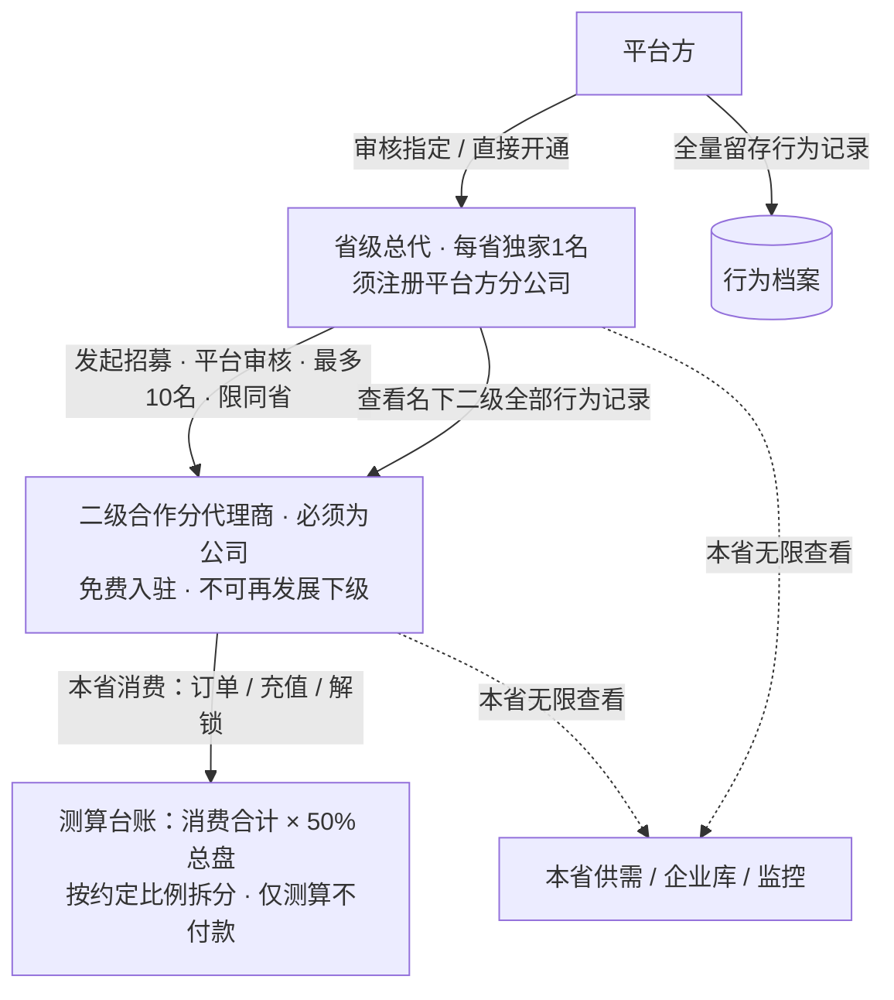
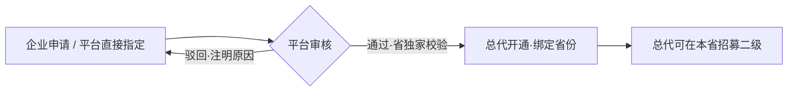
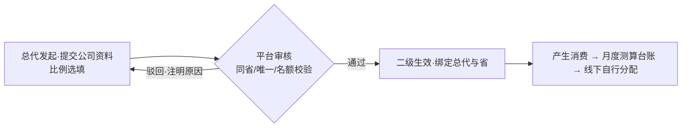

# 省级总代体系・商业模式说明（管理评审版）

> 用途：供管理岗位确认「省级总代 → 二级合作分代理商」的业务模式、规则与逻辑关系。
> 本文只讲业务规则与权责，不含开发实现、页面、数据结构与排期内容。
> 状态：待管理确认；文末确认清单逐条勾选后生效。

***

## 1. 一句话说明

平台以**省**为单位独家发展「省级总代」，总代在本省范围内最多招募 10 家「二级合作分代理商」；平台按二级在平台上全部消费的 **50%** 为总代做**收益测算台账**，但**平台不付款、不结算、不可提现**，总代与二级之间的分配由双方**线下自行约定和执行**；总代与二级在**本省范围内**享有免解锁查看、监控无限、直接联系的权益，全部行为留痕。

***

## 2. 业务背景与本体系的位置

### 2.1 为什么调整

原「企业合伙人」采用线上邀请返佣、结算进钱包、可提现的资金模式，与本次「平台不碰资金、总代线下分配」的定位冲突，因此将其替换为两层代理体系。

### 2.2 与其他既有业务的关系（并行存在，互不替代）

| 既有业务                       | 是否受影响     | 说明                      |
| -------------------------- | --------- | ----------------------- |
| 个人合伙人（个人申请，8%/2% 推广返佣，可提现） | 不受影响，原样保留 | 面向个人推广者，与本代理体系是两条线      |
| 建筑企业 / 中介企业的邀请返佣与提现        | 不受影响，原样保留 | 普通入驻企业的推广收益通道不变         |
| 资质招商加盟（分公司挂靠）              | 不受影响      | 属品牌资质合作，与本代理体系分开        |
| 平台资金原则                     | 不变        | 平台只做信息撮合，不代付、不抽佣、不做资金托管 |

> 即：本次只替换「企业合伙人」这一个身份，其余业务线照常运行。

***

## 3. 角色与关系总览

**三个角色的定位：**

* **平台方**：制定规则、审核与指定总代、审核二级招募、留存全部行为档案；**不经手代理分账资金**。

* **省级总代**：本省独家合作伙伴，负责招募和管理名下二级，录入线下约定的分配比例，查看测算台账与二级行为；自身仍是普通企业，可正常经营。

* **二级合作分代理商**：总代招募的本地公司，承担本地推广 / 获客，享有本省查看权益；**不能再发展自己的下级**。

***

## 4. 角色准入与权益对照

| 项目        | 省级总代                                | 二级合作分代理商                      |
| --------- | ----------------------------------- | ----------------------------- |
| 主体要求      | 企业，且**必须注册平台方分公司**并提交资料核验           | 合法工商公司即可（营业执照等），**无需**注册平台分公司 |
| 如何获得身份    | 双轨：企业申请经平台审核指定；或平台直接指定开通            | 由总代发起，平台审核通过后生效               |
| 区域        | 绑定唯一省份，**每省仅 1 名（独家）**              | 必须与发起总代**同省**（省内可跨市）          |
| 费用        | 线上不展示收费、无付费入口；相关费用线下另行执行            | 免费入驻，由总代发起                    |
| 下级名额      | 最多 **10 名**二级（待审核 / 已通过 / 已驳回都计入名额） | 不可发展下级                        |
| 普通经营能力    | 保留：可发布供需、接单、成交、自身钱包消费               | 具备：可发布供需、接单、成交、自身钱包消费         |
| 本省无限查看    | 免解锁直连 / 企业库全量 / 监控无限                | 同左                            |
| 跨省查看      | 按平台普通规则                             | 按平台普通规则                       |
| 测算台账      | 查看名下全部二级的月汇总、逐笔、拆分、退款冲减             | 查看本人约定所得测算                    |
| 分配比例      | 可为名下二级录入 / 修改线下约定比例（留痕）             | 不可修改比例                        |
| 行为记录      | 查看名下二级全部行为日志                        | 不可查看他人                        |
| 平台钱包 / 提现 | 关闭（平台不付款）                           | 关闭（平台不付款）                     |

***

## 5. 准入与招募规则

### 5.1 省级总代开通

1. **双轨产生**：企业可提交省级总代申请（分公司执照、意向省份、公司资料）由平台审核指定；平台也可直接为符合条件的企业开通。

2. **省独家**：一个省只授权 1 名总代；该省已有总代时，重复申请 / 指定一律不通过，并提示「该省已独家授权」。

3. **分公司要求**：总代本人须完成平台方分公司注册并提交核验资料。

### 5.2 二级招募（总代发起，平台认可）

1. **主体**：必须是合法注册公司，免费入驻，不收入驻费。

2. **同省**：二级公司须位于总代授权省内，跨省不能发起。

3. **唯一绑定**：一家公司只能绑定一名总代，不能被多名总代重复招募。

4. **名额**：每名总代最多 10 名二级，待审核、已通过、已驳回**都占用名额**，满 10 不能再发起。

5. **平台认可**：总代提交公司资料后，由平台审核通过才生效；驳回须注明原因，可补充重提。

6. **两层封顶**：二级不能再发展自己的下级，体系严格只有「总代 → 二级」两层。

***

## 6. 分账测算规则（平台只测算，不付款）

### 6.1 测算口径

1. **总盘**：某二级在统计周期内全部平台消费行为金额（订单成交、钱包充值、积分解锁等）合计 × **50%**，即为该二级对应的总代可分配总盘。
2. **拆分**：二级约定所得 = 该二级总盘 × 总代录入的线下约定比例；总代自留 = 该二级总盘 − 二级约定所得。
3. **比例约束**：约定分给二级的比例限定在 **0–50%**，且二级约定所得不得超过其总盘（防止拆分倒挂），超界或倒挂不予保存。
4. **台账**：逐笔记录消费行为，按月汇总成月账单；发生退款 / 售后时，从后续测算中等额冲减并留痕。
5. **资金边界**：以上全部数字仅为测算留痕，**不进入平台钱包余额、不可提现、平台不代付不垫付**；总代与二级实际怎么分、何时付，由双方线下自行约定与执行。

### 6.2 测算示例（仅说明口径，非真实数据）

> 某二级当月在平台消费合计 10,000 元：总盘 = 10,000 × 50% = 5,000 元；总代与该二级线下约定分给二级 20% → 二级约定所得 = 5,000 × 20% = 1,000 元，总代自留 = 4,000 元。以上仅为平台台账测算，**实际 1,000 元由总代线下付给二级，平台不经手**。

***

## 7. 本省无限查看权益

仅限总代授权省及名下二级所在省范围：

| 权益          | 总代 / 二级（本省） | 跨省        |
| ----------- | ----------- | --------- |
| 供需联系方式      | 免积分解锁、可直接联系 | 按平台普通解锁规则 |
| 本省企业库 / 项目库 | 全量可见        | 按平台普通可见规则 |
| 监控企业数量      | 不限家数        | 按平台普通额度   |

> 边界：无限查看只在**本省**生效，不扩展为全国；超出授权省仍受平台普通规则约束。

***

## 8. 行为记录与监管

* **记录范围**：二级的浏览、查看、联系、解锁、成交、充值等行为均留痕。

* **可见范围**：总代可查看自己名下二级的全部行为日志；平台后台全量留存用于核查。

* **作用**：作为平台监管、违规认定与合作评估的依据，不用于平台自动分账。

***

## 9. 业务流程

### 9.1 总代开通流程

### 9.2 二级招募流程

***

## 10. 本体系明确不做（边界）

* 不做平台代付、垫付、分账对账、税务发票处理（纯线下，平台不留资金流）。

* 不允许二级再发展下级。

* 不改动个人合伙人体系，不改动建筑 / 中介现有返佣与提现。

* 不改动资质招商加盟业务线。

* 不把测算金额接入平台钱包或提现。

***

## 11. 管理确认清单

| #  | 确认项                               | 结论        |
| -- | --------------------------------- | --------- |
| 1  | 每省独家 1 名总代，总代须注册平台方分公司            | ☐ 同意 ☐ 调整 |
| 2  | 总代双轨产生：企业申请审核 / 平台直接指定            | ☐ 同意 ☐ 调整 |
| 3  | 二级必须为公司、免费、由总代发起、平台审核生效           | ☐ 同意 ☐ 调整 |
| 4  | 二级限同省、唯一绑定、总数 ≤10（含全部状态）          | ☐ 同意 ☐ 调整 |
| 5  | 二级不可再发展下级，体系严格两层                  | ☐ 同意 ☐ 调整 |
| 6  | 按二级全部消费 ×50% 做总盘测算，比例限 0–50% 且不倒挂 | ☐ 同意 ☐ 调整 |
| 7  | 平台只测算留痕，不付款、不进钱包、不可提现，分配线下执行      | ☐ 同意 ☐ 调整 |
| 8  | 退款 / 售后从后续测算中等额冲减，按月汇总            | ☐ 同意 ☐ 调整 |
| 9  | 总代与二级享本省免解锁直连、企业库全量、监控无限；跨省按普通规则  | ☐ 同意 ☐ 调整 |
| 10 | 总代可看名下二级全行为，平台全量留存                | ☐ 同意 ☐ 调整 |
| 11 | 个人合伙人、建筑 / 中介返佣、加盟业务线保持不变         | ☐ 同意 ☐ 调整 |

***

## 12. 待管理确认的暂定项

| 项          | 暂定建议（无异议即照此执行）                              |
| ---------- | ------------------------------------------- |
| 对外名称与标识    | 建议称「省级总代（省代）」「二级合作分代理商」，标识配色另行设计，不沿用个人合伙人样式 |
| 行为记录字段与保存期 | 建议记录时间 / 动作 / 对象 / 省份 / 关联公司，合作期内全量保留        |
| 二级合作协议     | 建议签署《二级合作协议》，本期可先占位                         |

***

> 本说明与《省级总代体系迭代执行文档》口径一致；如管理确认中某条调整，以调整后结论为准并同步更新执行文档。